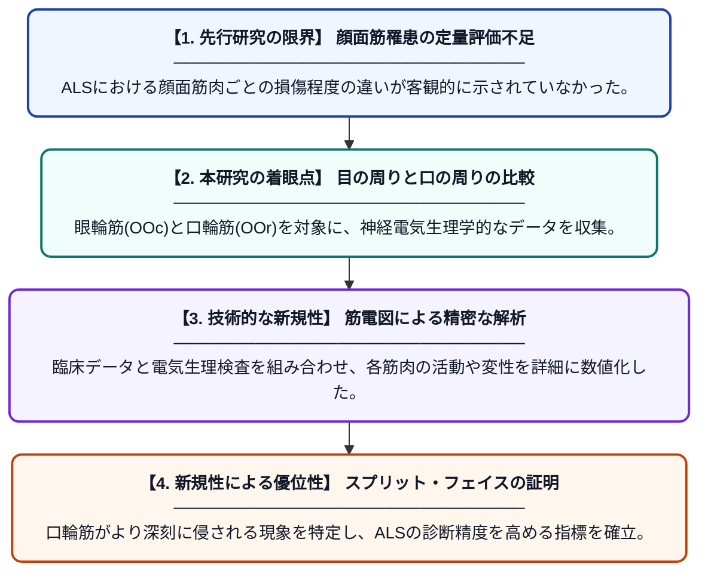

# 筋萎縮性側索硬化症（ALS）患者におけるスプリット・フェイス現象の臨床的および神経電気生理学的特徴

**Original Title**: *Clinical and Neuroelectrophysiological Characteristics of Split Face Phenomenon in Patients with Amyotrophic Lateral Sclerosis*

> **💡 一言要約**: ALS患者の顔に現れる特異な筋肉の痩せ方を解明

| 項目 | 内容 |
|---|---|
| **著者** | D ZHANG, W WANG, J XU, X LYU, Y ZHAO, C YAN |
| **掲載誌** | JOURNAL OF RARE … 2026 |
| **アラートキーワード** | ALS |
| **原文リンク** | [https://pesquisa.bvsalud.org/portal/resource/pt/wpr-1242753](https://pesquisa.bvsalud.org/portal/resource/pt/wpr-1242753) |
| **PDF版要約** | [README.pdf](./README.pdf) |

---

## 📊 新規性の図解（先行研究との違いと本研究のブレークスルー）

## 📝 要約

この研究は、ALS患者における眼輪筋（OOc）と口輪筋（OOr）の罹患パターンを臨床データと電気生理学的手法を用いて調査したものです。その結果、口の周りの筋肉（口輪筋）が目の周りの筋肉（眼輪筋）よりも重度に侵される「スプリット・フェイス現象」が存在することを明らかにしました。

## ❓ どんな問題に取り組んだか

ALSは全身の筋肉が衰える病気ですが、顔面の筋肉がどのような順序や規則性で侵されていくのかについては、これまで十分に解明されていませんでした。特に、目の周りと口の周りでダメージの受けやすさに違いがあるのか、客観的なデータに基づいた評価が求められていました。

## ✨ 何が新しい？何がすごい？（新規性）

本研究は、手で見られる「スプリット・ハンド現象」と同様の偏りが顔面でも起きていることを神経電気生理学的に証明しました。具体的には、口輪筋が眼輪筋に比べて顕著に萎縮や神経変性を示すことを突き止め、ALSにおける脳神経核の脆弱性の違いを提示しました。これはALSの診断精度を向上させ、顔面神経の障害パターンを理解する上での重要な貢献です。

## 🎓 大学1年生向けの解説

ALSという難病では全身の筋肉が痩せていきますが、実は顔の中でも「痩せやすい場所」と「痩せにくい場所」があることがわかりました。この研究では、機械を使って筋肉の電気信号を調べた結果、目の周りよりも口の周りの筋肉の方が早く、激しくダメージを受けることを突き止めました。この現象を「スプリット・フェイス（顔の分裂）」と呼び、医師がALSを正しく診断するための新しい手がかりとして注目されています。
