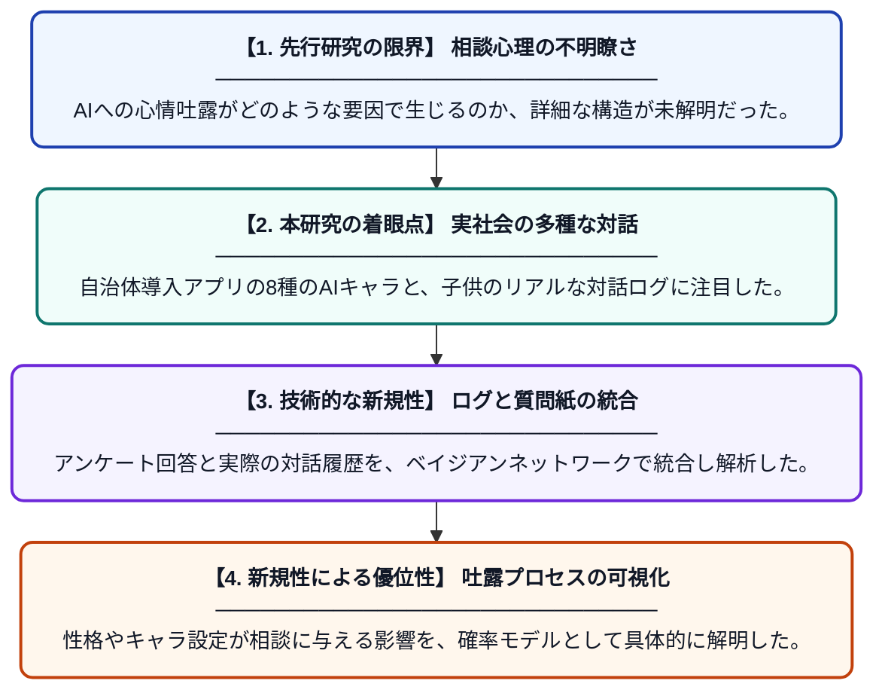

# ヒトはAIにどのように悩みや心情を打ち明けるのか：三田市「MIRAIノート」のベイジアンネットワークによる分析

**Original Title**: *ヒトは AI にどのように悩みを相談し, 心情を吐露するのか 三田市 MIRAI ノートのベイジアンネットワーク分析*

> **💡 一言要約**: 子供がAIに本音を話す仕組みをデータから可視化

| 項目 | 内容 |
|---|---|
| **著者** | 安松健， 堀川浩規， 仲矢史雄 |
| **掲載誌** | 人工知能学会第二種研究会資料 2026 |
| **アラートキーワード** | ベイジアンネットワーク |
| **PDF** | [https://www.jstage.jst.go.jp/article/jsaisigtwo/2026/EAA-001/2026_06/_pdf](https://www.jstage.jst.go.jp/article/jsaisigtwo/2026/EAA-001/2026_06/_pdf) |
| **原文リンク** | [https://www.jstage.jst.go.jp/article/jsaisigtwo/2026/EAA-001/2026_06/_pdf](https://www.jstage.jst.go.jp/article/jsaisigtwo/2026/EAA-001/2026_06/_pdf) |
| **PDF版要約** | [README.pdf](./README.pdf) |

---

## 📊 新規性の図解（先行研究との違いと本研究のブレークスルー）

## 📝 要約

兵庫県三田市の小中学生向けアプリ「MIRAIノート」にて、8種類のAIキャラクターと対話する子供たちのデータを分析した研究です。アンケートと対話ログをベイジアンネットワークで解析し、悩みの内容や吐露の仕方の構造を明らかにしています。

## ❓ どんな問題に取り組んだか

子供たちが抱える悩みや本音は、身近な大人には話しにくい場合があります。AIがその受け皿として期待されていますが、実際にどのようなプロセスでAIに心情を吐露するのか、その具体的な構造は十分に解明されていませんでした。

## ✨ 何が新しい？何がすごい？（新規性）

実際の自治体（三田市）で導入されているアプリの運用データを用いている点が非常に画期的です。8種類もの多様なAIキャラクターと対話するリアルなログとアンケートを組み合わせ、ベイジアンネットワークを用いて分析しました。性格や状況が相談行動にどう繋がるかの因果関係を、実際のフィールドデータから可視化した点が大きな貢献です。

## 🎓 大学1年生向けの解説

「人には言えない悩みでも、AIになら話せる」という経験はありませんか？この研究は、小中学生がAIアプリを使って、どんな悩みをどうやって話しているのかを数学的な方法で調べたものです。AIのキャラ設定によって子供たちの話しやすさがどう変わるかなどがデータで示されています。将来、AIが私たちのメンタルケアを支えるための重要なヒントが詰まっています。
