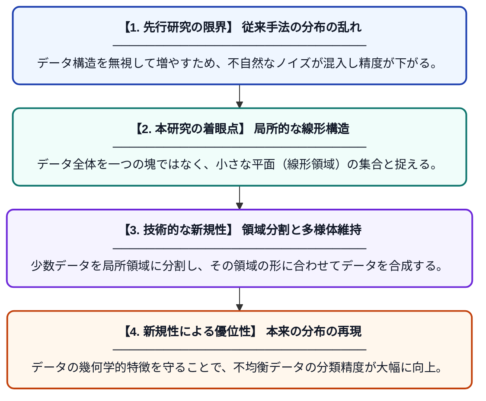

# 局所線形領域SMOTE：不均衡データ分類のための多様体構造を維持する改良型オーバーサンプリング手法

**Original Title**: *Local Linear Region SMOTE: An Improved Oversampling Algorithm Maintaining Manifold Structures for Imbalanced Data Classification*

> **💡 一言要約**: 多様体構造を守り、高精度にデータを補完する新技術

| 項目 | 内容 |
|---|---|
| **著者** | J Zhang |
| **アラートキーワード** | manifold learning |
| **PDF** | [https://www.academia.edu/download/133317104/Local_Linear_Region.pdf](https://www.academia.edu/download/133317104/Local_Linear_Region.pdf) |
| **原文リンク** | [https://www.academia.edu/download/133317104/Local_Linear_Region.pdf](https://www.academia.edu/download/133317104/Local_Linear_Region.pdf) |
| **PDF版要約** | [README.pdf](./README.pdf) |

---

## 📊 新規性の図解（先行研究との違いと本研究のブレークスルー）

## 📝 要約

不均衡データの問題に対し、少数派クラスの幾何学的構造（多様体）を維持しながらデータを補完する「LLRSMOTE」を提案しています。データを複数の局所的な線形領域に分割し、その領域内で新しいサンプルを生成することで、より自然なデータ分布を実現しました。

## ❓ どんな問題に取り組んだか

従来のSMOTEなどの手法では、データの背後にある幾何学的な分布（多様体構造）を無視して合成データを生成していました。その結果、本来のデータの形を壊したり、クラス間の境界を曖昧にするノイズが発生し、分類精度が低下するという課題がありました。

## ✨ 何が新しい？何がすごい？（新規性）

多様体学習と局所線形表現の概念を融合させ、少数派データを事前に複数の「局所線形領域」に分割する手法を導入しました。これにより、単純な直線的補完ではなく、データの局所的な分布形状に沿って適切にサンプルを増やすことが可能になっています。このアプローチは、データの本来の特性を損なわず、複雑な分布を持つ不均衡データにおいても高い分類能力を発揮するという貢献をしました。

## 🎓 大学1年生向けの解説

AIに何かを教えるとき、データの数に極端な偏りがあると上手く学習できません。足りないデータを自動で増やす技術がありますが、これまでは「適当な場所」にデータを増やしてしまい、かえってAIを混乱させることがありました。この研究では、データの「並び方のクセ」を分析し、その並びに沿った「自然な場所」にデータを増やす方法を開発しました。これにより、AIがデータの形を正しく理解し、より賢く判断できるようになります。
