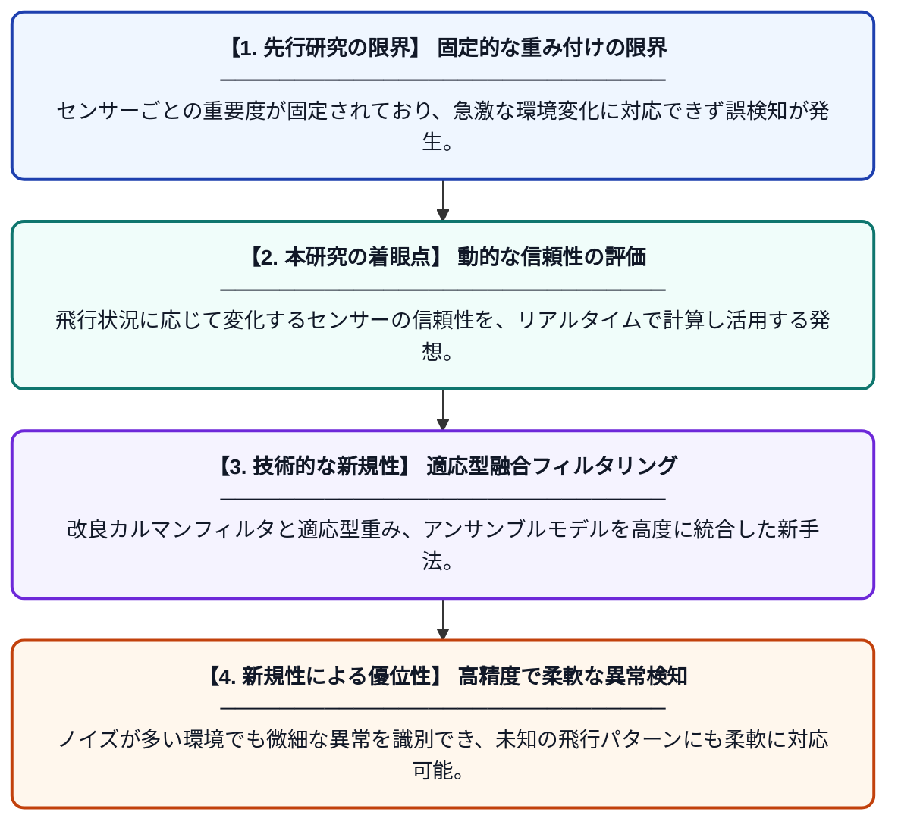

# 適応型重み融合に基づく飛行試験異常検知フレームワーク

**Original Title**: *A Flight Test Anomaly Detection Framework Based on Adaptive Weight Fusion*

> **💡 一言要約**: 適応型重み付けで飛行試験の異常を逃さず検知

| 項目 | 内容 |
|---|---|
| **著者** | Y Wang |
| **掲載誌** | International Conference on Artificial Intelligence … 2026 |
| **アラートキーワード** | kalman filter  "anomaly ... |
| **原文リンク** | [https://saemobilus.sae.org/papers/a-flight-test-anomaly-detection-framework-based-adaptive-weight-fusion-2026-99-0606](https://saemobilus.sae.org/papers/a-flight-test-anomaly-detection-framework-based-adaptive-weight-fusion-2026-99-0606) |
| **PDF版要約** | [README.pdf](./README.pdf) |

---

## 📊 新規性の図解（先行研究との違いと本研究のブレークスルー）

## 📝 要約

飛行試験における複雑なセンサーデータの異常を検知するため、動的なセンサー重み付け、改良型カルマンフィルタ、およびアンサンブル学習を統合した新しいフレームワークを提案しました。実験の結果、環境変化が激しい飛行条件下でも、従来手法を上回る検知精度とロバスト性を実現しています。

## ❓ どんな問題に取り組んだか

飛行試験では膨大なセンサーからデータが得られますが、ノイズや動的な環境変化により正確な異常検知が困難でした。既存の手法ではセンサーごとの重要度を固定していたため、特定の飛行状況下で検知精度が低下したり誤検知が発生したりする課題がありました。

## ✨ 何が新しい？何がすごい？（新規性）

本研究の核心は、センサーの信頼度に応じてリアルタイムで重みを調整する「適応型重み融合」を導入した点にあります。さらに、改良型カルマンフィルタによる状態推定と、複数のモデルを組み合わせたアンサンブル異常検知を統合することで、単一のアルゴリズムでは捉えきれない複雑な異常パターンを識別可能にしました。これにより、先行研究と比較して多様な飛行シナリオへの適応力が格段に向上しています。

## 🎓 大学1年生向けの解説

飛行機が正しく動いているかを確認するテストでは、たくさんのセンサーを使ってデータを集めます。しかし、風などの影響でデータが乱れると、本当に故障しているのか単なるノイズなのか判断が難しくなります。この研究では、その時々の状況に合わせて「どのセンサーの情報を信じるべきか」をAIが自動で判断する仕組みを作りました。これにより、複雑な動きをしている最中でも、機体のわずかな異常を正確に見つけることができるようになります。
