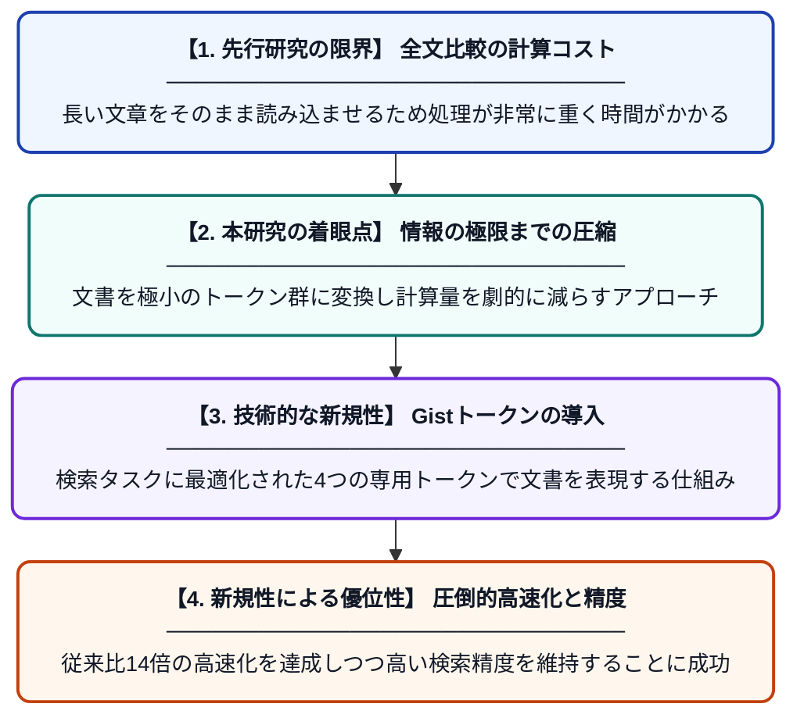

# GistRank: 大規模言語モデルを用いた要約圧縮によるリスト形式ランキング

**Original Title**: *GistRank: Gist-Compressed Listwise Ranking with Large Language Models*

> **💡 一言要約**: 4つのトークンで爆速・高精度な検索順位付け

| 項目 | 内容 |
|---|---|
| **著者** | G Chen, W Liu, R Li, Q Ma, Y Lu, H Shi, B Xu, J Huang |
| **掲載誌** | arXiv preprint arXiv … 2026 |
| **アラートキーワード** | one shot |
| **PDF** | [https://arxiv.org/pdf/2610.39610](https://arxiv.org/pdf/2610.39610) |
| **原文リンク** | [https://arxiv.org/pdf/2610.39610](https://arxiv.org/pdf/2610.39610) |
| **PDF版要約** | [README.pdf](./README.pdf) |

---

## 📊 新規性の図解（先行研究との違いと本研究のブレークスルー）

## 📝 要約

各文書をわずか4つの「要約（Gist）トークン」に圧縮することで、大規模言語モデル（LLM）による順位付けを劇的に高速化する手法を提案しています。精度を維持しつつ、従来手法と比較して約14倍の処理速度向上を実現しました。

## ❓ どんな問題に取り組んだか

LLMを用いた文書の順位付けは、入力テキストが長くなるほど計算コストが指数関数的に増大し、リアルタイムの検索には不向きでした。特に複数の文書を一度に比較する手法では、処理時間の長さと入力文字数の制限が大きな課題となっていました。

## ✨ 何が新しい？何がすごい？（新規性）

各文書を検索に特化した4つの「Gistトークン」へ極限まで圧縮し、それらを並べて一度に評価する手法を開発しました。従来の全文を読み込ませる手法に対し、精度低下を最小限に抑えつつ14倍もの高速化を達成しています。単なる要約ではなく、LLMがランキング判断を行いやすい形式に情報を凝縮している点が独自の貢献です。

## 🎓 大学1年生向けの解説

検索エンジンがたくさんのWebページを並び替えるとき、これまではページの内容をすべて読んでいたので時間がかかっていました。この研究では、各ページの内容を「4つの特別な記号」にギュッと凝縮し、その記号だけを見て比較する方法を開発しました。これにより、一瞬でたくさんのページをチェックできるようになり、ネット検索がもっと速くて正確になります。
