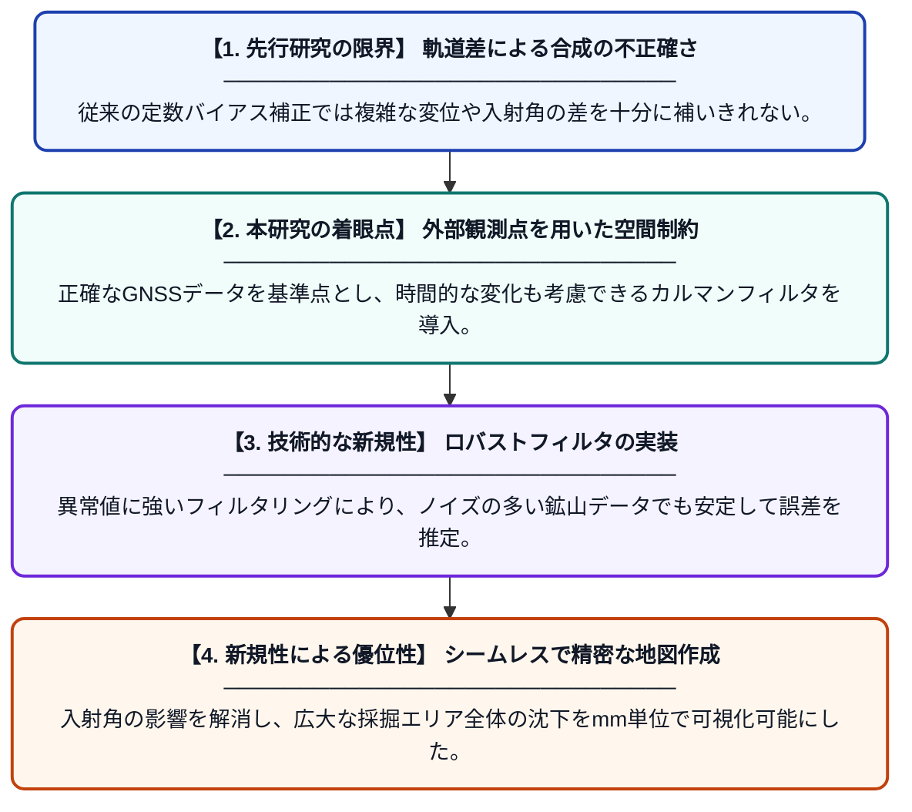

# 外部GNSS制約と頑健なカルマンフィルタを統合した、鉱山地域向けマルチトラックInSAR変位場モザイクアルゴリズム

**Original Title**: *A Multi-track InSAR deformation field mosaicking algorithm incorporating external GNSS constraints and a robust Kalman filter for mining areas*

> **💡 一言要約**: GNSSとフィルタで鉱山の地盤沈下を精密に繋ぐ

| 項目 | 内容 |
|---|---|
| **著者** | S Zhang, J Li, N Liu, Z Ren, J Si, F Wen, S Li, S Gao |
| **掲載誌** | IEEE Transactions on … 2026 |
| **アラートキーワード** | kalman filter |
| **原文リンク** | [https://ieeexplore.ieee.org/abstract/document/11779521/](https://ieeexplore.ieee.org/abstract/document/11779521/) |
| **PDF版要約** | [README.pdf](./README.pdf) |

---

## 📊 新規性の図解（先行研究との違いと本研究のブレークスルー）

## 📝 要約

鉱山地域の広域な地盤沈下を捉えるため、GNSSデータによる制約と頑健なカルマンフィルタを組み合わせた新しいInSARデータ合成（モザイク）手法を提案しています。異なる観測軌道の入射角の差やバイアス誤差を精密に補正し、一貫性のある高精度な変位場を復元することに成功しました。

## ❓ どんな問題に取り組んだか

複数の衛星軌道から得られるInSARデータを統合する際、軌道ごとの入射角の違いや定数バイアスの影響により、データの継ぎ目に誤差が生じる課題がありました。特に地盤変動が激しい鉱山地域では、従来の手法では正確な広域マップの作成が困難でした。

## ✨ 何が新しい？何がすごい？（新規性）

本研究は、外部のGNSS観測値を拘束条件として組み込み、頑健なカルマンフィルタを用いてフレーム間の誤差を逐次推定する仕組みを開発しました。従来の最小二乗法による調整と比較して、入射角の幾何学的な差異を詳細に分析し、定数バイアス補正の限界を理論的に議論した点が画期的です。これにより、ノイズに強く、物理的整合性の高い広域変位場の生成が可能となりました。

## 🎓 大学1年生向けの解説

人工衛星を使って地面の数ミリの動きを測る技術がありますが、広い範囲を測るには複数のデータをパズルのように繋ぎ合わせる必要があります。しかし、衛星の角度や通り道が違うと、繋ぎ目に「ズレ」が生じてしまいます。この研究では、地面に設置した正確なGPSの値をガイド役にし、さらに「カルマンフィルタ」という予測と修正を繰り返す計算手法を使って、そのズレを綺麗に補正しました。これにより、広い鉱山の地盤沈下を一枚の正確な地図として見ることができるようになりました。
