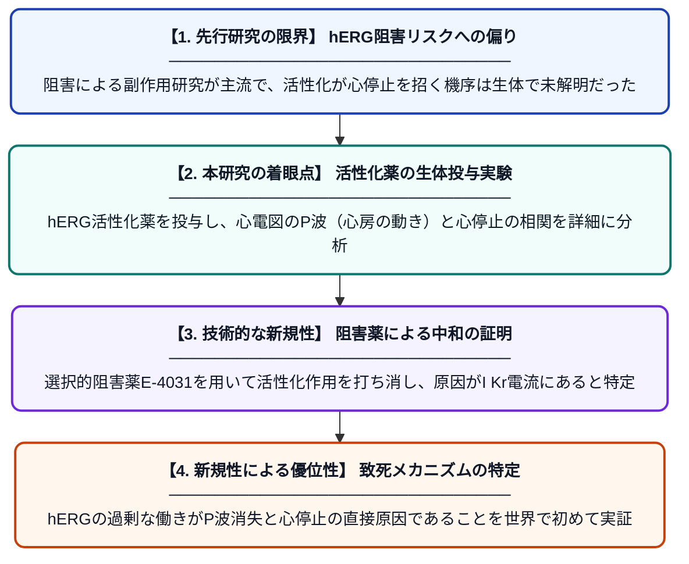

# hERG活性化薬ICA-105574はイソフルラン麻酔下のモルモットにおいてP波消失と心停止を誘発する

**Original Title**: *hERG-activating compound ICA-105574 induces P-wave disappearance and cardiac arrest in isoflurane-anesthetized guinea pigs*

> **💡 一言要約**: hERG活性化が招く未知の心停止リスクを解明

| 項目 | 内容 |
|---|---|
| **著者** | M Ishida, K Furutani, K Asakura, S Kita |
| **掲載誌** | The Journal of Toxicological Sciences 2026 |
| **アラートキーワード** | ICA |
| **原文リンク** | [https://www.jstage.jst.go.jp/article/jts/51/11/51_583/_article/-char/ja/](https://www.jstage.jst.go.jp/article/jts/51/11/51_583/_article/-char/ja/) |
| **PDF版要約** | [README.pdf](./README.pdf) |

---

## 📊 新規性の図解（先行研究との違いと本研究のブレークスルー）

## 📝 要約

hERGチャネルを活性化する化合物ICA-105574が、麻酔下のモルモットでP波の消失と致死的な心停止を引き起こすことを明らかにしました。hERG阻害薬であるE-4031の投与によってこの心停止が阻止されたことから、過剰なhERG電流（I Kr）が心停止の直接的な原因であることが示唆されました。

## ❓ どんな問題に取り組んだか

創薬研究においてhERGチャネルの「阻害」による副作用（QT延長等）は厳格に管理されていますが、逆にチャネルの「活性化」が心機能に及ぼすリスクは十分に理解されていません。特に、活性化薬が実際の生体（インビボ）でどのような致死的不整脈を誘発し得るのか、その詳細な経過を特定する必要がありました。

## ✨ 何が新しい？何がすごい？（新規性）

本研究は、hERG活性化薬ICA-105574が生体内でP波の消失（心房活動の停止）を伴う心停止を引き起こすことを初めて明確に示しました。先行研究では細胞レベルの評価が中心でしたが、麻酔下の個体を用いた実験により、hERG阻害薬でその致死的作用を中和できることを証明しました。これにより、hERG電流の過剰な増強が新たな不整脈リスク因子であることを決定づけました。

## 🎓 大学1年生向けの解説

心臓が規則正しく動くには、電気信号のバランスがとても重要です。これまでは「電気の流れ（hERGチャネル）を止めること」が危険だとされてきましたが、この研究は逆に「電気を流しすぎてしまうこと」も心臓を止める原因になることを発見しました。実験では、薬で電気の流れを強めすぎると心臓が止まってしまいますが、別の薬でその流れを抑えると助かることがわかりました。薬の安全性を守るための新しい基準につながる発見です。
