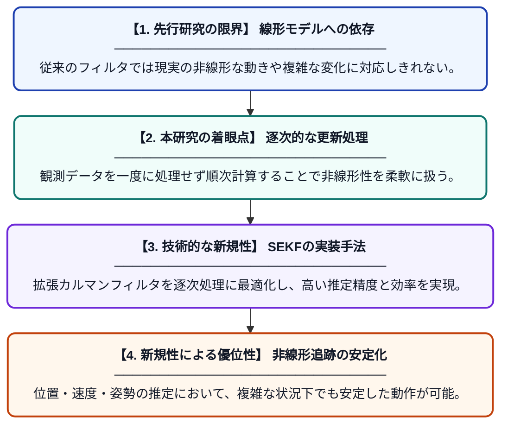

# 非線形システムにおける位置・速度推定のための逐次拡張カルマンフィルタの実装

**Original Title**: *ANNIE WESTERLUND HELENA JAKOBSSON LARSSON*

> **💡 一言要約**: 非線形な動きを正確に追う逐次カルマンフィルタの実装

| 項目 | 内容 |
|---|---|
| **著者** | A WESTERLUND |
| **アラートキーワード** | kalman filter |
| **原文リンク** | [https://odr.chalmers.se/server/api/core/bitstreams/987683eb-c059-4bd8-babe-d7060d7b8efe/content](https://odr.chalmers.se/server/api/core/bitstreams/987683eb-c059-4bd8-babe-d7060d7b8efe/content) |
| **PDF版要約** | [README.pdf](./README.pdf) |

---

## 📊 新規性の図解（先行研究との違いと本研究のブレークスルー）

## 📝 要約

この論文は、位置、速度、および姿勢を推定するために、非線形システムに適用可能な「逐次拡張カルマンフィルタ」を実装・解説した研究です。従来のカルマンフィルタを非線形な動的モデルに対応させるための理論を整理し、効率的な状態推定の手法を提示しています。

## ❓ どんな問題に取り組んだか

現実世界の物体の動きやセンサーの観測は、単純な直線（線形）ではなく複雑な曲線（非線形）を描くことが一般的です。従来のカルマンフィルタではこうした非線形性をうまく扱えず、位置や速度の推定精度が低下するという課題がありました。

## ✨ 何が新しい？何がすごい？（新規性）

本研究の新規性は、拡張カルマンフィルタ（EKF）を「逐次（Sequential）」処理の枠組みで再構築し、具体的な実装手順を明確にした点にあります。複数のセンサー観測値を一括で処理するのではなく、順次処理することで非線形システムの計算負荷を管理し、推定精度を安定させています。これにより、複雑な座標変換が必要なナビゲーションシステムにおいても、より柔軟な状態推定が可能になりました。

## 🎓 大学1年生向けの解説

ロボットやドローンが自分の正確な場所を知るためには、センサーの誤差を考慮しながら計算する「カルマンフィルタ」という技術が使われます。しかし、現実の動きはガタガタしていたり急に曲がったりするため、単純な計算式では対応できません。この論文では、その複雑で「曲がった」動きを賢く計算するための、新しい順番でデータを処理する方法を提案しています。これによって、より正確に物体の位置や速さを当てることができるようになります。
