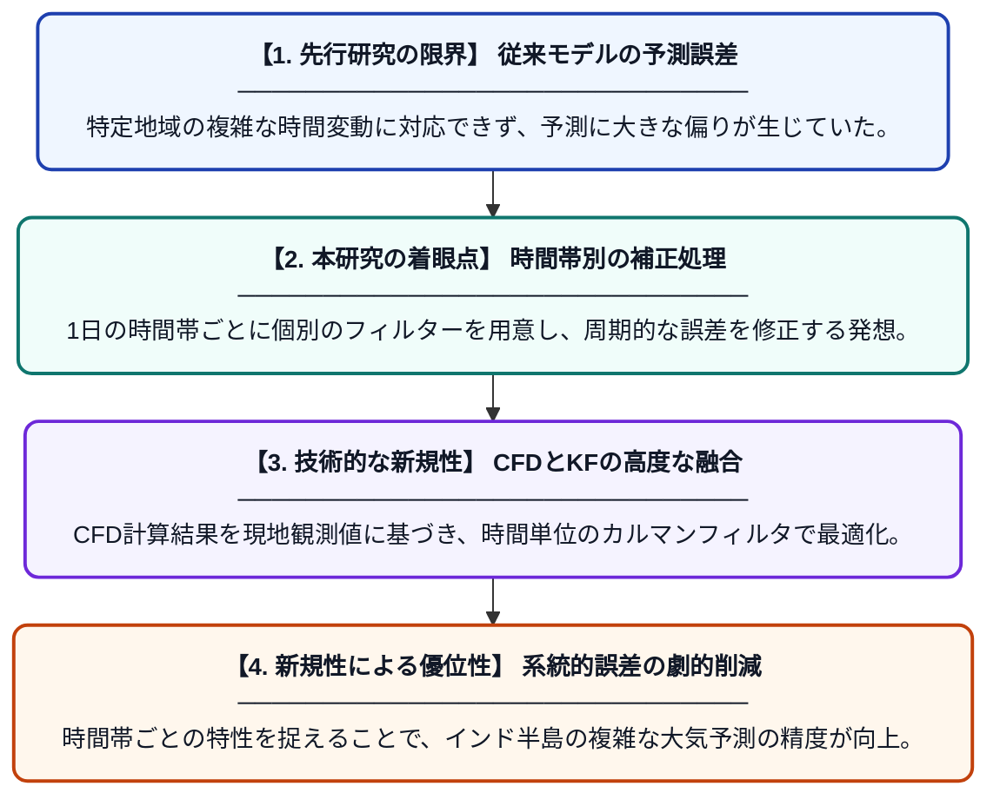

# CFDと現地観測を用いた大気境界層における光学乱流予測：インド半島を対象としたケーススタディ

**Original Title**: *Optical turbulence forecasting in the atmospheric boundary layer using CFD and on-site measurements: a case study for the Indian peninsula*

> **💡 一言要約**: CFDとAIを融合し大気の揺らぎを時間別に高精度予測

| 項目 | 内容 |
|---|---|
| **著者** | AP Kalaga, A Gogulapati, NR Golla, A Pratap |
| **掲載誌** | Environmental Effects on Light … 2026 |
| **アラートキーワード** | kalman filter |
| **原文リンク** | [https://www.spiedigitallibrary.org/conference-proceedings-of-spie/14281/142810E/Optical-turbulence-forecasting-in-the-atmospheric-boundary-layer-using-CFD/10.1117/12.3116818.short](https://www.spiedigitallibrary.org/conference-proceedings-of-spie/14281/142810E/Optical-turbulence-forecasting-in-the-atmospheric-boundary-layer-using-CFD/10.1117/12.3116818.short) |
| **PDF版要約** | [README.pdf](./README.pdf) |

---

## 📊 新規性の図解（先行研究との違いと本研究のブレークスルー）

## 📝 要約

数値流体力学（CFD）と現地での実測データを組み合わせ、大気中の光の揺らぎ（光学乱流）を高精度に予測する手法を提案した研究です。24時間周期の変動に対応するため、時間帯ごとに独立したカルマンフィルターを適用する枠組みを構築し、予測の偏りを効果的に補正しています。

## ❓ どんな問題に取り組んだか

光学乱流はレーザー通信や天体観測の精度を低下させる大きな要因ですが、その発生を正確に予測することは非常に困難です。従来のモデルでは、地形や気象条件の変化に伴う複雑な時間変動を十分に捉えることができず、予測結果に大きな誤差が生じるという課題がありました。

## ✨ 何が新しい？何がすごい？（新規性）

本研究の核心は、1日を1時間ごとの単位に分け、それぞれの時間帯に対して個別のカルマンフィルターを割り当てる「Diurnal Kalman Filter」という枠組みを導入した点にあります。CFDによるシミュレーション結果と実際の観測値をこのフィルターで統合することにより、昼夜で劇的に変化する大気の状態に合わせた系統的なバイアスの修正を可能にしました。インド半島特有の気象条件下でこの手法を実証し、従来手法を上回る予測精度を達成した点が大きな貢献です。

## 🎓 大学1年生向けの解説

星がまたたいて見えるのは、空気の中に「揺らぎ」があるからです。この揺らぎは、レーザーで情報を送るときなどに邪魔になるため、いつどこで発生するかを予測する必要があります。この論文では、コンピュータによる空気の流れの計算と、実際の現場での測定値を組み合わせ、さらに「時間帯ごとに予測のクセを直す」という新しいアイデアを使って、空の状態をより正確に当てることに成功しました。
