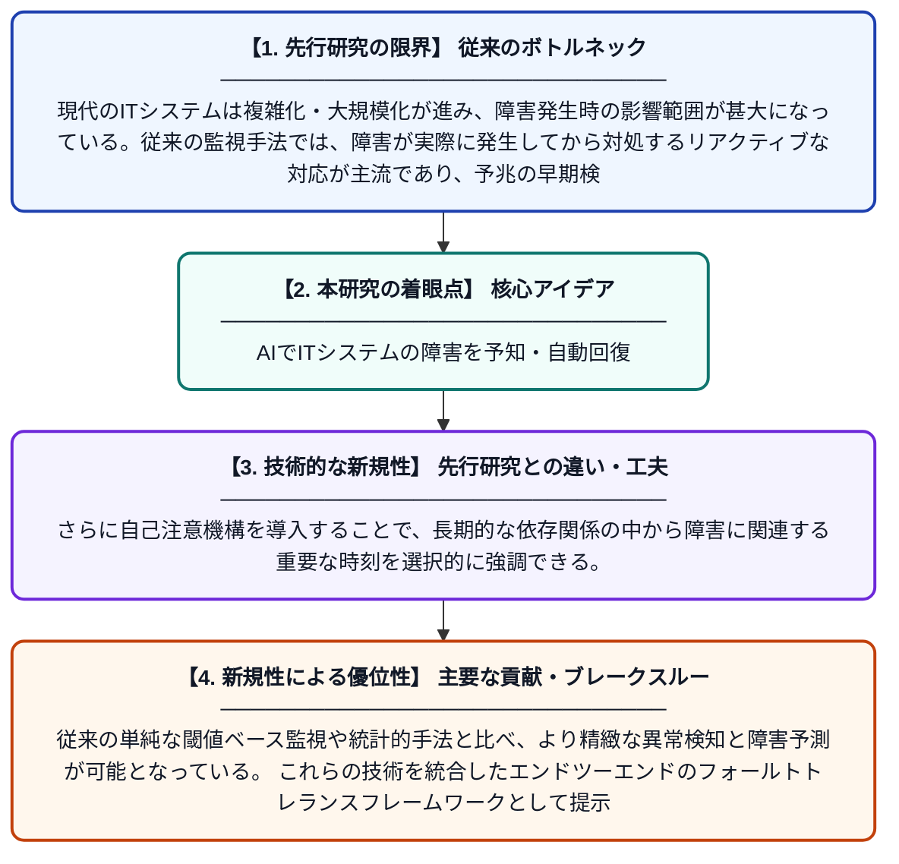

# 耐障害性と回復性を備えたITシステム：フォールトトレランスのためのエンジニアリングアプローチ

**Original Title**: *Resilient IT Systems: Engineering Approaches for Fault Tolerance and Recovery*

> **💡 一言要約**: AIでITシステムの障害を予知・自動回復

| 項目 | 内容 |
|---|---|
| **著者** | SR Jalluri, S Hota, K Sutaria, R Salini, J Singh |
| **掲載誌** | International Journal of AI and Machine Learning 2026 |
| **アラートキーワード** | independent component ... |
| **PDF** | [https://svedbergopen.com/index.php/ijaiml/article/download/611/472](https://svedbergopen.com/index.php/ijaiml/article/download/611/472) |
| **原文リンク** | [https://svedbergopen.com/index.php/ijaiml/article/download/611/472](https://svedbergopen.com/index.php/ijaiml/article/download/611/472) |
| **PDF版要約** | [README.pdf](./README.pdf) |

---

## 📊 新規性の図解（先行研究との違いと本研究のブレークスルー）

## 📝 要約

本論文では、独立成分分析（ICA）を用いた特徴抽出と、積層LSTMおよび自己注意機構を組み合わせたモデルにより、ITシステムの障害を高精度に検出・予測する手法を提案している。時系列的な依存関係を学習しながら、システムの動的な変化を捉えることで、障害発生前の予兆検知と迅速な回復を実現する。これにより、ITシステム全体の耐障害性と可用性の向上を目指している。

## ❓ どんな問題に取り組んだか

現代のITシステムは複雑化・大規模化が進み、障害発生時の影響範囲が甚大になっている。従来の監視手法では、障害が実際に発生してから対処するリアクティブな対応が主流であり、予兆の早期検知や自動回復には限界があった。特に、時系列データ中の微妙なパターンや複雑な依存関係を捉えることが困難であった。

## ✨ 何が新しい？何がすごい？（新規性）

ICAによる特徴抽出とスタックドLSTMの組み合わせにより、時間的依存関係と非線形なシステムダイナミクスを同時に捉える点が新しい。さらに自己注意機構を導入することで、長期的な依存関係の中から障害に関連する重要な時刻を選択的に強調できる。従来の単純な閾値ベース監視や統計的手法と比べ、より精緻な異常検知と障害予測が可能となっている。これらの技術を統合したエンドツーエンドのフォールトトレランスフレームワークとして提示している点が主要な貢献である。

## 🎓 大学1年生向けの解説

コンピュータシステムは突然壊れることがあり、それによって大きな損害が生じることがあります。この研究では、AIを使ってシステムが壊れる「前兆」を早めに見つける仕組みを作りました。人間の脳の神経回路を模した「LSTM」という技術で過去のデータのパターンを学習し、「自己注意機構」で特に重要な時間帯に注目できるようにしています。これにより、問題が大きくなる前に自動で対処し、システムを守ることができます。身近な例で言えば、体の異変を早期に察知して病気を未然に防ぐ「予防医学」のコンピュータ版と考えるとわかりやすいでしょう。
