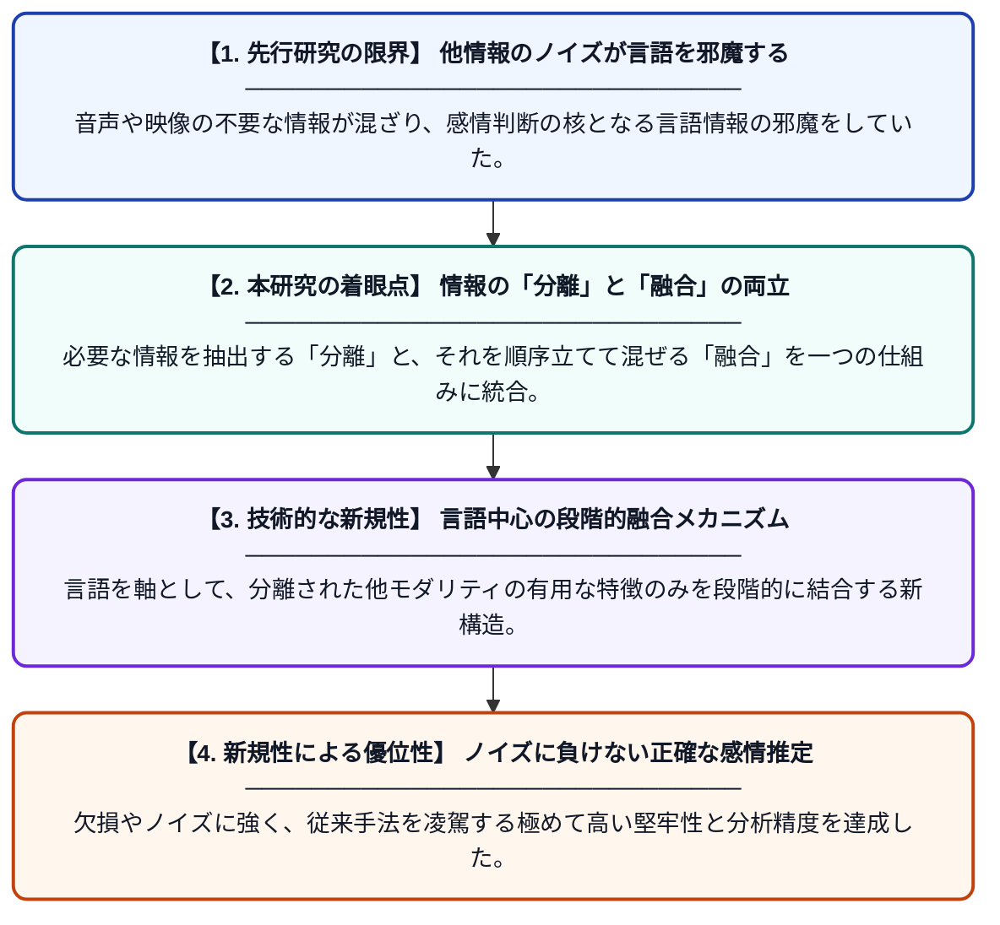

# 言語中心の堅牢なマルチモーダル感情分析に向けた情報の分離と段階的融合の橋渡し

**Original Title**: *Bridging Disentanglement and Progressive Fusion for Language-Centric Robust Multimodal Sentiment Analysis*

> **💡 一言要約**: 言語を主役に、情報分離と融合で感情を鋭く捉える

| 項目 | 内容 |
|---|---|
| **著者** | T Li, J Wang, Q Jia, S Liu |
| **掲載誌** | IEEE Transactions on Affective Computing 2026 |
| **アラートキーワード** | affective computing |
| **原文リンク** | [https://www.computer.org/csdl/journal/ta/5555/01/11780606/2lc4abX9yow](https://www.computer.org/csdl/journal/ta/5555/01/11780606/2lc4abX9yow) |
| **PDF版要約** | [README.pdf](./README.pdf) |

---

## 📊 新規性の図解（先行研究との違いと本研究のブレークスルー）

## 📝 要約

テキスト、音声、映像を組み合わせた感情分析において、言語を主軸に据えつつ各情報の特性を整理・統合する新しいフレームワークを提案しています。情報の「分離」と「段階的融合」を橋渡しすることで、ノイズやデータの欠損に強い、高精度な感情推定を実現しました。

## ❓ どんな問題に取り組んだか

従来のマルチモーダル感情分析では、音声や映像に含まれるノイズが原因で精度が低下したり、異なる情報同士が互いに干渉し合ったりする課題がありました。また、感情判断において最も重要な言語情報が、他の情報に埋もれて十分に活用されないという問題もありました。

## ✨ 何が新しい？何がすごい？（新規性）

本研究は、共通情報と各モダリティ固有の情報を切り分ける「情報分離」と、言語を核として他情報を順序立てて統合する「段階的融合」を統合した点が画期的です。先行研究が分離か融合のいずれかに特化していたのに対し、両者を最適に組み合わせることで、一部のデータが欠けても精度を維持できる高い堅牢性を実現しました。これにより、複雑な実環境下でも一貫して高い感情分析性能を発揮します。

## 🎓 大学1年生向けの解説

AIが人の感情を読み取る際、言葉の内容だけでなく、声のトーンや表情も参考にします。しかし、映像が暗かったり周囲がうるさかったりすると、AIは混乱してしまいます。この研究では、まず言葉を「主役」として扱い、次に声や顔の動きから本当に必要な情報だけを抜き出して、順序よく組み合わせていく魔法のような仕組みを作りました。この工夫により、たとえ一部の情報が不完全でも、AIは正しく感情を理解できるようになります。
