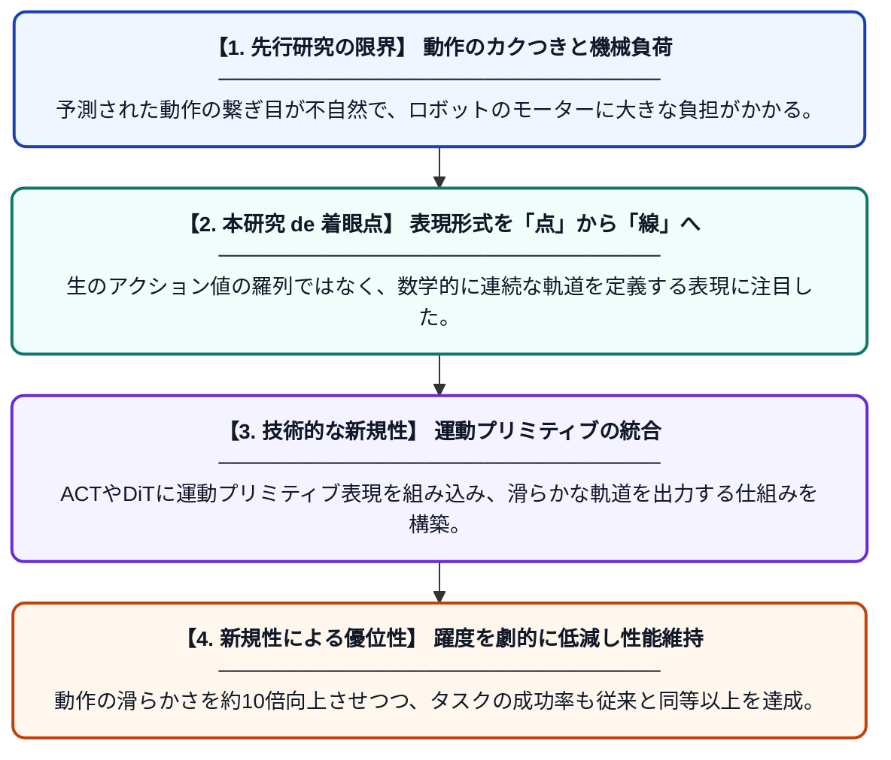

# 運動プリミティブ表現による模倣学習のための滑らかなアクションチャンキング

**Original Title**: *Smooth Action Chunking Via Movement-Primitive Representations for Imitation Learning*

> **💡 一言要約**: 動作の「カクつき」を抑えてロボットを滑らかに動かす新技術

| 項目 | 内容 |
|---|---|
| **著者** | S Nomura, T Osa, Y Kato, K Ota, N Shitanda, T Harada |
| **掲載誌** | arXiv preprint arXiv … 2026 |
| **アラートキーワード** | one shot |
| **PDF** | [https://arxiv.org/pdf/2610.39451](https://arxiv.org/pdf/2610.39451) |
| **原文リンク** | [https://arxiv.org/pdf/2610.39451](https://arxiv.org/pdf/2610.39451) |
| **PDF版要約** | [README.pdf](./README.pdf) |

---

## 📊 新規性の図解（先行研究との違いと本研究のブレークスルー）

## 📝 要約

模倣学習におけるアクションチャンキング手法に運動プリミティブ（MP）表現を導入し、ロボットの動作の滑らかさを劇的に向上させる手法を提案しています。ACTやDiTといった既存のモデルに適用可能で、シミュレーションおよび実機の双腕ロボットにおいて、動作の「カクつき」を示す躍度（ジャーク）を大幅に低減しました。

## ❓ どんな問題に取り組んだか

模倣学習のアクションチャンキングでは、将来の動作をまとめて予測することで高い性能を得られますが、生成される動作が不連続になりやすく、ロボットのモーターに負担をかける激しい振動（躍度）が生じるという課題がありました。

## ✨ 何が新しい？何がすごい？（新規性）

従来の数値の羅列を出力する手法とは異なり、数学的に滑らかな軌道を生成できる「運動プリミティブ（MP）」を学習の表現形式として採用した点が革新的です。ACTやDiTといった主要な生成モデルにこの表現を組み込む汎用的な枠組みを構築し、精度を維持したまま動作の躍度を従来の10分の1以下にまで低減することに成功しました。これにより、ハードウェアへのダメージを抑えつつ、より自然で人間らしい制御を可能にしています。

## 🎓 大学1年生向けの解説

ロボットに人間の動きを真似させる際、先の動きをまとめて予測すると効率的ですが、予測された動きがギクシャクしてしまう問題がありました。この研究では、バラバラな点を予測するのではなく、滑らかな曲線の描き方を学習させる「運動プリミティブ」という手法を導入しました。その結果、ロボットがカクカクせず、人間のようにスムーズで無駄のない動きができるようになりました。これはロボットが壊れにくくなることにも繋がります。
