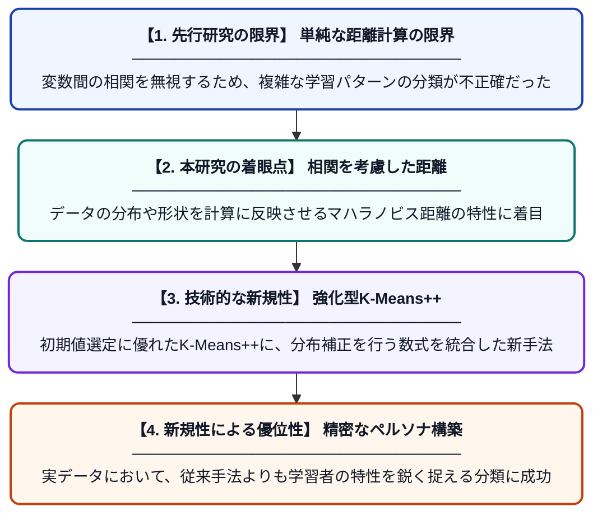

# 多次元学習者ペルソナのためのマハラノビス距離強化型K-Means++クラスタリング：Canvas MOOCデータセットによる検証

**Original Title**: *Mahalanobis-enhanced K-Means++ Clustering for Multidimensional Learner Personas: Evidence from the Canvas MOOC Dataset*

> **💡 一言要約**: 距離計算の進化で学習者の個性を正確に把握

| 項目 | 内容 |
|---|---|
| **著者** | Y Liu, R Yan, Y Xiao, A Chen, D Zhang |
| **掲載誌** | Journal of computing and information … 2026 |
| **アラートキーワード** | affective computing |
| **PDF** | [https://hrcak.srce.hr/file/510108](https://hrcak.srce.hr/file/510108) |
| **原文リンク** | [https://hrcak.srce.hr/file/510108](https://hrcak.srce.hr/file/510108) |
| **PDF版要約** | [README.pdf](./README.pdf) |

---

## 📊 新規性の図解（先行研究との違いと本研究のブレークスルー）

## 📝 要約

オンライン学習プラットフォームのデータを活用し、学習者の特徴を精密に分類する新手法を提案した論文です。マハラノビス距離をK-Means++法に統合することで、多次元的な学習行動の相関を考慮した高精度なペルソナ構築を実現しました。

## ❓ どんな問題に取り組んだか

従来のクラスタリング手法では、学習データの各項目が互いに影響し合う性質を十分に考慮できず、分類精度が低下する課題がありました。そのため、複雑な学習者のタイプを正確に反映したペルソナを作成することが困難でした。

## ✨ 何が新しい？何がすごい？（新規性）

本研究の最大の特徴は、K-Means++アルゴリズムにマハラノビス距離を組み込み、データの相関やばらつきを数学的に補正した点にあります。これにより、従来のユークリッド距離では捉えきれなかった多次元的な学習パターンの境界を明確に抽出できるようになりました。実社会のCanvas MOOCデータセットを用いて、手法の有効性と実用性を証明した点が重要な貢献です。

## 🎓 大学1年生向けの解説

オンライン学習をしている学生の「学習スタイル」をAIで自動的に分類する研究です。これまでは単純な距離でグループ分けしていましたが、この研究ではデータの「ばらつき」や「つながり」を考慮する賢い数式を使いました。その結果、学生一人ひとりの特徴をより正確に捉えたグループ分けができるようになりました。将来は、この結果を使って学生ごとに最適なアドバイスを送ることが期待されています。
