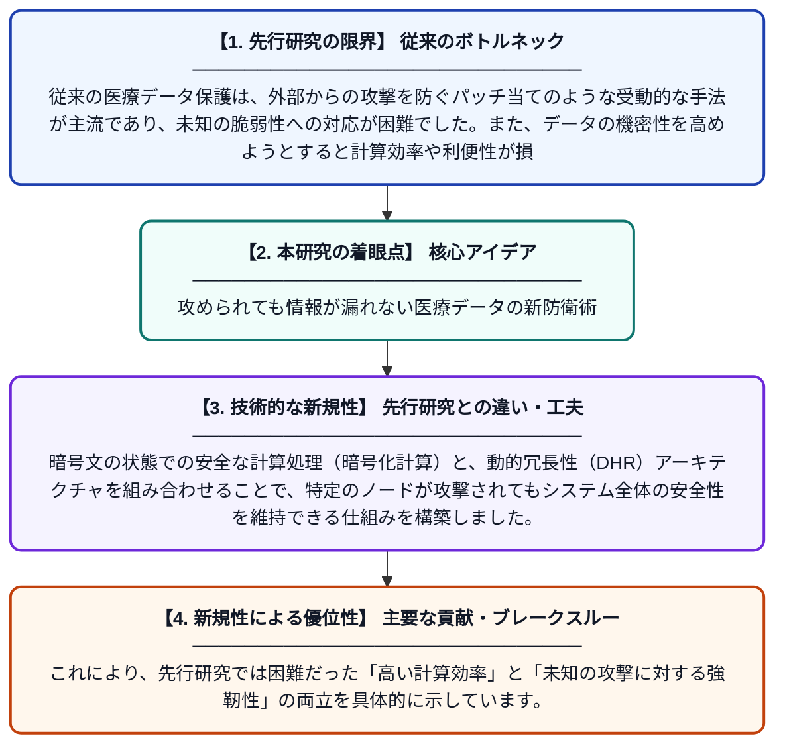

# 多様な内生的セキュリティアーキテクチャによる医療データマイニングの強化

**Original Title**: *Empowering medical data mining via a diversified endogenous security architecture*

> **💡 一言要約**: 攻められても情報が漏れない医療データの新防衛術

| 項目 | 内容 |
|---|---|
| **著者** | BB Yuan, YG Chen, Y Ping, ZS Feng, SL Tian, AC Zuo |
| **アラートキーワード** | Secure Computing |
| **PDF** | [https://www.tmrjournals.com/public/articlePDF/20261015/d86053072178c1183ac1cd946f258ad7.pdf](https://www.tmrjournals.com/public/articlePDF/20261015/d86053072178c1183ac1cd946f258ad7.pdf) |
| **原文リンク** | [https://www.tmrjournals.com/public/articlePDF/20261015/d86053072178c1183ac1cd946f258ad7.pdf](https://www.tmrjournals.com/public/articlePDF/20261015/d86053072178c1183ac1cd946f258ad7.pdf) |
| **PDF版要約** | [README.pdf](./README.pdf) |

---

## 📊 新規性の図解（先行研究との違いと本研究のブレークスルー）

## 📝 要約

医療データマイニングにおけるセキュリティと利便性の矛盾を解決するため、受動的な防護から能動的な「内生的セキュリティ」へのパラダイムシフトを提案しています。暗号化されたデータ上での安全な計算を可能にする多様な動的冗長アーキテクチャを導入し、堅牢なデータ活用を実現しました。

## ❓ どんな問題に取り組んだか

従来の医療データ保護は、外部からの攻撃を防ぐパッチ当てのような受動的な手法が主流であり、未知の脆弱性への対応が困難でした。また、データの機密性を高めようとすると計算効率や利便性が損なわれるというトレードオフが大きな課題となっていました。

## ✨ 何が新しい？何がすごい？（新規性）

本研究は、システムの構造自体に防御機能を組み込む「内生的セキュリティ」を医療データマイニングに適用した点が革新的です。暗号文の状態での安全な計算処理（暗号化計算）と、動的冗長性（DHR）アーキテクチャを組み合わせることで、特定のノードが攻撃されてもシステム全体の安全性を維持できる仕組みを構築しました。これにより、先行研究では困難だった「高い計算効率」と「未知の攻撃に対する強靭性」の両立を具体的に示しています。

## 🎓 大学1年生向けの解説

病院のデータは非常に重要ですが、ハッカーに狙われやすいという問題があります。これまでの対策は、後からカギを増やすようなものでしたが、この研究では「金庫の形を常に変え続ける」ような新しい仕組みを作りました。データを暗号化したまま分析できる技術も使っているため、万が一泥棒が中に入っても、何が書いてあるか読み取ることができません。これによって、プライバシーを守りながら安全に病気の研究を進めることができるようになります。
