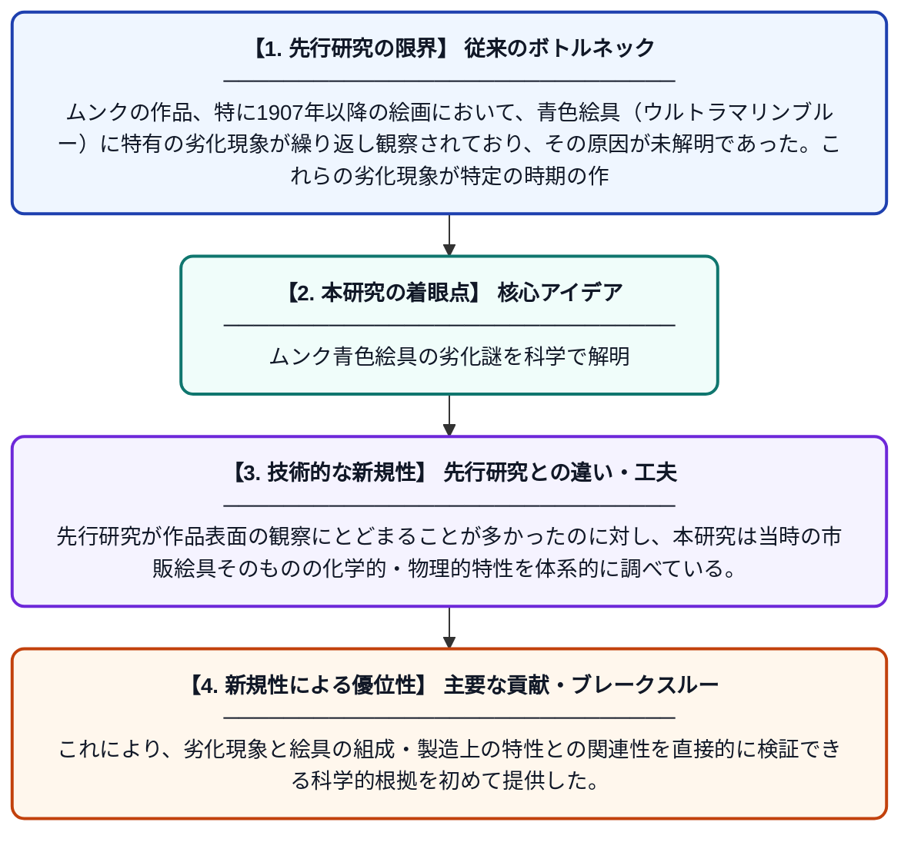

# エドヴァルド・ムンクのコレクションにおける絵画の分析：20世紀初頭の市販油絵具の多角的分析研究

**Original Title**: *… in Edvard Munch's collection: a multi-analytical study of early 20th century commercial oil paints: authors: Beatrice G. Boracchi, Eun-Jin Strand Ferrer, ICA Sandu,[et al.]*

> **💡 一言要約**: ムンク青色絵具の劣化謎を科学で解明

| 項目 | 内容 |
|---|---|
| **著者** | ICA Sandu, B Boracchi, JS Ferrer |
| **アラートキーワード** | ICA |
| **原文リンク** | [https://munch.tind.io/record/46832](https://munch.tind.io/record/46832) |
| **PDF版要約** | [README.pdf](./README.pdf) |

---

## 📊 新規性の図解（先行研究との違いと本研究のブレークスルー）

## 📝 要約

ノルウェーの画家エドヴァルド・ムンクが使用した青色絵具、特に1907年以降の作品に見られる劣化現象を調査するため、10種類の市販ウルトラマリンブルー絵具を多角的な分析手法で研究した。絵具の化学組成や物理的特性を詳細に解析することで、劣化メカニズムの解明を試みている。この研究はムンク作品の保存修復に向けた科学的基盤を提供するものである。

## ❓ どんな問題に取り組んだか

ムンクの作品、特に1907年以降の絵画において、青色絵具（ウルトラマリンブルー）に特有の劣化現象が繰り返し観察されており、その原因が未解明であった。これらの劣化現象が特定の時期の作品に集中していることから、当時使用された市販絵具の組成や品質が関係している可能性が指摘されていた。

## ✨ 何が新しい？何がすごい？（新規性）

本研究では、ムンクが実際に使用したと考えられる市販ウルトラマリンブルー絵具を複数種類選定し、X線回折・蛍光X線分析・分光法など複数の分析手法を組み合わせた多角的アプローチを採用した点が新しい。先行研究が作品表面の観察にとどまることが多かったのに対し、本研究は当時の市販絵具そのものの化学的・物理的特性を体系的に調べている。これにより、劣化現象と絵具の組成・製造上の特性との関連性を直接的に検証できる科学的根拠を初めて提供した。

## 🎓 大学1年生向けの解説

エドヴァルド・ムンクは「叫び」で有名なノルウェーの画家で、彼の絵画には青色の部分が時間とともに劣化してしまう問題があります。この研究では、ムンクが使っていたチューブ入りの市販青色絵具を科学的な機器で詳しく調べました。絵具に含まれる化学成分や構造を分析することで、なぜ絵が傷んでしまうのかを明らかにしようとしています。こうした研究は、大切な美術作品を将来にわたって守るための修復・保存活動に役立てられます。
