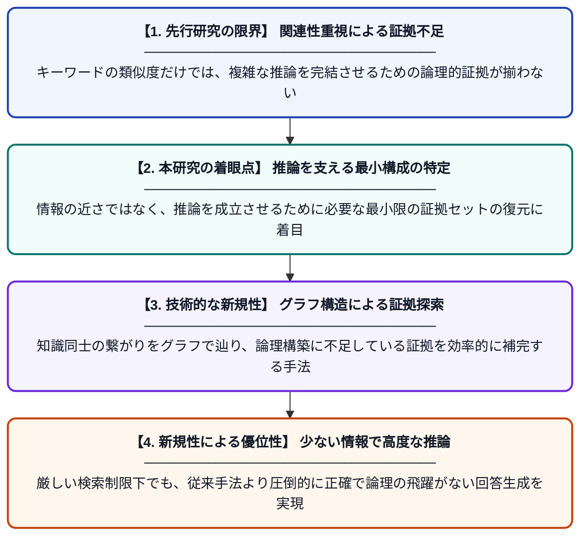

# 関連性だけでは不十分：信頼性の高いRAG推論のための最小限の証拠復元

**Original Title**: *When Relevance Is Not Enough: Minimal Support Recovery for Faithful RAG Reasoning*

> **💡 一言要約**: 関連性重視を脱し、証拠の網羅性でRAG推論を革新する

| 項目 | 内容 |
|---|---|
| **著者** | S Xu, M Asadinia |
| **掲載誌** | 25th International Conference on Machine … 2026 |
| **アラートキーワード** | graph rag |
| **原文リンク** | [https://ieeexplore.ieee.org/abstract/document/11758701/](https://ieeexplore.ieee.org/abstract/document/11758701/) |
| **PDF版要約** | [README.pdf](./README.pdf) |

---

## 📊 新規性の図解（先行研究との違いと本研究のブレークスルー）

## 📝 要約

検索拡張生成（RAG）において、関連性の高い情報を集めるだけでは論理的な推論を完結させるのに不十分なケースがあることを指摘しました。本研究は、厳格な検索予算内で推論を支える「最小限の完全な証拠セット」を特定・復元する手法を提案し、複雑な推論タスクでの精度を向上させています。

## ❓ どんな問題に取り組んだか

従来のRAGは「関連性」に基づく検索を重視しますが、複雑な問いに対しては断片的な情報しか得られず、論理構築（プルーフ）に必要な証拠が欠けてしまう課題があります。特に検索件数に制限がある環境では、BM25などの既存手法では推論を完結させるための全情報を揃えられません。

## ✨ 何が新しい？何がすごい？（新規性）

本研究は、単なる類似度検索ではなく、推論の忠実性を保証するために「最小限で完全な証拠」を特定する枠組みを導入しました。グラフ検索技術を応用し、情報の繋がりを辿ることで、限られた検索予算でも論理的な穴を埋める手法を開発しています。これにより、複雑な多段階推論が必要な設定において、従来手法を凌駕する高い推論能力を達成しました。

## 🎓 大学1年生向けの解説

AIが質問に答える際、関係ありそうな文章をネット等から探してくる仕組みをRAGと呼びます。しかし、難しい問題だと「似たような話」を集めるだけではパズルのピースが足りず、AIが適当な推論をしてしまうことがありました。この研究は、パズルを完成させるのに『最低限どのピースが必要か』を論理的に見つけ出す新しい方法を提案しました。これによって、AIはより少ない情報源からでも、より正確で嘘のない説明ができるようになります。
