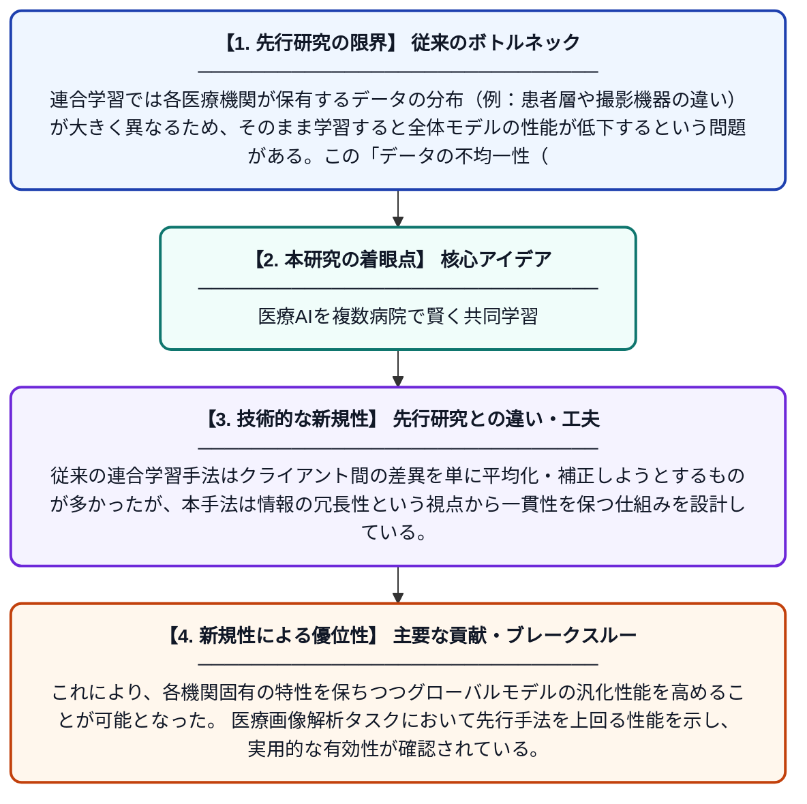

# 冗長性を考慮したクライアント一貫性による調和的な医療連合学習

**Original Title**: *Harmonized medical federated learning via redundancy-aware client consistency*

> **💡 一言要約**: 医療AIを複数病院で賢く共同学習

| 項目 | 内容 |
|---|---|
| **著者** | J Yi, Y Li, H Zhang, Q Bi, W Ji, H Huang, Y Huang |
| **掲載誌** | Pattern Recognition 2026 |
| **アラートキーワード** | Federated Learning |
| **原文リンク** | [https://www.sciencedirect.com/science/article/pii/S0031320326014883](https://www.sciencedirect.com/science/article/pii/S0031320326014883) |
| **PDF版要約** | [README.pdf](./README.pdf) |

---

## 📊 新規性の図解（先行研究との違いと本研究のブレークスルー）

## 📝 要約

連合学習（FL）は複数の医療機関がデータを共有せずに共同でAIモデルを訓練できる手法だが、各機関のデータ分布の違いが大きな課題となっている。本論文では、クライアント間の一貫性を冗長性の観点から最適化する新たな手法「調和的医療連合学習」を提案している。これにより、異なる機関間のデータ不均一性問題を効果的に緩和し、医療AIの精度向上を実現する。

## ❓ どんな問題に取り組んだか

連合学習では各医療機関が保有するデータの分布（例：患者層や撮影機器の違い）が大きく異なるため、そのまま学習すると全体モデルの性能が低下するという問題がある。この「データの不均一性（heterogeneity）」は連合学習における最大の障壁の一つであり、特に医療分野では機関ごとの差異が顕著になりやすい。従来手法ではこの分布差異を十分に吸収しきれず、学習の不安定化やモデル精度の劣化が生じていた。

## ✨ 何が新しい？何がすごい？（新規性）

本研究は「冗長性を考慮したクライアント一貫性（Redundancy-Aware Client Consistency）」という新しい概念を導入し、各クライアント（機関）間で共有すべき情報と冗長な情報を区別しながら学習を調和させる点が独自である。従来の連合学習手法はクライアント間の差異を単に平均化・補正しようとするものが多かったが、本手法は情報の冗長性という視点から一貫性を保つ仕組みを設計している。これにより、各機関固有の特性を保ちつつグローバルモデルの汎化性能を高めることが可能となった。医療画像解析タスクにおいて先行手法を上回る性能を示し、実用的な有効性が確認されている。

## 🎓 大学1年生向けの解説

複数の病院が患者データをお互いに見せ合わずに、一緒にAIを育てる仕組みを「連合学習」といいます。しかし、病院ごとに患者の特徴や撮影機器が違うので、そのままではAIがうまく学べないという問題があります。この論文では、各病院の情報の中から「本当に大事な部分」と「ダブっている不要な部分」を見分けながら、バランスよく学習する新しい方法を提案しています。これにより、どの病院のデータにも対応できる高精度な医療AIを、プライバシーを守りながら作れるようになります。
