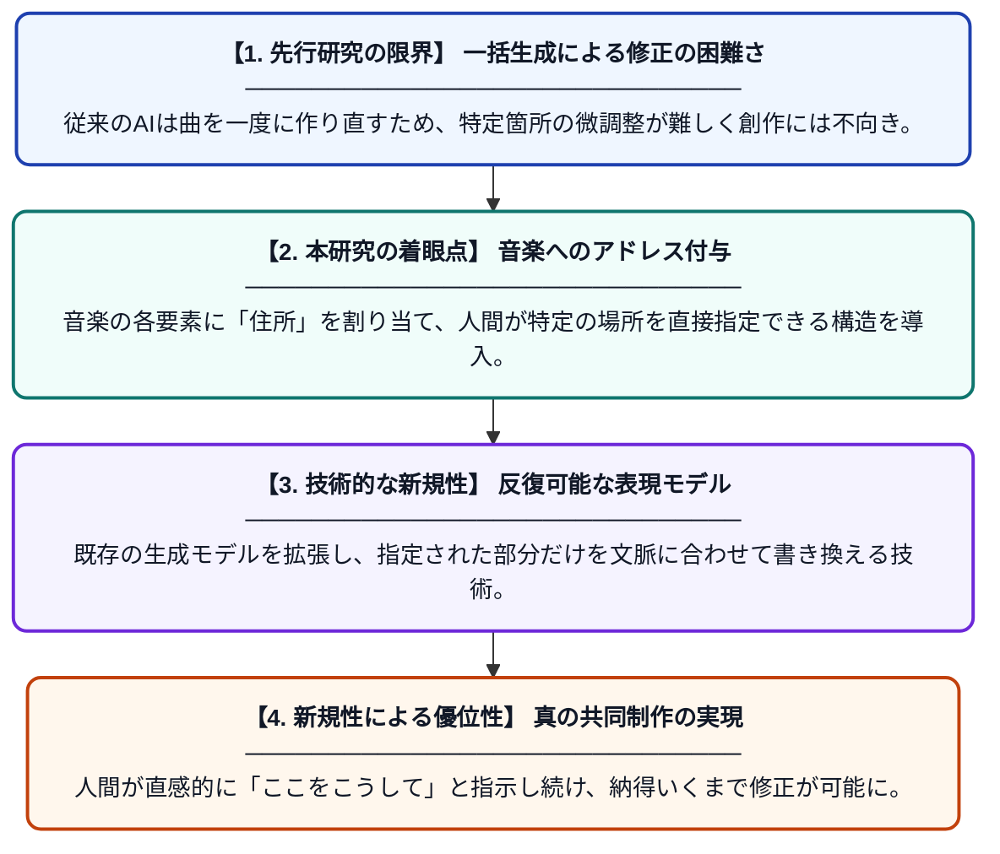

# 指をさせる音楽：人間とAIの反復的な共同制作のためのアドレス指定可能な表現

**Original Title**: *Music You Can Point At: Addressable Representations for Iterative Human-AI Music Co-Creation*

> **💡 一言要約**: 指をさして直せる！AIとの対話的な音楽制作

| 項目 | 内容 |
|---|---|
| **著者** | Q Yang, G Weinberg |
| **掲載誌** | Proceedings of the ACM AI Leadership Summit 2026 |
| **アラートキーワード** | one shot |
| **PDF** | [https://dl.acm.org/doi/pdf/10.1145/3806096.3844880](https://dl.acm.org/doi/pdf/10.1145/3806096.3844880) |
| **原文リンク** | [https://dl.acm.org/doi/pdf/10.1145/3806096.3844880](https://dl.acm.org/doi/pdf/10.1145/3806096.3844880) |
| **PDF版要約** | [README.pdf](./README.pdf) |

---

## 📊 新規性の図解（先行研究との違いと本研究のブレークスルー）

## 📝 要約

現在の生成AIは一括で音楽を出力してしまい、一部を修正するような試行錯誤が困難です。本研究では、音楽の特定部分をピンポイントで指定（アドレス指定）して修正できる新しい表現方法を提案し、人間とAIが対話するように作曲を進められる手法を開発しました。

## ❓ どんな問題に取り組んだか

従来の生成AIは、短いテキストから一気に完成品を作り出す「一発勝負」の形式が主流であり、アーティストが日常的に行う「一部分だけを書き直す」という反復的な制作プロセスに対応できていません。その結果、AIは創作のパートナーというよりは、単なる自動生成ツールに留まっていました。

## ✨ 何が新しい？何がすごい？（新規性）

音楽データの中に、特定の場所や要素を指し示すことができる「アドレス指定可能な表現」を組み込んだ点が画期的です。先行研究では曲の一部を変えるために全体を再生成する必要がありましたが、本手法では音楽の構造的な整合性を保ったまま、指定した箇所のメロディや楽器構成だけを更新できます。これにより、人間がAIに対して「ここのフレーズをもう少し明るくして」といった具体的な修正指示を出し続けることが可能になりました。

## 🎓 大学1年生向けの解説

今のAIは「曲を作って」と頼むと一瞬で完成品を出してくれますが、実は「サビのこの音だけ変えて」といった細かい直しが苦手です。この研究では、AIが作った曲の特定の場所に名前を付けて、そこを指さして「ここを直して」と言えるような仕組みを作りました。これによって、人間とAIが一緒に何度も手直しをしながら、納得のいく一曲を少しずつ完成させていくことができるようになります。
