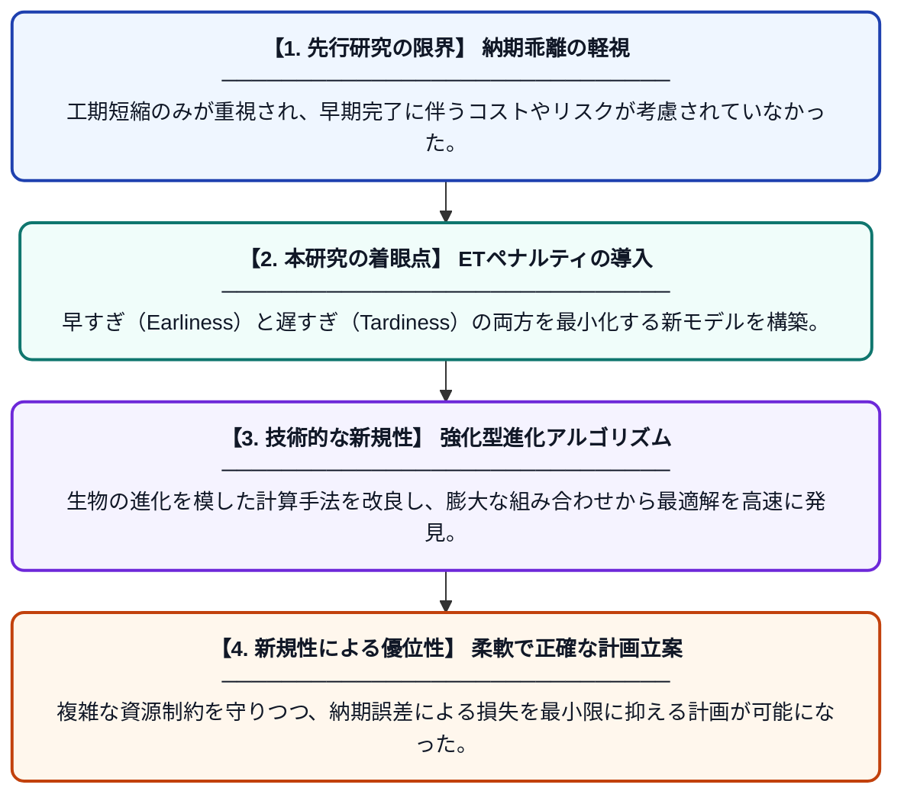

# ET-RCPSP：早期・遅延ペナルティを考慮した新たな資源制約付きプロジェクトスケジューリング問題と強化型進化アルゴリズムによる解決

**Original Title**: *ET-RCPSP: a novel RCPSP variant with earliness-tardiness penalties solved by enhanced evolutionary algorithm*

> **💡 一言要約**: 納期厳守と資源最適化を両立する新スケジューリング法

| 項目 | 内容 |
|---|---|
| **著者** | HN Thi, HD Quoc |
| **掲載誌** | Bulletin of Electrical Engineering and Informatics 2026 |
| **アラートキーワード** | rcpsp |
| **PDF** | [https://beei2.org/index.php/EEI/article/download/12147/5160](https://beei2.org/index.php/EEI/article/download/12147/5160) |
| **Git リポジトリ** | [https://github.com/imopse/iMOPSE](https://github.com/imopse/iMOPSE) |
| **原文リンク** | [https://beei2.org/index.php/EEI/article/download/12147/5160](https://beei2.org/index.php/EEI/article/download/12147/5160) |
| **PDF版要約** | [README.pdf](./README.pdf) |

---

## 📊 新規性の図解（先行研究との違いと本研究のブレークスルー）

## 📝 要約

本研究は、タスクの完了が納期より早すぎる場合と遅れる場合の両方にペナルティを課す、実用的な「ET-RCPSP」モデルを提案しています。この複雑な最適化問題を効率的に解くため、探索能力を高めた強化型進化アルゴリズムを開発し、製造やプロジェクト管理におけるコスト最小化を実現しました。

## ❓ どんな問題に取り組んだか

従来の資源制約付きプロジェクトスケジューリング（RCPSP）では、主に総工期の短縮が重視され、納期より早く終わりすぎることで発生する在庫コストなどの「早期ペナルティ」が十分に考慮されていませんでした。現実の製造現場では、ジャストインタイムの観点から、早すぎず遅すぎない絶妙なタイミングでの完了と、限られた資源の有効活用を同時に達成する必要があります。

## ✨ 何が新しい？何がすごい？（新規性）

本研究の新規性は、従来のRCPSPにタスク固有の早期・遅延ペナルティを統合した「ET-RCPSP」という新しい問題枠組みを定義した点にあります。さらに、この難解な問題を解くために、従来の進化アルゴリズムに独自の改良を加えた「強化型進化アルゴリズム」を構築しました。これにより、先行研究では困難だった「資源の制約」と「厳密な納期管理」という相反する要素を、高い精度で同時に最適化することが可能になりました。

## 🎓 大学1年生向けの解説

プロジェクトを進める際、予定より遅れるのは困りますが、実は早すぎても「保管場所が必要になる」といった無駄が発生します。この研究は、限られた人数や道具を使いながら、すべての作業を「ちょうど良い時間」に終わらせるための、コンピュータ用の高度な計算式を作りました。これまでの方法よりも、より実際の工場や工事現場のルールに近い形で、最も無駄のない計画を自動で立てられるようになったのがすごい点です。
