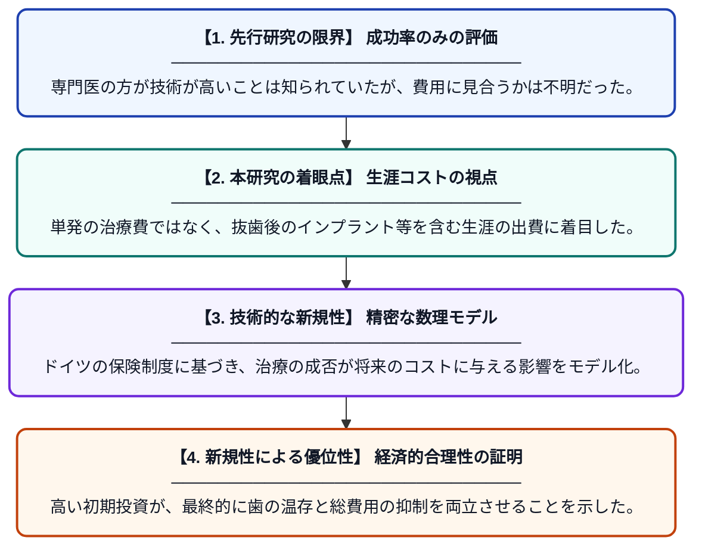

# ドイツにおける歯内療法専門医による治療が歯の生存率と治療コストに与える影響：費用対効果分析

**Original Title**: *Effects of Specialist Endodontic Therapy on Tooth Retention and Treatment Costs in Germany: A Cost‐Effectiveness Analysis*

> **💡 一言要約**: 専門医の根管治療：高くても歯が残り、結局お得。

| 項目 | 内容 |
|---|---|
| **著者** | L Benz, W Leontiev, F Schwendicke, E Walter |
| **掲載誌** | International Endodontic Journal 2026 |
| **アラートキーワード** | ICA |
| **原文リンク** | [https://onlinelibrary.wiley.com/doi/abs/10.1111/iej.70315](https://onlinelibrary.wiley.com/doi/abs/10.1111/iej.70315) |
| **PDF版要約** | [README.pdf](./README.pdf) |

---

## 📊 新規性の図解（先行研究との違いと本研究のブレークスルー）

## 📝 要約

ドイツの歯科医療において、歯内療法専門医による根管治療が一般歯科医（GP）と比較してどれほど歯の温存に寄与し、経済的合理性があるかを調査しました。シミュレーションの結果、専門医による治療は初期コストが高いものの、再治療や抜歯のリスクを低減し、長期的な費用対効果が高いことが示されました。

## ❓ どんな問題に取り組んだか

根管治療は日常的に行われる処置ですが、一般歯科医による治療は専門医に比べて失敗率が高い傾向にあります。治療の失敗は再治療や抜歯、インプラントといった高額な後続処置を招くため、初期段階で高価な専門医治療を受けることが、患者の生涯コストや歯の寿命にどう影響するかが不明確でした。

## ✨ 何が新しい？何がすごい？（新規性）

本研究の最大の特徴は、ドイツの実際の臨床データとマルコフモデルを組み合わせ、長期的な「費用対効果」を初めて詳細に算出した点にあります。単に治療の成功率を比べるだけでなく、患者の余命やその後の治療経路を考慮し、専門医への紹介が経済的に最も合理的な選択肢になり得ることを定量的に立証しました。これにより、医療政策や保険償還の議論に重要な科学的根拠を提供しています。

## 🎓 大学1年生向けの解説

虫歯がひどくなった時に行う「歯の神経の治療（根管治療）」には、普通の歯医者さんと、その治療だけを専門に行う先生がいます。専門の先生にお願いすると料金は高くなりますが、その分治療が上手なので、歯を抜かずに済む確率が上がります。この研究は、「最初に高いお金を払ってでも専門の先生に治してもらう方が、将来的に何度も治療を繰り返すより安上がりで、自分の歯も長く残せる」ということを統計データで明らかにしました。
