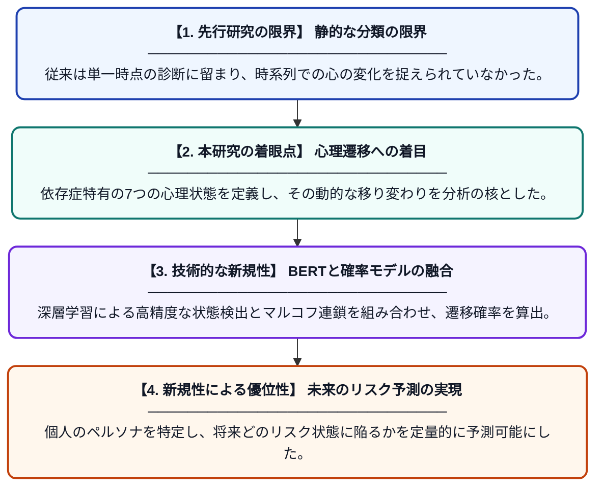

# リスクの状態：マルコフ連鎖と深層言語モデルを用いたギャンブル依存症者の心理状態とペルソナの予測

**Original Title**: *State of Risk: Predicting the Mental State and Persona of Problem Gamblers Using Markov Chains and Deep Language Models*

> **💡 一言要約**: AIが依存症者の心の変化を予測しリスクを防ぐ

| 項目 | 内容 |
|---|---|
| **著者** | N Binesh, KVR Pasham |
| **掲載誌** | IEEE Access 2026 |
| **アラートキーワード** | affective computing |
| **PDF** | [https://ieeexplore.ieee.org/iel8/6287639/6514899/11803249.pdf](https://ieeexplore.ieee.org/iel8/6287639/6514899/11803249.pdf) |
| **原文リンク** | [https://ieeexplore.ieee.org/iel8/6287639/6514899/11803249.pdf](https://ieeexplore.ieee.org/iel8/6287639/6514899/11803249.pdf) |
| **PDF版要約** | [README.pdf](./README.pdf) |

---

## 📊 新規性の図解（先行研究との違いと本研究のブレークスルー）

## 📝 要約

ギャンブル依存症者の投稿から7つの心理状態を検出し、その遷移を分析するアプローチを提案しています。BERTを用いた深層学習とマルコフ連鎖を組み合わせることで、ユーザーの心理的な変化や将来のリスク行動を高い精度で予測することに成功しました。

## ❓ どんな問題に取り組んだか

ギャンブル依存症は深刻な社会問題ですが、個人の心理状態がどのように変化し悪化していくのかをリアルタイムで把握することは困難でした。従来の分析は単一の時点での分類に留まることが多く、感情が移り変わる動的なプロセスまでは十分に解明されていませんでした。

## ✨ 何が新しい？何がすごい？（新規性）

BERTによる深層学習とマルコフ連鎖を統合し、7つの特定のメンタルヘルス状態を検出・予測するハイブリッドな枠組みを構築した点が画期的です。手動アノテーションされた投稿データを用い、感情の遷移パターンからユーザーを特定の「ペルソナ」に分類する手法を開発しました。これにより、過去の投稿履歴から将来のリスク状態を高精度に予測できるようになったことが主要な貢献です。

## 🎓 大学1年生向けの解説

ネットの掲示板などに書かれた文章から、その人がどれくらいギャンブルに依存しているか、今はどんな気持ちかをAIが読み取る研究です。AIは「後悔」や「切望」など7つの感情を見分け、その感情が次にどう変わっていくかを天気予報のように予測します。難しい数学のモデルと最新のAI技術を組み合わせることで、依存症が悪化する前に助けの手を差し伸べるためのヒントを見つけ出しました。
