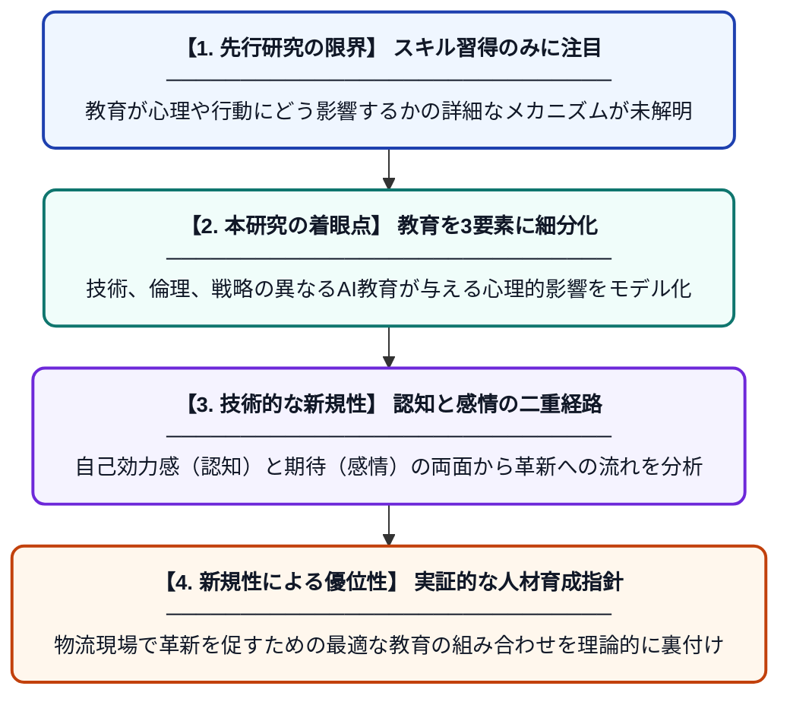

# AIトレーニングの種類が物流従業員の革新的行動に及ぼす影響：認知・感情経路モデルの検証

**Original Title**: *How Different Types of Artificial Intelligence Training Relate to Innovative Behavior Among Logistics Employees: A Cognitive–Affective Pathway Model*

> **💡 一言要約**: AI教育が物流現場の「革新」を生む心理メカニズム

| 項目 | 内容 |
|---|---|
| **著者** | W Seo, W Hwang |
| **掲載誌** | Systems 2026 |
| **アラートキーワード** | logistics |
| **原文リンク** | [https://www.mdpi.com/2079-8954/14/11/1398](https://www.mdpi.com/2079-8954/14/11/1398) |
| **PDF版要約** | [README.pdf](./README.pdf) |

---

## 📊 新規性の図解（先行研究との違いと本研究のブレークスルー）

## 📝 要約

物流業界におけるAIトレーニングの種類（技術的、倫理的、戦略的）が従業員の革新的行動にどのように寄与するかを調査した研究です。245名の物流実務者を対象とした調査に基づき、AIに対する認知（自己効力感）と感情（期待感）が媒介するメカニズムを明らかにしました。

## ❓ どんな問題に取り組んだか

多くの物流企業がAIトレーニングに多額の投資をしていますが、それがどのように従業員の自発的な改善や革新的な行動に結びつくのか、そのプロセスは不明確でした。特に、教育内容の違いが従業員の心理状態や行動にどのような影響を与えるかが解明されていませんでした。

## ✨ 何が新しい？何がすごい？（新規性）

本研究は、AIトレーニングを単一の教育と見なさず、技術・倫理・戦略の3つの側面から分類し、それぞれの影響を個別に評価した点が革新的です。従来のスキル向上に焦点を当てた研究とは異なり、AIに対する「自己効力感（認知）」と「期待（感情）」の二つの経路が革新的行動を促進することを実証しました。これにより、物流業界に特化した具体的かつ多角的な人材開発戦略（HRD）のフレームワークを構築した点が大きな貢献です。

## 🎓 大学1年生向けの解説

物流の現場でAIを使いこなすには、単にボタンの押し方を覚えるだけでは不十分です。この研究では、AIの仕組みやマナー、使い方を学ぶことで、従業員が「自分ならAIを使いこなせる」という自信を持ち、「AIで仕事が良くなる」とワクワクすることが、新しいアイデアを生む鍵だと分かりました。つまり、AI教育は単なる技術習得ではなく、やる気や自信といった「心」を動かすことで、現場をより良くする行動に繋がるのです。
