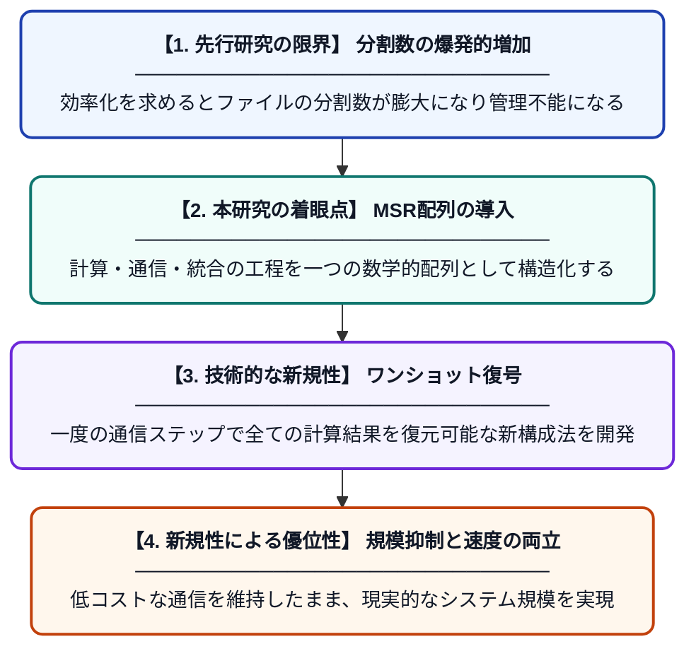

# カスケード型符号化分散計算のためのMap–Shuffle–Reduce配列：境界と構成法

**Original Title**: *Map–Shuffle–Reduce Arrays for Cascaded Coded Distributed Computing: Bounds and Constructions*

> **💡 一言要約**: 分散計算の通信効率を保ちつつ、規模の壁を打破する新技術

| 項目 | 内容 |
|---|---|
| **著者** | J Fang, Y Huang, G Wu, M Zhang, M Cheng |
| **掲載誌** | Entropy 2026 |
| **アラートキーワード** | one shot |
| **原文リンク** | [https://www.mdpi.com/1099-4300/28/11/1247](https://www.mdpi.com/1099-4300/28/11/1247) |
| **PDF版要約** | [README.pdf](./README.pdf) |

---

## 📊 新規性の図解（先行研究との違いと本研究のブレークスルー）

## 📝 要約

複数の計算機で並列処理を行うカスケード型分散計算において、通信コストを抑えつつシステム規模（ファイル分割数など）を劇的に削減する「MSR配列」という新しい構造を提案しました。この研究は、Map、Shuffle、Reduceの各工程を数学的にモデル化し、一度の通信でデータの復元が可能な効率的なアルゴリズムを構築しています。

## ❓ どんな問題に取り組んだか

符号化分散計算（CDC）では通信量を減らすためにデータを細分化しますが、従来の手法ではファイル分割数や出力関数の数が指数関数的に増大し、実用上の大きな障害となっていました。特に計算が連続するカスケード型において、効率とシステム規模のトレードオフをどう解決するかが課題でした。

## ✨ 何が新しい？何がすごい？（新規性）

本論文は「MSR配列」という概念を導入し、MapからReduceまでの全工程を一貫した構造で設計する「ワンショット手法」を確立しました。先行研究に比べて、通信効率の最適性を維持したまま、ファイル分割数を大幅に削減できる具体的な構成法を提示した点が画期的です。さらに、理論的な通信コストの下界（理論的な限界値）を導出し、提案手法がそれに極めて近い性能を持つことを証明しました。

## 🎓 大学1年生向けの解説

たくさんのコンピュータで協力して計算をするとき、一番時間がかかるのはコンピュータ同士のデータのやり取り（通信）です。これを効率化するためにデータを細かく分けて送るのですが、細かく分けすぎると管理が複雑になりすぎてパンクしてしまいます。この研究では、数学的なパズルを解くような工夫で、データを細かく分けすぎずに、かつ最短の時間で通信を終わらせる新しいルールを作りました。これにより、大規模な計算をより現実的な仕組みで高速化できるようになります。
