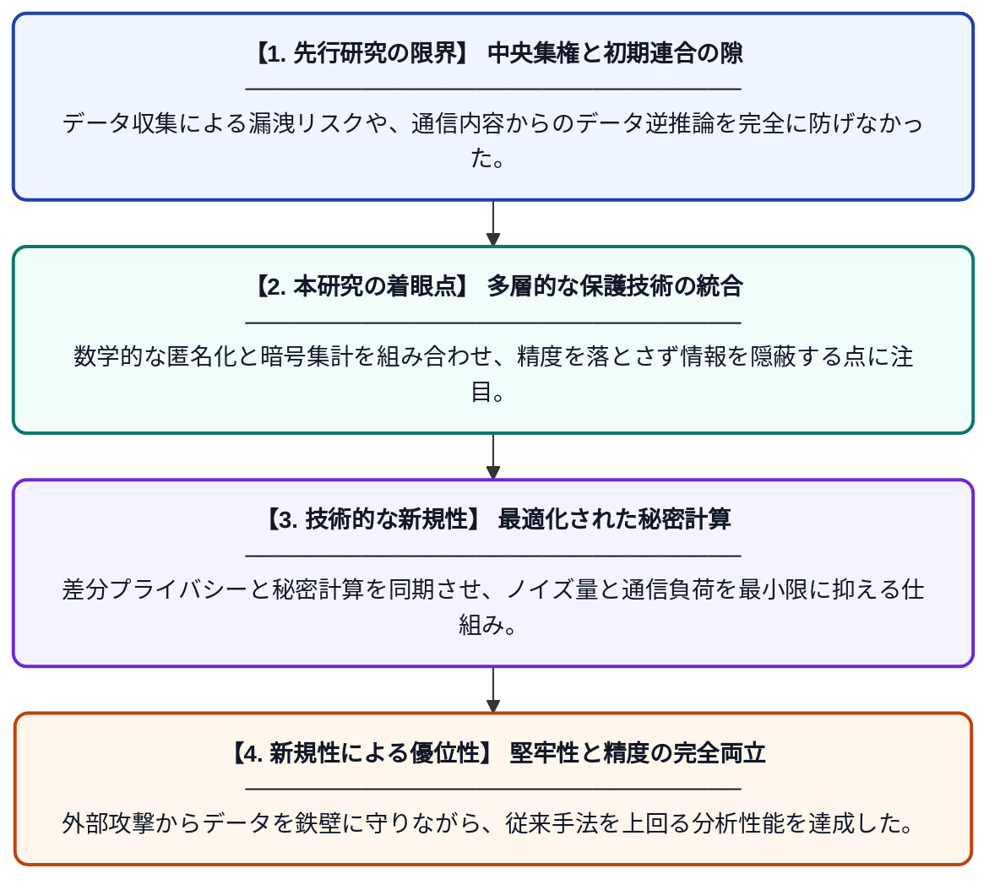

# 分散環境における安全なデータ処理のための連合学習に基づいたプライバシー保護AIモデルの強化

**Original Title**: *Enhanced Federated Learning-Based Privacy-Preserving AI Model for Secure Data Processing in Distributed Environments*

> **💡 一言要約**: プライバシーとAIの精度を両立する次世代の連合学習

| 項目 | 内容 |
|---|---|
| **著者** | D Salunke, J Gujare, Y Deshmukh, O Narayane… |
| **掲載誌** | IEEE International … 2026 |
| **アラートキーワード** | differential privacy |
| **原文リンク** | [https://ieeexplore.ieee.org/abstract/document/11742386/](https://ieeexplore.ieee.org/abstract/document/11742386/) |
| **PDF版要約** | [README.pdf](./README.pdf) |

---

## 📊 新規性の図解（先行研究との違いと本研究のブレークスルー）

## 📝 要約

本研究は、差分プライバシーと秘密計算アグリゲーションを統合することで、データの機密性を極限まで高めた新しい連合学習フレームワークを提案しています。分散された環境下で、従来の集中型学習や標準的な連合学習よりも強固なセキュリティを保ちつつ、高い予測精度を維持できることを証明しました。

## ❓ どんな問題に取り組んだか

従来の集中型学習ではデータ漏洩のリスクが避けられず、初期の連合学習でも通信過程から元のデータが推測される脆弱性がありました。また、プライバシー保護を強化すると学習精度や計算効率が著しく低下するというトレードオフが大きな課題でした。

## ✨ 何が新しい？何がすごい？（新規性）

本論文の核心は、差分プライバシーによるノイズ付加とセキュアアグリゲーション技術を高度に組み合わせ、防御力と精度のバランスを最適化した点にあります。先行研究では困難だった「悪意のある参加者によるデータ復元攻撃」への完全な耐性を備えつつ、集中学習に匹敵する学習速度を実現しました。この統合アプローチにより、通信コストを抑えながら高度な機密保護を可能にしたことが最大の貢献です。

## 🎓 大学1年生向けの解説

AIに学習させる際、通常は1つの場所にデータを集めますが、これでは大切な個人情報が盗まれる危険があります。この研究では、データを手元に置いたまま「学習結果」だけをやり取りする『連合学習』という方法をさらに進化させました。やり取りするデータに特殊な加工を施したり暗号化したりすることで、万が一途中で盗まれても中身が絶対にわからないように工夫しています。これにより、プライバシーを守りながらみんなで賢いAIを作れるようになります。
