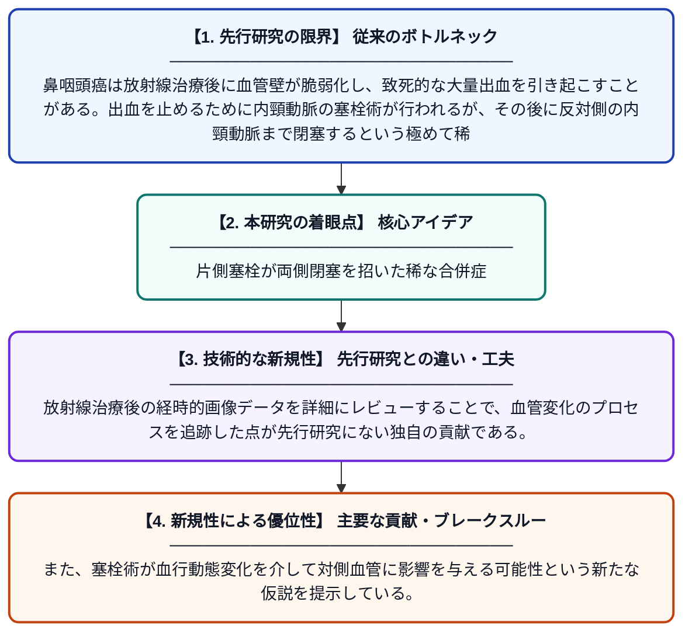

# 鼻咽頭癌の大量出血に対する右内頸動脈塞栓術後に生じた両側内頸動脈閉塞：症例報告

**Original Title**: *Bilateral internal carotid artery occlusion following embolization of the right internal carotid artery in a nasopharyngeal carcinoma with massive bleeding: a case report*

> **💡 一言要約**: 片側塞栓が両側閉塞を招いた稀な合併症

| 項目 | 内容 |
|---|---|
| **著者** | Y Wu, Q Luo, Q He |
| **掲載誌** | Brazilian Journal of Otorhinolaryngology 2026 |
| **アラートキーワード** | ICA |
| **原文リンク** | [https://www.sciencedirect.com/science/article/pii/S1808869426001163](https://www.sciencedirect.com/science/article/pii/S1808869426001163) |
| **PDF版要約** | [README.pdf](./README.pdf) |

---

## 📊 新規性の図解（先行研究との違いと本研究のブレークスルー）

## 📝 要約

本論文は、鼻咽頭癌（NPC）の大量出血治療として右内頸動脈の塞栓術を施行した後、反対側の左内頸動脈にも閉塞が生じた稀な症例を報告している。放射線治療後の定期フォローアップ画像データを詳細に分析し、この異常な臨床現象のメカニズムを考察した。片側の血管塞栓術が両側の動脈閉塞を引き起こすという予期せぬ合併症を明らかにした重要な症例報告である。

## ❓ どんな問題に取り組んだか

鼻咽頭癌は放射線治療後に血管壁が脆弱化し、致死的な大量出血を引き起こすことがある。出血を止めるために内頸動脈の塞栓術が行われるが、その後に反対側の内頸動脈まで閉塞するという極めて稀かつ重篤な合併症のメカニズムは十分に解明されていなかった。

## ✨ 何が新しい？何がすごい？（新規性）

片側の内頸動脈塞栓術後に対側の内頸動脈閉塞が生じた症例はこれまでほとんど報告されておらず、本報告はNPC患者における両側内頸動脈閉塞の初期的な症例記録として位置づけられる。放射線治療後の経時的画像データを詳細にレビューすることで、血管変化のプロセスを追跡した点が先行研究にない独自の貢献である。また、塞栓術が血行動態変化を介して対側血管に影響を与える可能性という新たな仮説を提示している。

## 🎓 大学1年生向けの解説

鼻咽頭癌（鼻の奥にできるがん）は放射線治療を受けた後、血管がもろくなって大出血を起こすことがあります。この出血を止めるために、首の大きな血管（内頸動脈）を詰まらせる処置（塞栓術）が行われました。ところが右側の血管を詰めたはずなのに、なぜか左側の血管まで詰まってしまうという非常に珍しいことが起きました。この論文はその不思議な現象を詳しく調べ、なぜそうなったのかを画像データをもとに考察した報告です。
