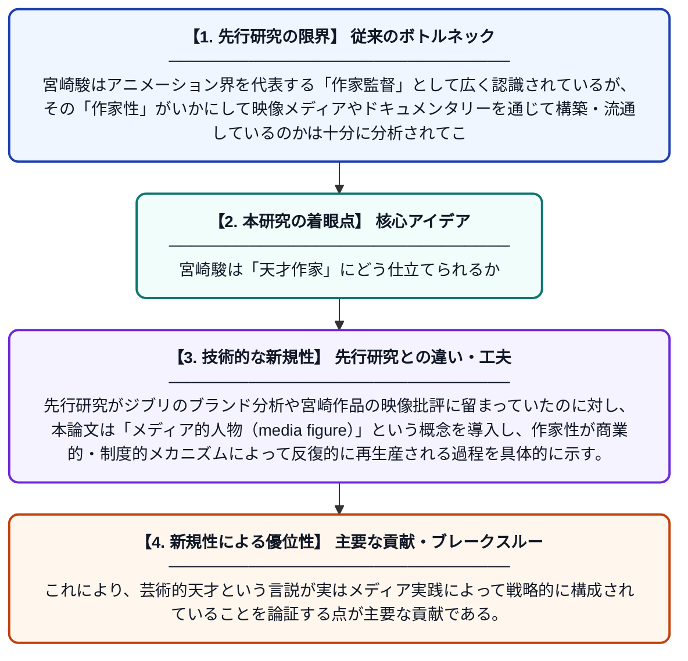

# 「一つのショットで映画が傑作かどうかわかる」——スタジオジブリのメイキングドキュメンタリーにおける宮崎駿の『メディア的人物』としてのオートゥール的アイデンティティ

**Original Title**: *"One shot tells me whether a film is great or not." Hayao Miyazaki's Auteurist Identity as 'Media Figure' in Studio Ghibli's Making-Of Documentaries*

> **💡 一言要約**: 宮崎駿は「天才作家」にどう仕立てられるか

| 項目 | 内容 |
|---|---|
| **著者** | D Höwelkröger |
| **掲載誌** | 2026 |
| **アラートキーワード** | one shot |
| **PDF** | [https://publish.fid-media.de/bitstreams/8e0fe40f-ef3d-4840-a396-694c36a72019/download](https://publish.fid-media.de/bitstreams/8e0fe40f-ef3d-4840-a396-694c36a72019/download) |
| **原文リンク** | [https://publish.fid-media.de/bitstreams/8e0fe40f-ef3d-4840-a396-694c36a72019/download](https://publish.fid-media.de/bitstreams/8e0fe40f-ef3d-4840-a396-694c36a72019/download) |
| **PDF版要約** | [README.pdf](./README.pdf) |

---

## 📊 新規性の図解（先行研究との違いと本研究のブレークスルー）

## 📝 要約

本論文は、スタジオジブリのメイキングドキュメンタリー、特に最新作『宮崎駿と鷺』を対象に、監督・宮崎駿がいかに「アニメーションの作家（オートゥール）」として言説的に構築されているかを分析する。オートゥール理論を受容の枠組みとして用い、ジブリのブランドイメージ研究とも接続しながら、宮崎駿が「メディア的人物」としていかに機能しているかを論じる。これにより、商業的ブランド戦略と芸術的作家性の言説がどのように交差するかを明らかにする。

## ❓ どんな問題に取り組んだか

宮崎駿はアニメーション界を代表する「作家監督」として広く認識されているが、その「作家性」がいかにして映像メディアやドキュメンタリーを通じて構築・流通しているのかは十分に分析されてこなかった。特に、メイキングドキュメンタリーという特定のジャンルが、監督イメージの形成においてどのような役割を担うかという問いは未開拓であった。

## ✨ 何が新しい？何がすごい？（新規性）

本研究は、オートゥール理論を単なる批評概念としてではなく「受容のカテゴリー」として捉え直し、メイキングドキュメンタリーというメディア形式に適用した点が新しい。先行研究がジブリのブランド分析や宮崎作品の映像批評に留まっていたのに対し、本論文は「メディア的人物（media figure）」という概念を導入し、作家性が商業的・制度的メカニズムによって反復的に再生産される過程を具体的に示す。これにより、芸術的天才という言説が実はメディア実践によって戦略的に構成されていることを論証する点が主要な貢献である。

## 🎓 大学1年生向けの解説

「オートゥール（auteur）」とは、映画監督を単なる職人ではなく、作品全体に個性を刻む「芸術家」として見なす考え方です。宮崎駿はその代表例とされていますが、この論文では『もののけ姫』や『君たちはどう生きるか』のようなジブリ映画に付随するメイキングドキュメンタリーを分析し、宮崎駿の「天才作家」というイメージがどのように映像を通じて作られているかを調べています。つまり、「天才」は生まれるのではなく、メディアによって繰り返し語られることで作られる側面があることを示した研究です。
