# HeteroDL: 地理的分散および不均一なハードウェア環境における非中央集権型分散深層学習フレームワーク

**Original Title**: *HeteroDL: A Decentralized Distributed Deep Learning Framework over Geo-distributed and Heterogeneous Hardware*

> **💡 一言要約**: バラバラなGPUを繋ぎ分散学習を最適化する

| 項目 | 内容 |
|---|---|
| **著者** | Z Tang, S Zhang, Z Pei, H Wang, W Gong, M Liwang… |
| **掲載誌** | IEEE Transactions on Cloud … 2026 |
| **アラートキーワード** | distributed deep learning ... |
| **原文リンク** | [https://www.computer.org/csdl/journal/cc/5555/01/11745924/2kNp23WW6mA](https://www.computer.org/csdl/journal/cc/5555/01/11745924/2kNp23WW6mA) |
| **PDF版要約** | [README.pdf](./README.pdf) |

---

## 📊 新規性の図解（先行研究との違いと本研究のブレークスルー）

```mermaid
%%{init: {'flowchart': {'wrappingWidth': 520, 'nodeSpacing': 18, 'rankSpacing': 28, 'padding': 14, 'curve': 'basis'}, 'themeVariables': {'fontSize': '14px'}}}%%
flowchart TD
    S1["<b>【1. 先行研究の限界】 従来のボトルネック</b><br/>──────────────────────────────<br/>従来の分散学習は、同じ種類のGPUと高速な通信網を前提として設計されていましたが、地理的に分散した環境ではGPUの性能差やネットワークの不安定さが大きな課題となります。特に、性能の"]
    S2["<b>【2. 本研究の着眼点】 核心アイデア</b><br/>──────────────────────────────<br/>バラバラなGPUを繋ぎ分散学習を最適化する"]
    S3["<b>【3. 技術的な新規性】 先行研究との違い・工夫</b><br/>──────────────────────────────<br/>異なるGPUモデル間での柔軟な負荷分散と、不規則なネットワーク形状に合わせた最適な配置アルゴリズムを開発した点が大きな貢献です。"]
    S4["<b>【4. 新規性による優位性】 主要な貢献・ブレークスルー</b><br/>──────────────────────────────<br/>これにより、既存のフレームワークでは対応できなかった多様なハードウェア環境での学習効率を大幅に向上させました。"]
    S1 --> S2
    S2 --> S3
    S3 --> S4
    style S1 fill:#EFF6FF,stroke:#1E40AF,stroke-width:2px,color:#111827,rx:8,ry:8
    style S2 fill:#F0FDFA,stroke:#0F766E,stroke-width:2px,color:#111827,rx:8,ry:8
    style S3 fill:#F5F3FF,stroke:#6D28D9,stroke-width:2px,color:#111827,rx:8,ry:8
    style S4 fill:#FFF7ED,stroke:#C2410C,stroke-width:2px,color:#111827,rx:8,ry:8
```

## 📝 要約

地理的に離れた場所にあり、性能の異なるGPUが混在する環境で効率的に深層学習を行うためのフレームワーク「HeteroDL」を提案しています。ハードウェアの性能差による負荷の偏りや、不規則なネットワーク構造におけるデータの割り当て問題を解決し、学習の高速化を実現しました。

## ❓ どんな問題に取り組んだか

従来の分散学習は、同じ種類のGPUと高速な通信網を前提として設計されていましたが、地理的に分散した環境ではGPUの性能差やネットワークの不安定さが大きな課題となります。特に、性能の異なるGPU間での負荷調整や、不規則な接続形態における効率的な処理の割り振りが非常に困難でした。

## ✨ 何が新しい？何がすごい？（新規性）

本研究は、データ・パイプライン・テンソル並列を組み合わせたハイブリッド並列処理において、不均一なリソースに特化した新しいスケジューリング手法を導入しました。異なるGPUモデル間での柔軟な負荷分散と、不規則なネットワーク形状に合わせた最適な配置アルゴリズムを開発した点が大きな貢献です。これにより、既存のフレームワークでは対応できなかった多様なハードウェア環境での学習効率を大幅に向上させました。

## 🎓 大学1年生向けの解説

世界中に散らばっている、性能がバラバラなコンピュータ（GPU）を協力させて、一つの大きなAIを賢く作るための研究です。性能が良いGPUに多めに仕事を振ったり、通信が遅いルートを避けたりする「賢い指揮者」のような仕組みを作りました。これを使えば、専用の超高性能な施設がなくても、世界中の余っている計算資源を組み合わせて効率よくAIを育てることができるようになります。
