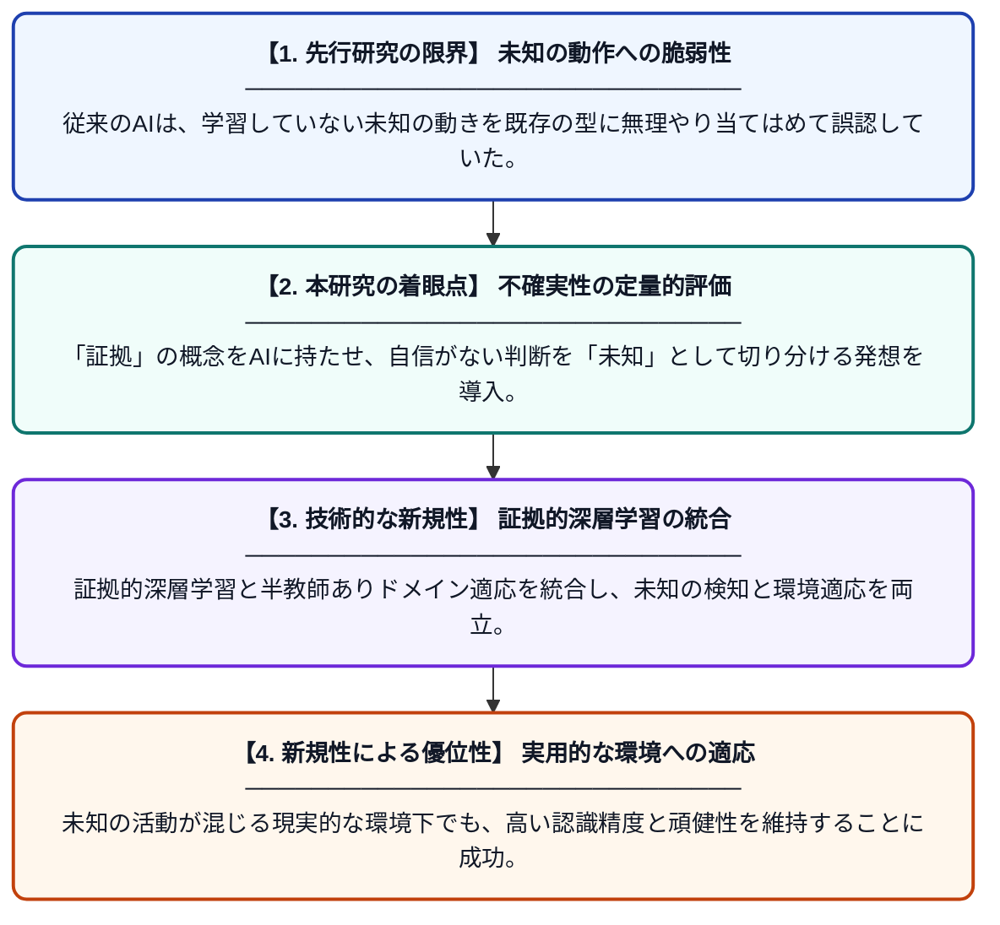

# 半教師ありドメイン適応を用いたオープンセットWi-Fi人間活動認識のための証拠的深層学習

**Original Title**: *Evidential Deep Learning for Open-Set Wi-Fi-Based Human Activity Recognition With Semi-Supervised Domain Adaptation*

> **💡 一言要約**: Wi-Fiで未知の動きを見抜き、新環境に即座に適応！

| 項目 | 内容 |
|---|---|
| **著者** | Y Li, D Chieng, BG Lee, CF Kwong, M You |
| **掲載誌** | IEEE Transactions on Mobile Computing 2026 |
| **アラートキーワード** | Semi supervise |
| **PDF** | [https://ieeexplore.ieee.org/iel8/7755/4358975/11804675.pdf](https://ieeexplore.ieee.org/iel8/7755/4358975/11804675.pdf) |
| **原文リンク** | [https://ieeexplore.ieee.org/iel8/7755/4358975/11804675.pdf](https://ieeexplore.ieee.org/iel8/7755/4358975/11804675.pdf) |
| **PDF版要約** | [README.pdf](./README.pdf) |

---

## 📊 新規性の図解（先行研究との違いと本研究のブレークスルー）

## 📝 要約

Wi-Fi信号を用いた活動認識において、未知の動作を検知しつつ、異なる環境への適応を可能にする新しい深層学習モデルを提案しています。証拠的深層学習（EDL）と半教師あり学習を組み合わせることで、ラベルのないデータからも学習し、高い認識精度を実現しました。

## ❓ どんな問題に取り組んだか

従来のWi-Fi活動認識は学習済みの動作のみを前提としており、未知の動作を既存のカテゴリに誤認する課題がありました。また、環境が変わると認識精度が著しく低下するため、新しい場所への導入には膨大な再学習データが必要でした。

## ✨ 何が新しい？何がすごい？（新規性）

証拠的深層学習（EDL）を導入することで、モデルが自身の判断に対する「確信度」を定量化し、未知の動作を効果的に排除できる点が画期的です。さらに、半教師ありドメイン適応を組み合わせ、少量のラベル付きデータと大量のラベルなしデータから環境差を補正する仕組みを構築しました。これにより、未知クラスの拒絶と環境適応を同時に、かつ高精度に達成しています。

## 🎓 大学1年生向けの解説

Wi-Fiの電波は人が動くと形がわずかに変化します。この研究は、その変化をAIで分析して「歩いている」などを当てる技術をより使いやすくしたものです。これまではAIが知らない動きを見ると無理やり知っている動きに分類していましたが、この技術は「これは知らない動きだ」と正直に判断できます。また、部屋が変わっても少しのデータで賢くなれるため、色々な場所ですぐに使えるようになります。
