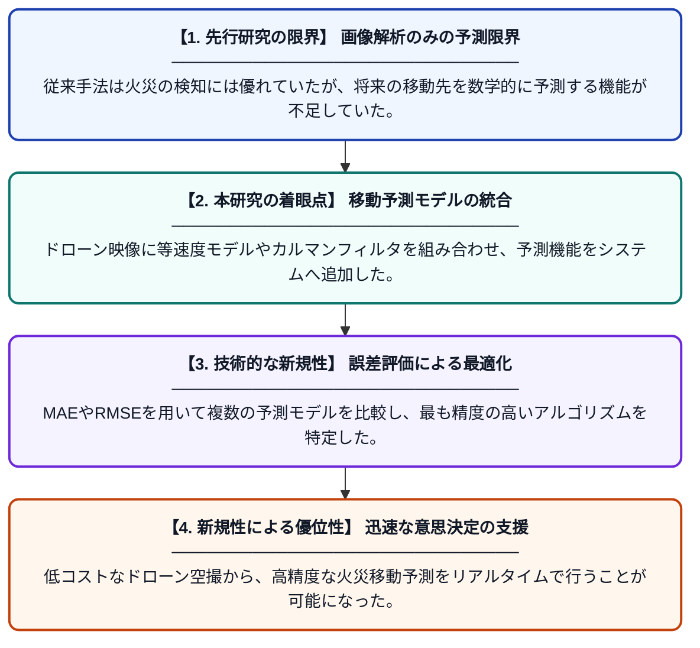

# Enhanced PyroScan: ドローンを活用した山火事移動予測システムの高度化

**Original Title**: *Enhanced PyroScan: A UAV-Based Wildfire Movement Prediction System*

> **💡 一言要約**: ドローンとAIで山火事の進む先を精密に予測する

| 項目 | 内容 |
|---|---|
| **著者** | SR Singireddy, IK Dutta, B Ghosh |
| **掲載誌** | IEEE 17th Annual Ubiquitous Computing … 2026 |
| **アラートキーワード** | kalman filter |
| **原文リンク** | [https://ieeexplore.ieee.org/abstract/document/11775519/](https://ieeexplore.ieee.org/abstract/document/11775519/) |
| **PDF版要約** | [README.pdf](./README.pdf) |

---

## 📊 新規性の図解（先行研究との違いと本研究のブレークスルー）

## 📝 要約

ドローン（UAV）を用いて山火事の広がりをリアルタイムで追跡し、将来の移動を予測するシステム「Enhanced PyroScan」を提案した論文です。等速度モデルとカルマンフィルタを用いた予測精度を比較評価し、火災の挙動をより正確に把握する手法を確立しました。

## ❓ どんな問題に取り組んだか

山火事は拡大速度が非常に速く、消防活動を適切に行うには火の動きをリアルタイムで正確に予測する必要があります。しかし、従来の画像解析ベースの手法だけでは、複雑に変化する火災の進路を高精度に予測し続けることが難しいという課題がありました。

## ✨ 何が新しい？何がすごい？（新規性）

従来の画像ベースの分析フレームワーク「PyroScan」に、高度な移動予測モデルを統合した点が最大の特徴です。等速度モデルとカルマンフィルタを導入し、平均絶対誤差（MAE）や二乗平均平方根誤差（RMSE）を用いて予測精度を定量的に比較評価しました。これにより、ドローンからの限られた情報からでも、火災の将来的な位置をより高精度かつ効率的に算出することが可能になりました。

## 🎓 大学1年生向けの解説

山火事が起きたとき、火が次にどこへ燃え広がるかを予測するのはとても難しい問題です。この研究では、ドローンを空に飛ばして撮影した映像から、AIのような計算手法を使って「火の進むスピードと方向」を割り出すシステムを開発しました。過去の動きから未来を予測する「カルマンフィルタ」という数学的なモデルを活用することで、予測のズレを最小限に抑えています。これによって、消防隊員が安全に、かつ効率的に火を消し止めるための手助けができるようになります。
