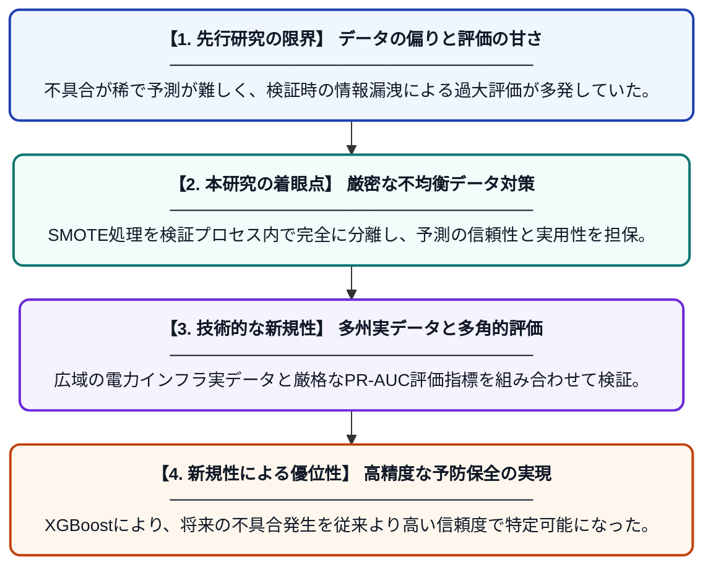

# 33kV配電用開閉器における次サイクル故障発生の予測：複数州の公益事業データを用いた機械学習ベンチマーク

**Original Title**: *Predicting Next-Cycle Recorded Defect Occurrence in 33 kV Distribution Switchgear: A Machine Learning Benchmark Using Multi-State Utility Data*

> **💡 一言要約**: 電力設備の故障をAIで先回り予測

| 項目 | 内容 |
|---|---|
| **著者** | NRM Nasir, W Maioute, MA Mahmoud, AA Bakar… |
| **掲載誌** | IEEE International … 2026 |
| **アラートキーワード** | SMOTE |
| **原文リンク** | [https://ieeexplore.ieee.org/abstract/document/11792783/](https://ieeexplore.ieee.org/abstract/document/11792783/) |
| **PDF版要約** | [README.pdf](./README.pdf) |

---

## 📊 新規性の図解（先行研究との違いと本研究のブレークスルー）

## 📝 要約

33kV配電設備のスイッチギアにおける将来の不具合発生を予測するため、複数の地域の電力データを用いた機械学習モデルの比較検証を行いました。不均衡データの課題に対し、SMOTEやクラス重み付けを適切に適用し、情報の漏洩を防ぎつつ高精度な予測を実現しています。

## ❓ どんな問題に取り組んだか

配電設備のメンテナンスにおいて、不具合の発生は非常に稀であるため、機械学習で予測しようとするとデータが極端に偏る「クラス不均衡」が問題となります。また、不適切なデータ処理により、予測モデルが学習時に評価データの内容を知ってしまう「情報漏洩」が発生しやすく、信頼性の高い評価が困難でした。

## ✨ 何が新しい？何がすごい？（新規性）

複数州にわたる広範な実データを活用し、不均衡データ対策としてSMOTE（データ増幅手法）を交差検証の内部で独立して適用することで、評価の厳密性を確保した点が画期的です。さらに、XGBoostなどの複数のアルゴリズムをベンチマーク比較し、適合率-再現率曲線下面積（PR-AUC）を指標に、不具合予測における実用的な最適モデルを特定しました。

## 🎓 大学1年生向けの解説

電柱の近くなどにある、電気の流れを切り替える装置（スイッチギア）が次にいつ壊れるかをAIで予想する研究です。装置が壊れることはめったにないため、AIに学習させるためのデータが足りないという課題がありましたが、数学的な工夫でデータを補い、正確に予想できるようにしました。これが実用化されれば、停電が起きる前に修理ができるようになり、私たちの生活がより安全になります。
