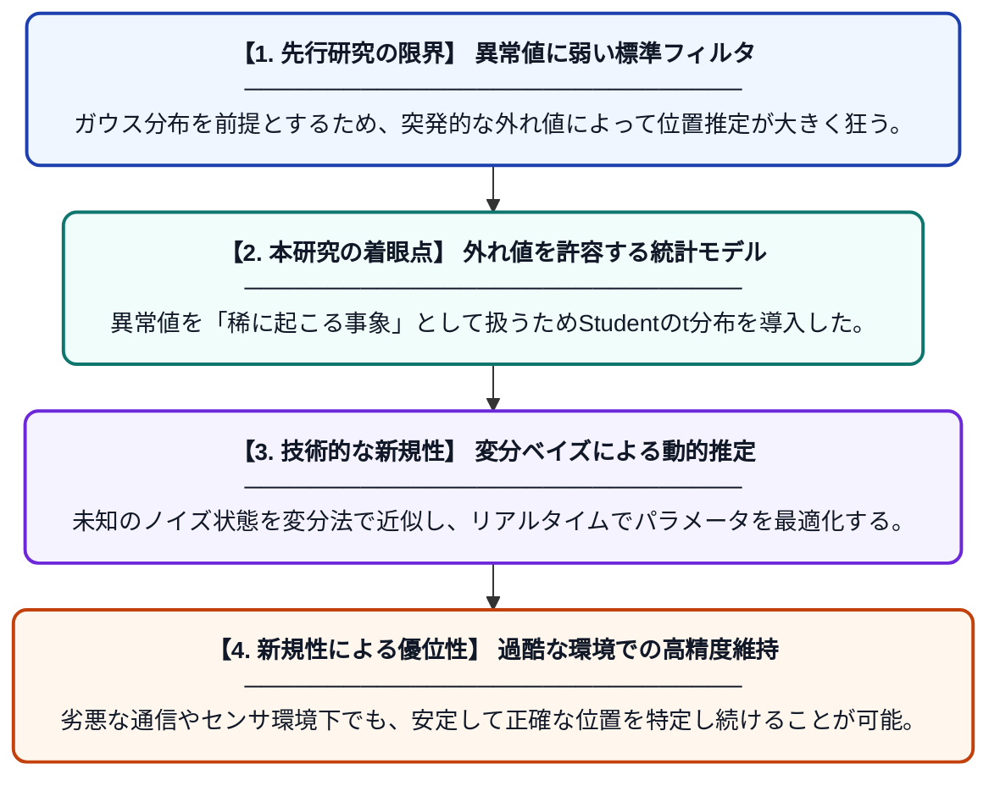

# 変分ベイズ容積カルマンフィルタに基づく自動運転センサネットワークの堅牢なナビゲーション

**Original Title**: *Robust navigation for autonomous driving sensor networks based on variational Bayesian cubature Kalman filter*

> **💡 一言要約**: 異常ノイズに強く、走りながら学習する自動運転技術

| 項目 | 内容 |
|---|---|
| **著者** | Y Wang |
| **掲載誌** | International Journal of Sensor Networks 2026 |
| **アラートキーワード** | kalman filter |
| **原文リンク** | [https://www.inderscienceonline.com/doi/abs/10.1504/IJSNET.2026.157552](https://www.inderscienceonline.com/doi/abs/10.1504/IJSNET.2026.157552) |
| **PDF版要約** | [README.pdf](./README.pdf) |

---

## 📊 新規性の図解（先行研究との違いと本研究のブレークスルー）

## 📝 要約

自動運転のセンサネットワークにおいて、突発的なノイズや外れ値の影響を抑える堅牢な自己位置推定手法を提案しています。Studentのt分布を用いてノイズをモデル化し、変分ベイズ法によって走行中にノイズ特性をリアルタイムで推定することで、高精度なナビゲーションを実現しました。

## ❓ どんな問題に取り組んだか

自動運転車のセンサは、環境の変化や故障によって「外れ値（異常なデータ）」を出すことがあり、これが位置推定の精度を大きく低下させます。従来のカルマンフィルタはガウス分布を前提としているため、こうした極端なノイズ（重い裾を持つノイズ）に弱く、実環境での信頼性に課題がありました。

## ✨ 何が新しい？何がすごい？（新規性）

本研究は、外れ値を統計的に許容できるStudentのt分布と容積カルマンフィルタ（CKF）を統合し、さらに変分ベイズ法を採用した点が画期的です。先行研究ではノイズの性質を事前に決める必要がありましたが、本手法は走行中に未知のノイズパラメータを逐次推定し、適応的に補正することができます。これにより、非線形性が強く予測困難な環境下でも、従来手法を凌駕するロバスト性を実現しました。

## 🎓 大学1年生向けの解説

自動運転車が自分の場所を知るにはセンサが必要ですが、雨や建物の反射でセンサが「嘘のデータ」を返すことがあります。この論文では、その「嘘」に騙されないための数学的な工夫を開発しました。Studentのt分布という道具を使って珍しい間違いをあらかじめ想定し、計算方法を工夫することで、走りながら賢くノイズを処理できるようにしています。その結果、どんなに厳しい環境でも車が迷子にならない仕組みが出来上がりました。
