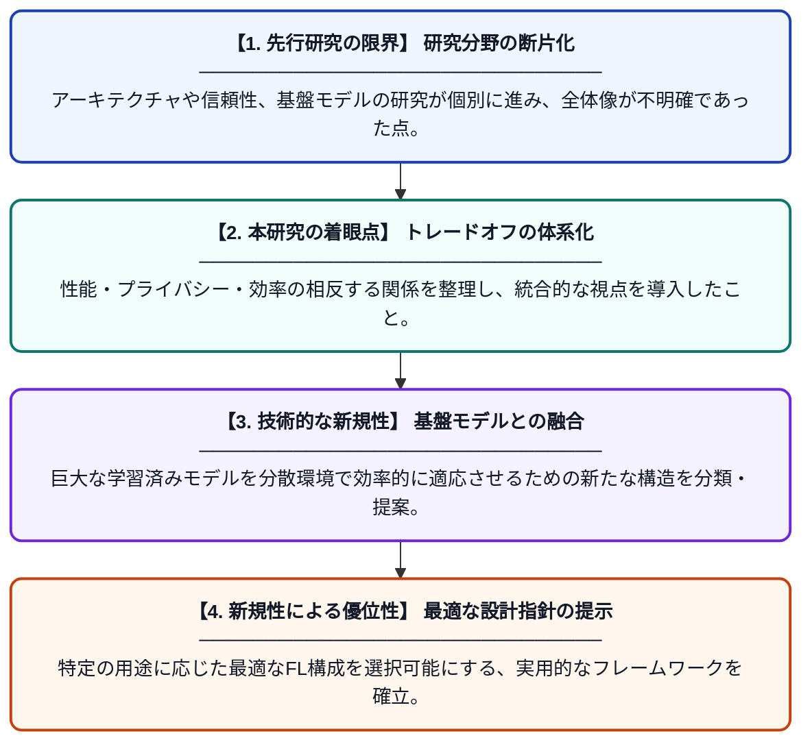

# フェデレーション学習のトレードオフ：アーキテクチャ、信頼、基盤モデルの批判的統合

**Original Title**: *The Trade-off Landscape of Federated Learning: A Critical Synthesis of Architectures, Trust, and Foundation Models*

> **💡 一言要約**: FLの進化とトレードオフを解き明かす包括的ガイド

| 項目 | 内容 |
|---|---|
| **著者** | I Ahammad, MA Hossain |
| **掲載誌** | e-Prime–Nexus of Electrical, Electronic, and Intelligent … 2026 |
| **アラートキーワード** | Federated Learning |
| **原文リンク** | [https://www.sciencedirect.com/science/article/pii/S3117511226001041](https://www.sciencedirect.com/science/article/pii/S3117511226001041) |
| **PDF版要約** | [README.pdf](./README.pdf) |

---

## 📊 新規性の図解（先行研究との違いと本研究のブレークスルー）

## 📝 要約

分散されたデータでモデルを学習するフェデレーション学習（FL）における、アーキテクチャ、信頼性、基盤モデルの最新動向を包括的に分析した論文です。プライバシー保護とモデル精度のトレードオフを整理し、断片化された研究分野を統合するフレームワークを提示しています。

## ❓ どんな問題に取り組んだか

フェデレーション学習はプライバシーや規制遵守の観点から注目されていますが、研究がアーキテクチャや信頼性、基盤モデルの統合といった各分野で断片化しています。また、セキュリティの確保と学習効率の維持という相反する要求をどのように最適化するかが大きな課題となっています。

## ✨ 何が新しい？何がすごい？（新規性）

本研究の新規性は、最新の「基盤モデル（Foundation Models）」とフェデレーション学習の融合に焦点を当て、その相互作用を体系的に分類した点にあります。単なる手法の紹介に留まらず、信頼性、通信効率、プライバシーの3軸におけるトレードオフを明確化する新しい統合的フレームワークを提案しました。これにより、複雑なFLエコシステムの全体像を理解するための道筋を示しています。

## 🎓 大学1年生向けの解説

「フェデレーション学習」とは、個人のデータを手元に置いたまま、みんなで協力して一つの賢いAIを作る技術です。この論文は、その技術をさらに進化させるために、どうやって「安全さ」と「賢さ」を両立させるかを詳しくまとめています。特に、ChatGPTのような巨大なAIをこの仕組みにどう取り入れるかを解説しており、プライバシーを守りながら便利なAIを作るための「設計図」のような役割を果たします。
