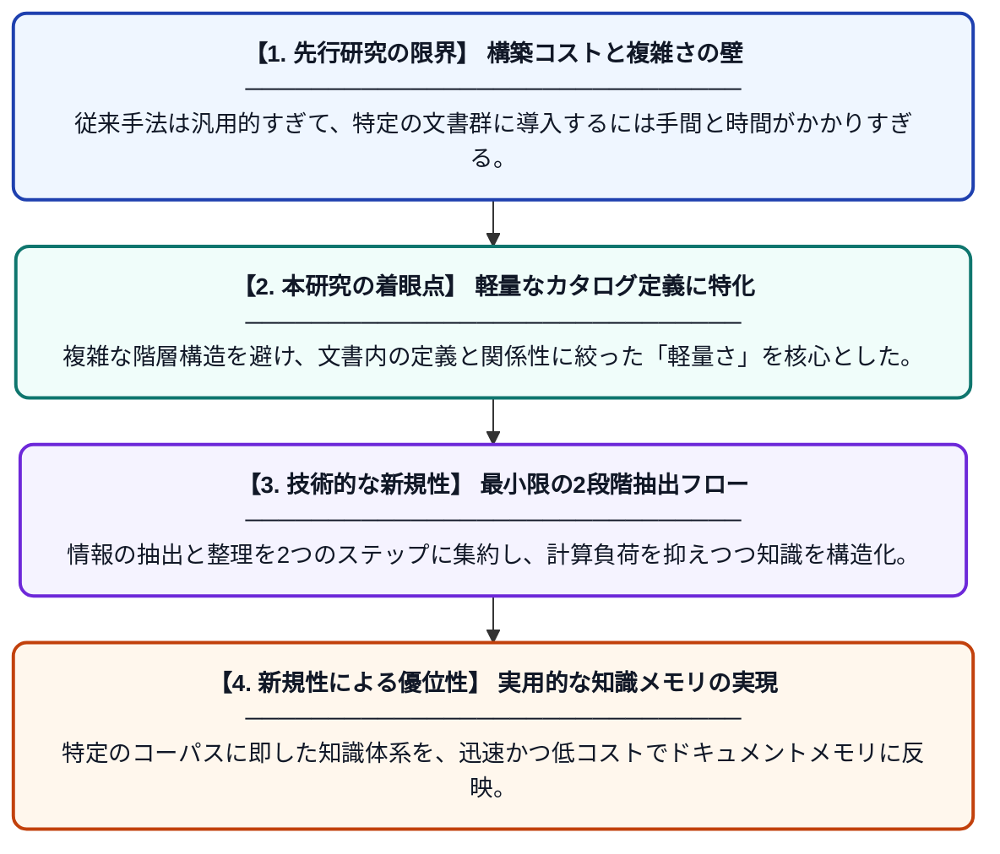

# Hivemind: ドキュメントメモリにおけるコーパス特化型軽量オントロジー構築のための最小2段階プロトコル

**Original Title**: *Hivemind: A Minimal Two-Stage Protocol for Corpus-Specific Lightweight Ontology Induction in Document Memory*

> **💡 一言要約**: 2段階で文書から実用的な知識構造を自動抽出

| 項目 | 内容 |
|---|---|
| **著者** | C Lesur, G Lesur |
| **掲載誌** | 2026 |
| **アラートキーワード** | Ontology |
| **PDF** | [https://lesur.ai/research/papers/hivemind-lightweight-ontology.pdf](https://lesur.ai/research/papers/hivemind-lightweight-ontology.pdf) |
| **原文リンク** | [https://lesur.ai/research/papers/hivemind-lightweight-ontology.pdf](https://lesur.ai/research/papers/hivemind-lightweight-ontology.pdf) |
| **PDF版要約** | [README.pdf](./README.pdf) |

---

## 📊 新規性の図解（先行研究との違いと本研究のブレークスルー）

## 📝 要約

特定の文書群（コーパス）からエンティティや関係性の定義を抽出する、軽量で効率的なオントロジー構築手法「Hivemind」を提案しています。最小限の2段階プロセスを採用することで、ドキュメントメモリに適した実用的な知識カタログを迅速に生成します。

## ❓ どんな問題に取り組んだか

従来のオントロジー構築手法は、広範な知識体系を対象とするため複雑で、特定の文書群に特化した実用的な定義を迅速に得ることが困難でした。また、既存のオントロジー工学は、特定のドキュメント管理や検索タスクに導入するには仕組みが重すぎるという課題がありました。

## ✨ 何が新しい？何がすごい？（新規性）

本研究は「最小2段階プロトコル」を採用し、テキスト定義を持つフラットなエンティティと関係のカタログ作成に特化することで、処理の圧倒的な軽量化を実現しました。従来の広範なオントロジー学習とは異なり、特定のコーパス（文書集合）に最適化された定義を抽出することに注力しています。この特化型アプローチにより、ドキュメントメモリやRAG（検索拡張生成）への統合が非常に容易になる点が主要な貢献です。

## 🎓 大学1年生向けの解説

たくさんの文章の中から、そこで使われている重要な「言葉」と「言葉同士のつながり」を見つけ出し、辞書のようなリストを自動で作る技術についての研究です。これまでは専門家が長い時間をかけて作っていましたが、この「Hivemind」という方法なら、たった2つのステップで簡単に作ることができます。これを使うと、AIが大量の書類の内容を整理したり、必要な情報を探し出したりするのがずっと得意になります。
