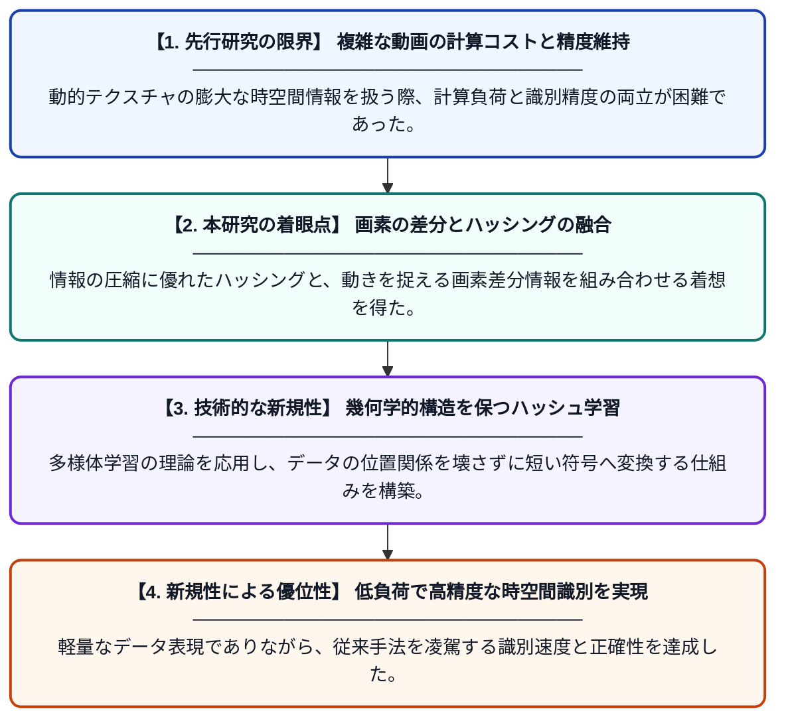

# 画素差分ハッシングによる動的テクスチャ認識のための時空間表現学習

**Original Title**: *Spatiotemporal Representation Learning via Pixel-Difference Hashing for Dynamic Texture Recognition*

> **💡 一言要約**: 画素の差から動きの「質感」を高速・高精度に抽出

| 項目 | 内容 |
|---|---|
| **著者** | D Ruxin |
| **アラートキーワード** | manifold learning |
| **PDF** | [https://unnc.globalimpact.cn/files/2206707375/RuxinDING-20416129-thesis.pdf](https://unnc.globalimpact.cn/files/2206707375/RuxinDING-20416129-thesis.pdf) |
| **原文リンク** | [https://unnc.globalimpact.cn/files/2206707375/RuxinDING-20416129-thesis.pdf](https://unnc.globalimpact.cn/files/2206707375/RuxinDING-20416129-thesis.pdf) |
| **PDF版要約** | [README.pdf](./README.pdf) |

---

## 📊 新規性の図解（先行研究との違いと本研究のブレークスルー）

## 📝 要約

動的テクスチャ認識において、画素間の差分情報を利用したハッシング手法を導入し、効率的かつ頑健な時空間表現を学習する手法を提案しています。多様体学習やグラフベースのハッシングの考え方を深層学習に統合し、計算コストを抑えつつ高い識別性能を実現しました。

## ❓ どんな問題に取り組んだか

煙や水流のような動的テクスチャは複雑な時間変化を伴うため、その特徴を効率的に捉えることが困難です。従来の多様体学習やグラフベースの手法は表現力が高い一方で、大規模データに対する計算コストや、複雑な時空間データの次元削減における精度の維持に課題がありました。

## ✨ 何が新しい？何がすごい？（新規性）

画素差分に基づくハッシングを導入し、時空間的な近傍関係を保存しながら高効率なバイナリコードを生成する点が独創的です。Anchor Graph Hashingなどの多様体学習の概念を深層学習に組み込み、データの幾何学的構造を維持しつつ次元圧縮を行っています。これにより、従来手法よりも計算負荷を大幅に低減しながら、動的テクスチャの微細な変化を正確に識別することに成功しました。

## 🎓 大学1年生向けの解説

この研究は、ビデオの中にある「水や煙のような動く模様」を、コンピュータに賢く認識させる方法についてのものです。隣り合った画素の明るさの「差」に注目し、それを短いデジタル符号（ハッシュ値）に変換することで、情報の重要度を保ったままデータを軽量化します。まるで、複雑な動画を「特徴を凝縮した短い合い言葉」に変換するような技術です。これにより、コンピュータが高速かつ正確に動く模様を区別できるようになります。
