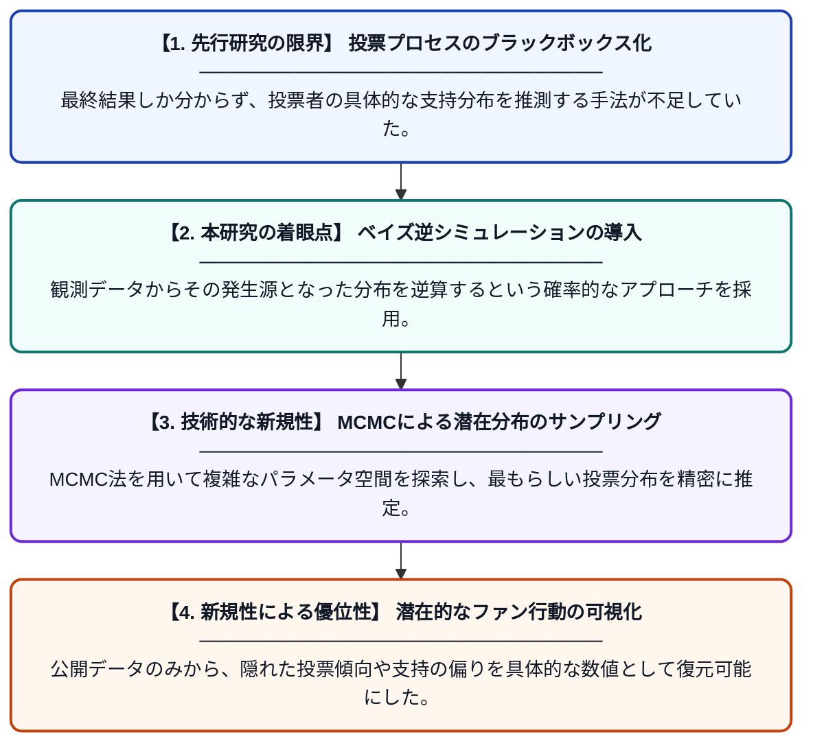

# ベイズMCMC推論を用いたダンス競技における潜在的なファン投票分布の復元

**Original Title**: *Reconstruction of latent fan vote distributions in dance competitions via Bayesian MCMC inference*

> **💡 一言要約**: 統計学でダンス投票の「裏側」を読み解く

| 項目 | 内容 |
|---|---|
| **著者** | Y Meng |
| **掲載誌** | … Conference on Algorithms, Image Processing, and … 2026 |
| **アラートキーワード** | MCMC |
| **原文リンク** | [https://www.spiedigitallibrary.org/conference-proceedings-of-spie/14504/145042A/Reconstruction-of-latent-fan-vote-distributions-in-dance-competitions-via/10.1117/12.3129753.short](https://www.spiedigitallibrary.org/conference-proceedings-of-spie/14504/145042A/Reconstruction-of-latent-fan-vote-distributions-in-dance-competitions-via/10.1117/12.3129753.short) |
| **PDF版要約** | [README.pdf](./README.pdf) |

---

## 📊 新規性の図解（先行研究との違いと本研究のブレークスルー）

## 📝 要約

ダンス競技における不透明な投票プロセスを解明するため、ベイズ統計学とMCMC（マルコフ連鎖モンテカルロ法）を用いた逆シミュレーション枠組みを提案しています。これにより、最終結果から逆算して、観測不可能なファンの支持傾向や投票分布を精度高く復元することが可能になりました。

## ❓ どんな問題に取り組んだか

ダンス競技では最終的な順位や得点のみが公表されることが多く、投票者が実際にどのような分布で支持を表明していたかという詳細は隠されています。これまでの分析手法では、このような複雑で潜在的な投票行動を正確にモデル化し、背後にあるファンの嗜好を捉えることが困難でした。

## ✨ 何が新しい？何がすごい？（新規性）

本研究は、ダンス競技の投票分析にベイズ逆シミュレーションとMCMCサンプリングを導入した点に大きな新規性があります。従来の統計手法では扱いきれなかった複雑な投票プロセスを確率的な分布として再構築し、個別の投票データがなくても集計データから「ファンの熱量の偏り」を特定できる仕組みを構築したことが主要な貢献です。

## 🎓 大学1年生向けの解説

ダンス大会の順位表だけを見ても、「一部の熱狂的なファンが押し上げたのか」それとも「全員が平均的に良いと評価したのか」という投票の内訳は分かりません。この研究では、数学的なシミュレーションを使って、隠された投票のバランスを逆算して導き出す方法を開発しました。これを使うことで、大会の結果からファンの隠れた心理や応援の傾向を詳しく分析できるようになります。
