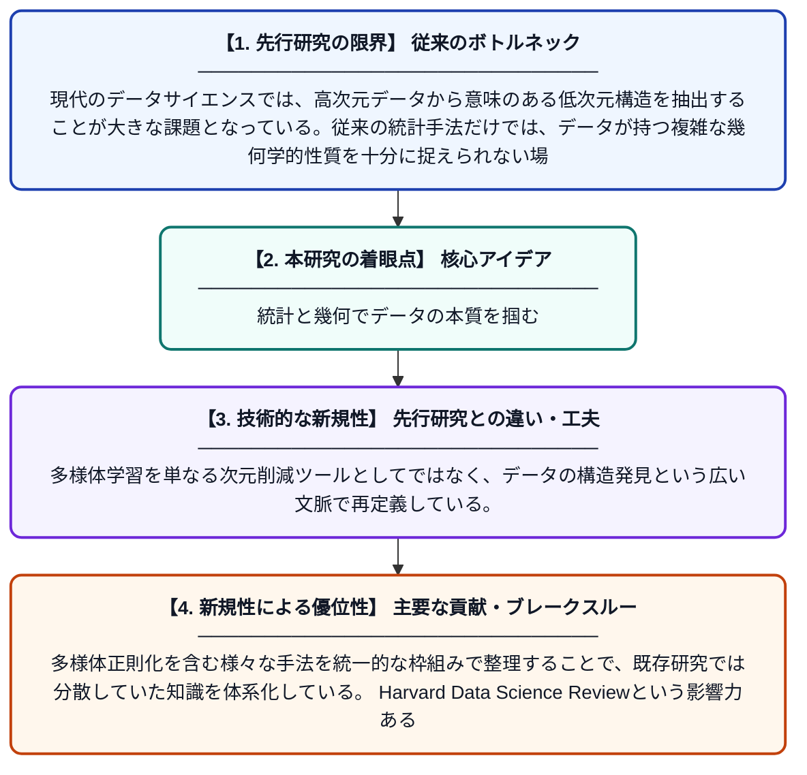

# データサイエンスの形成：統計学と幾何学

**Original Title**: *Shaping data science: Statistics and geometry*

> **💡 一言要約**: 統計と幾何でデータの本質を掴む

| 項目 | 内容 |
|---|---|
| **著者** | Z Yao, J Zhang |
| **掲載誌** | Harvard Data Science Review 2026 |
| **アラートキーワード** | manifold learning |
| **PDF** | [https://assets.pubpub.org/c99608f92-d70f-46c1-a72c-df272215f13e/p63b65052-759a-473f-917b-b9dee8e5c99b/exports/a30ef05c2d102c9f.pdf](https://assets.pubpub.org/c99608f92-d70f-46c1-a72c-df272215f13e/p63b65052-759a-473f-917b-b9dee8e5c99b/exports/a30ef05c2d102c9f.pdf) |
| **原文リンク** | [https://assets.pubpub.org/c99608f92-d70f-46c1-a72c-df272215f13e/p63b65052-759a-473f-917b-b9dee8e5c99b/exports/a30ef05c2d102c9f.pdf](https://assets.pubpub.org/c99608f92-d70f-46c1-a72c-df272215f13e/p63b65052-759a-473f-917b-b9dee8e5c99b/exports/a30ef05c2d102c9f.pdf) |
| **PDF版要約** | [README.pdf](./README.pdf) |

---

## 📊 新規性の図解（先行研究との違いと本研究のブレークスルー）

## 📝 要約

本論文は、データサイエンスにおける統計学と幾何学の交差点を探求し、特に多様体学習や次元削減の手法に焦点を当てている。データの低次元構造を発見・表現するための方法論を体系的に整理し、多様体正則化などの技術的アプローチを包括的に論じている。統計と幾何の融合がどのようにデータ分析の新たな地平を開くかを示す理論的・実践的な考察を提供する。

## ❓ どんな問題に取り組んだか

現代のデータサイエンスでは、高次元データから意味のある低次元構造を抽出することが大きな課題となっている。従来の統計手法だけでは、データが持つ複雑な幾何学的性質を十分に捉えられない場合がある。統計学と幾何学をいかに統合的に扱うかという理論的・方法論的枠組みが求められていた。

## ✨ 何が新しい？何がすごい？（新規性）

本研究は、統計学と幾何学という異なる分野の知見を統合する包括的な視点を提供している点が新しい。多様体学習を単なる次元削減ツールとしてではなく、データの構造発見という広い文脈で再定義している。多様体正則化を含む様々な手法を統一的な枠組みで整理することで、既存研究では分散していた知識を体系化している。Harvard Data Science Reviewという影響力ある媒体に掲載されており、分野横断的な議論をリードする役割を担っている。

## 🎓 大学1年生向けの解説

たとえば地球の表面は丸い球体ですが、地図として平面に広げて表現できますよね。このように複雑な形をしたデータも、うまく「平らに広げる」ことで理解しやすくなります。この論文は、そうした「データの形を理解する幾何学」と「データのパターンを分析する統計学」を組み合わせる方法を研究しています。たくさんの特徴量を持つ複雑なデータでも、実は少ない情報でうまく表現できることが多く、その本質的な構造を見つけ出すための理論的な枠組みを提供しています。
