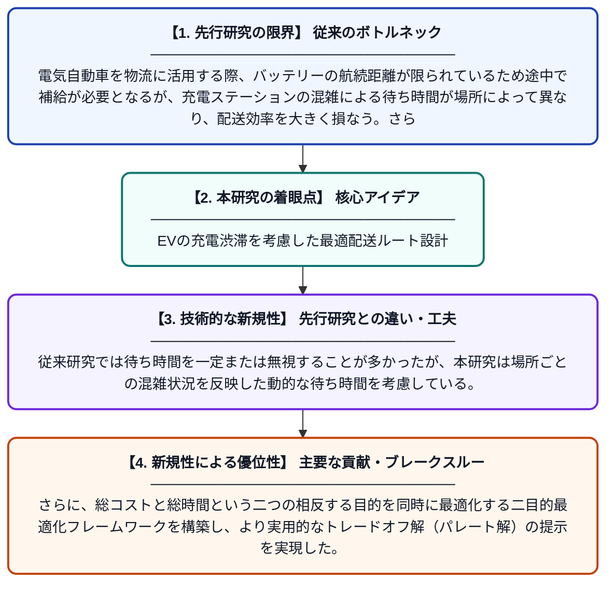

# 充電・バッテリー交換の補給方式と場所依存の待ち時間を考慮した電気自動車の二目的ルーティング

**Original Title**: *Bi-objective electric vehicle routing with charging–swapping replenishment and location-dependent waiting time*

> **💡 一言要約**: EVの充電渋滞を考慮した最適配送ルート設計

| 項目 | 内容 |
|---|---|
| **著者** | X Zhang, J Zhang, T Chen |
| **掲載誌** | Transportation Research Part E: Logistics and Transportation Review 2026 |
| **アラートキーワード** | VRP |
| **原文リンク** | [https://www.sciencedirect.com/science/article/pii/S1366554526004448](https://www.sciencedirect.com/science/article/pii/S1366554526004448) |
| **PDF版要約** | [README.pdf](./README.pdf) |

---

## 📊 新規性の図解（先行研究との違いと本研究のブレークスルー）

## 📝 要約

本論文は、物流配送における電気自動車（EV）の限られた航続距離、ステーションの混雑、および複数の補給オプション（充電・バッテリー交換）を同時に考慮した二目的ルーティング問題を研究している。ステーションごとに異なる待ち時間をモデル化し、コストと時間の両方を最適化する手法を提案している。実験により、提案手法が現実的な物流シナリオで有効であることを示している。

## ❓ どんな問題に取り組んだか

電気自動車を物流に活用する際、バッテリーの航続距離が限られているため途中で補給が必要となるが、充電ステーションの混雑による待ち時間が場所によって異なり、配送効率を大きく損なう。さらに、充電とバッテリー交換という複数の補給手段をどのように使い分けるかという意思決定も複雑であり、コストと時間を同時に最小化する最適ルートの設計が困難であった。

## ✨ 何が新しい？何がすごい？（新規性）

本研究の最大の新規性は、充電とバッテリー交換の両方の補給オプションを統合しつつ、ステーションの立地に依存した現実的な待ち時間をルーティングモデルに組み込んだ点にある。従来研究では待ち時間を一定または無視することが多かったが、本研究は場所ごとの混雑状況を反映した動的な待ち時間を考慮している。さらに、総コストと総時間という二つの相反する目的を同時に最適化する二目的最適化フレームワークを構築し、より実用的なトレードオフ解（パレート解）の提示を実現した。

## 🎓 大学1年生向けの解説

宅配便の配達にトラックの代わりに電気自動車を使うと、途中でバッテリーを補給しなければなりません。補給には「充電（時間がかかる）」と「バッテリー丸ごと交換（素早いが高い）」の2種類があります。また、充電スタンドが混んでいると待ち時間が長くなり、場所によってその時間は違います。この研究では、「お金をなるべくかけない」と「時間をなるべく短くする」という2つの目標を同時に満たす最善の配達ルートを計算する方法を考えました。現実の物流現場でEVを効率よく使えるようにするための重要な研究です。
