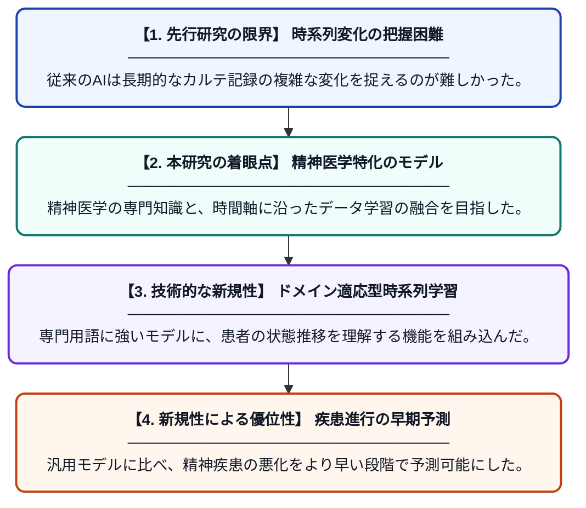

# PsychBERT II：電子健康記録を用いた精神疾患進行の早期予測のためのドメイン適応型時系列表現学習

**Original Title**: *PsychBERT II: Domain-Adaptive Longitudinal Representation Learning for Early Prediction of Psychiatric Disease Progression from e-Health Records*

> **💡 一言要約**: AIで精神疾患の進行を早期に見抜く

| 項目 | 内容 |
|---|---|
| **著者** | AK Bhasker, A Singh, G Chandra, I Alsolbi, S Prakash… |
| **掲載誌** | 1st International … 2026 |
| **アラートキーワード** | representation learning |
| **原文リンク** | [https://ieeexplore.ieee.org/abstract/document/11780080/](https://ieeexplore.ieee.org/abstract/document/11780080/) |
| **PDF版要約** | [README.pdf](./README.pdf) |

---

## 📊 新規性の図解（先行研究との違いと本研究のブレークスルー）

## 📝 要約

電子健康記録（EHR）の長期的な臨床データを解析し、精神疾患の進行を早期に予測するAIモデル「PsychBERT II」を提案した研究です。精神医学分野に特化したドメイン適応と時系列的な表現学習を組み合わせることで、複雑な患者データの変化を高精度に捉えることに成功しました。

## ❓ どんな問題に取り組んだか

精神疾患は経過が複雑で予測が難しく、従来のEHR解析手法では長期的な臨床データの変化を十分にモデル化できていませんでした。また、一般的な医療AIモデルでは、精神医学特有の専門的な語彙や文脈を正確に理解しきれないという課題がありました。

## ✨ 何が新しい？何がすごい？（新規性）

精神医学に特化した事前学習モデルに、患者の健康状態の変化を時間軸に沿って学習する「縦断的（ロンジチュージナル）表現学習」を統合した点が最大の特徴です。ドメイン適応技術を導入することで、専門性の高いカルテ情報から疾患進行の兆候を抽出する能力を大幅に向上させました。これにより、先行研究と比較して精神疾患の悪化予測において高い精度と早期発見の可能性を実現しています。

## 🎓 大学1年生向けの解説

この研究は、病院のカルテ記録から「心の病気」が今後どうなっていくかをAIで予測する技術を作ったものです。これまでのAIは、長い期間の記録から微妙な変化を読み取るのが苦手でしたが、この新しいAIは時間の経過に合わせた変化を理解するのがとても得意です。さらに、精神医学の専門用語も勉強させているので、お医者さんのような視点でカルテを分析できます。これが実現すれば、病気がひどくなる前に適切な治療を始める手助けができるようになります。
