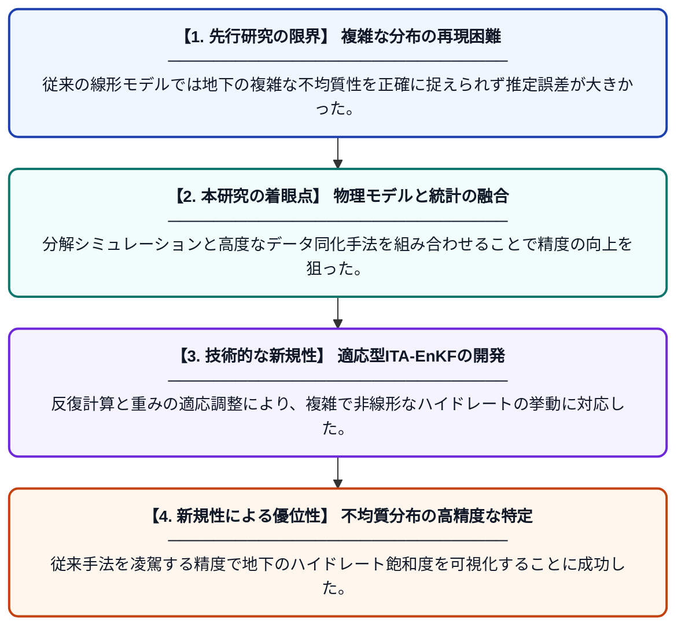

# アンサンブルカルマンフィルタを用いた不均質なハイドレート飽和度分布の逆解析に関する実現可能性研究

**Original Title**: *Feasibility study on the inversion of heterogeneous hydrate saturation distribution based on the ensemble Kalman filter algorithm*

> **💡 一言要約**: フィルタ技術で地下ハイドレートのムラを見抜く

| 項目 | 内容 |
|---|---|
| **著者** | YG Liu, XY Wang, J Hou, ZZ Sun, B Fang, YC Zhao… |
| **掲載誌** | Petroleum Science 2026 |
| **アラートキーワード** | kalman filter |
| **原文リンク** | [https://www.sciencedirect.com/science/article/pii/S1995822626007594](https://www.sciencedirect.com/science/article/pii/S1995822626007594) |
| **PDF版要約** | [README.pdf](./README.pdf) |

---

## 📊 新規性の図解（先行研究との違いと本研究のブレークスルー）

## 📝 要約

減圧法によるメタンハイドレート分解の物理シミュレーションに、改良されたデータ同化手法である反復テンパリング適応型アンサンブルカルマンフィルタ（ITA-EnKF）を統合しました。この手法により、地下に不均質に存在するハイドレートの初期飽和度分布を、観測データから高精度に推定することが可能になります。

## ❓ どんな問題に取り組んだか

メタンハイドレートは地下に均一ではなく「ムラ」を持って存在しており、効率的なエネルギー開発にはその分布を正確に知る必要があります。しかし、限られた生産データから地下深部の複雑な飽和度分布を逆算して特定することは、技術的に極めて困難な課題でした。

## ✨ 何が新しい？何がすごい？（新規性）

本研究は、従来のアンサンブルカルマンフィルタに反復的な調整（テンパリング）と適応的な重み付けを加えた「ITA-EnKF」を開発した点が革新的です。ハイドレート分解という極めて非線形性の強い物理現象に対し、この新アルゴリズムを適用することで、パラメータ推定の収束性と精度を大幅に向上させました。これにより、従来の統計手法では捉えきれなかった不均質な地下構造を、観測値から論理的に再現できることを示しました。

## 🎓 大学1年生向けの解説

「燃える氷」として知られるメタンハイドレートは、海の下にどんな分布で埋まっているのか外からは分かりません。この研究は、ガスを取り出した時の圧力や温度の変化データから、逆算して「どこにどれくらいの氷があったのか」を当てるパズルのような計算手法を作りました。例えるなら、ストローでジュースを飲んだ時の感覚だけで、コップの中の氷がどこに何個あるかをピタリと言い当てるような技術です。これができるようになると、どこを掘れば効率よくエネルギーが取れるかが正確に予測できます。
