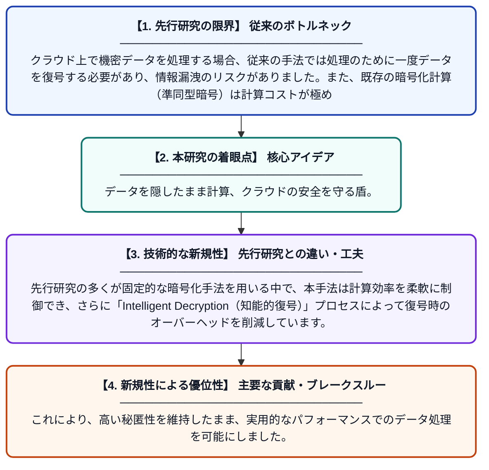

# HE-CloudShield: クラウドコンピューティングにおけるプライバシー保護データ処理のための適応型準同型暗号フレームワーク

**Original Title**: *HE-CloudShield: An Adaptive Homomorphic Encryption Framework for Privacy-Preserving Data Processing in Cloud Computing*

> **💡 一言要約**: データを隠したまま計算、クラウドの安全を守る盾。

| 項目 | 内容 |
|---|---|
| **著者** | R Perumal, C Maheswari, RL Priya, L GC, S Macherla |
| **掲載誌** | 7th International … 2026 |
| **アラートキーワード** | Secure Computing |
| **原文リンク** | [https://ieeexplore.ieee.org/abstract/document/11735981/](https://ieeexplore.ieee.org/abstract/document/11735981/) |
| **PDF版要約** | [README.pdf](./README.pdf) |

---

## 📊 新規性の図解（先行研究との違いと本研究のブレークスルー）

## 📝 要約

暗号化した状態のままで計算を可能にする「準同型暗号」を活用した、クラウド向けの新しいセキュリティ基盤「HE-CloudShield」を提案しています。平文を一切明かさずに安全なデータ処理を行い、効率的な復号プロセスを経て結果を取得できる仕組みを構築しました。

## ❓ どんな問題に取り組んだか

クラウド上で機密データを処理する場合、従来の手法では処理のために一度データを復号する必要があり、情報漏洩のリスクがありました。また、既存の暗号化計算（準同型暗号）は計算コストが極めて高く、実用的な速度での処理が困難でした。

## ✨ 何が新しい？何がすごい？（新規性）

本研究の新規性は、状況に応じて暗号化設定を最適化する「適応型」のフレームワークを導入した点にあります。先行研究の多くが固定的な暗号化手法を用いる中で、本手法は計算効率を柔軟に制御でき、さらに「Intelligent Decryption（知能的復号）」プロセスによって復号時のオーバーヘッドを削減しています。これにより、高い秘匿性を維持したまま、実用的なパフォーマンスでのデータ処理を可能にしました。

## 🎓 大学1年生向けの解説

インターネット上のサーバー（クラウド）で大切なデータを扱う際、中身を誰にも見られないようにしながら計算だけをしてもらう「準同型暗号」という魔法のような技術があります。この研究では、その魔法をより速く、より賢く使えるようにした「HE-CloudShield」という仕組みを開発しました。データを鍵のかかった箱に入れたまま一度も開けずに処理を行い、最後だけ効率的に中身を取り出せるようにすることで、プライバシーを完全に守りつつクラウドの便利さを享受できます。
