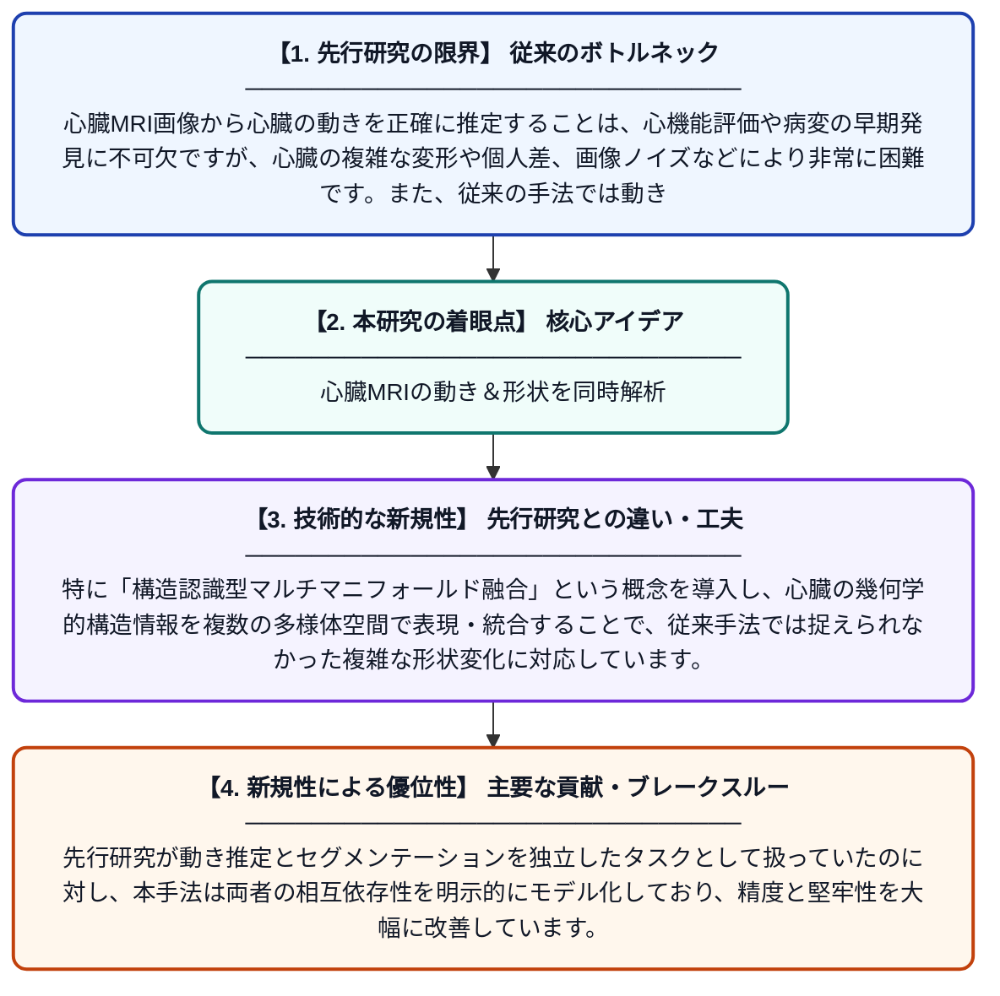

# 構造認識型マルチマニフォールド融合による心臓MR画像の動き推定とセグメンテーションの統合手法

**Original Title**: *Joint cardiac motion estimation and segmentation in MR images via structure-aware multi-manifold fusion*

> **💡 一言要約**: 心臓MRIの動き＆形状を同時解析

| 項目 | 内容 |
|---|---|
| **著者** | Q Zhao, X Wang |
| **掲載誌** | Pattern Recognition 2026 |
| **アラートキーワード** | manifold learning |
| **原文リンク** | [https://www.sciencedirect.com/science/article/pii/S003132032601527X](https://www.sciencedirect.com/science/article/pii/S003132032601527X) |
| **PDF版要約** | [README.pdf](./README.pdf) |

---

## 📊 新規性の図解（先行研究との違いと本研究のブレークスルー）

## 📝 要約

本論文は、心臓MRI画像における心臓の動き推定とセグメンテーション（領域分割）を同時に行う統合フレームワークを提案しています。構造認識型のマルチマニフォールド融合手法を用いることで、二つのタスクが互いに補完し合い、精度向上を実現します。これにより、心機能評価や病態モニタリングに有用な情報を高精度に抽出できます。

## ❓ どんな問題に取り組んだか

心臓MRI画像から心臓の動きを正確に推定することは、心機能評価や病変の早期発見に不可欠ですが、心臓の複雑な変形や個人差、画像ノイズなどにより非常に困難です。また、従来の手法では動き推定とセグメンテーションを別々に処理するため、各タスクが持つ相互補完的な情報を十分に活用できていませんでした。

## ✨ 何が新しい？何がすごい？（新規性）

本研究の最大の新規性は、心臓の動き推定とセグメンテーションを単一の統合フレームワークで同時に解くことで、両タスクが互いに性能を向上し合う仕組みを実現した点です。特に「構造認識型マルチマニフォールド融合」という概念を導入し、心臓の幾何学的構造情報を複数の多様体空間で表現・統合することで、従来手法では捉えられなかった複雑な形状変化に対応しています。先行研究が動き推定とセグメンテーションを独立したタスクとして扱っていたのに対し、本手法は両者の相互依存性を明示的にモデル化しており、精度と堅牢性を大幅に改善しています。

## 🎓 大学1年生向けの解説

心臓の動きをMRI（磁気共鳴画像）で正確に追跡することは、心臓病の診断にとても重要です。しかし心臓は複雑に動くため、コンピュータで自動的に分析するのは非常に難しいです。この研究では、「心臓がどう動いているか」と「心臓のどの部分がどこにあるか」という二つの問題を同時に解くAIを作りました。二つの問題を一緒に解くことで、それぞれの答えが互いにヒントになり、別々に解くよりも正確な結果が得られます。これにより、医師が心臓の状態をより正確に評価できるようになります。
