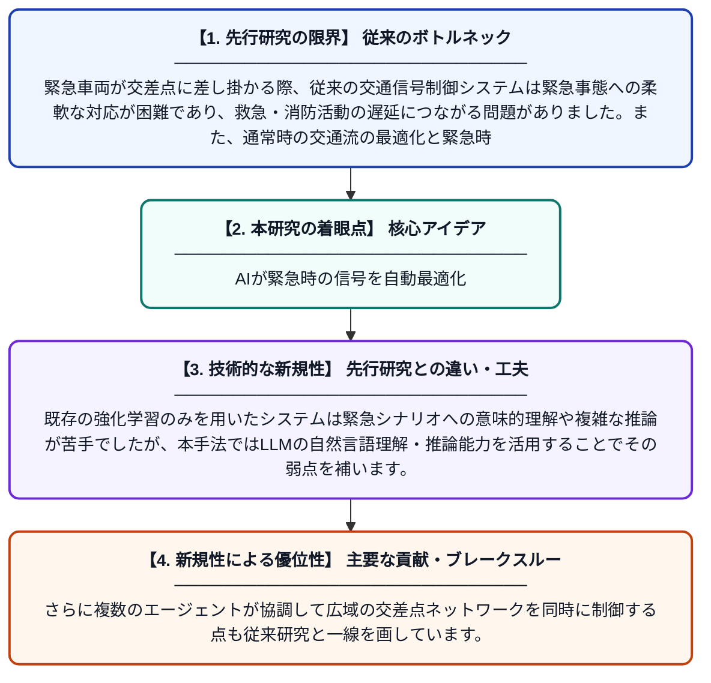

# TrafCopAgent: 強化学習とマルチエージェント協調を融合した適応型緊急交通制御

**Original Title**: *TrafCopAgent: synergizing reinforcement learning and multi-agent collaboration for adaptive emergency traffic control*

> **💡 一言要約**: AIが緊急時の信号を自動最適化

| 項目 | 内容 |
|---|---|
| **著者** | Y Fan |
| **掲載誌** | Scientific Reports 2026 |
| **アラートキーワード** | multi agent |
| **PDF** | [https://www.nature.com/articles/s41598-026-63349-7_reference.pdf](https://www.nature.com/articles/s41598-026-63349-7_reference.pdf) |
| **Git リポジトリ** | [https://github.com/mingchenghexi/RMTC](https://github.com/mingchenghexi/RMTC) |
| **原文リンク** | [https://www.nature.com/articles/s41598-026-63349-7_reference.pdf](https://www.nature.com/articles/s41598-026-63349-7_reference.pdf) |
| **PDF版要約** | [README.pdf](./README.pdf) |

---

## 📊 新規性の図解（先行研究との違いと本研究のブレークスルー）

## 📝 要約

本論文は、救急車や消防車などの緊急車両が通行する際に交通信号を自動的に最適化するAIシステム「TrafCopAgent」を提案しています。強化学習によって通常時の交通流を効率よく制御しながら、緊急時には大規模言語モデル（LLM）を活用したマルチエージェント意思決定モジュールが起動し、複雑な状況に柔軟に対応します。これにより、通常の交通効率と緊急時の対応能力を両立させることを実現しています。

## ❓ どんな問題に取り組んだか

緊急車両が交差点に差し掛かる際、従来の交通信号制御システムは緊急事態への柔軟な対応が困難であり、救急・消防活動の遅延につながる問題がありました。また、通常時の交通流の最適化と緊急時の特殊対応を同一のシステムで両立することは技術的に難しい課題でした。

## ✨ 何が新しい？何がすごい？（新規性）

本研究の新規性は、強化学習による通常時の交通制御と、LLMベースのマルチエージェントモジュールによる緊急時制御を切り替えるハイブリッドアーキテクチャにあります。既存の強化学習のみを用いたシステムは緊急シナリオへの意味的理解や複雑な推論が苦手でしたが、本手法ではLLMの自然言語理解・推論能力を活用することでその弱点を補います。さらに複数のエージェントが協調して広域の交差点ネットワークを同時に制御する点も従来研究と一線を画しています。

## 🎓 大学1年生向けの解説

救急車が信号に引っかかって現場到着が遅れると、命に関わることがあります。この研究では、AIが普段は信号をスムーズに制御しつつ、緊急車両が近づいたときだけ「特別モード」に切り替わるシステムを作りました。特別モードでは、ChatGPTのような言語AIが複数の交差点の信号を一斉に調整して緊急車両の通り道を確保します。ゲームのAIと会話AIを組み合わせた、いいとこ取りのシステムです。
