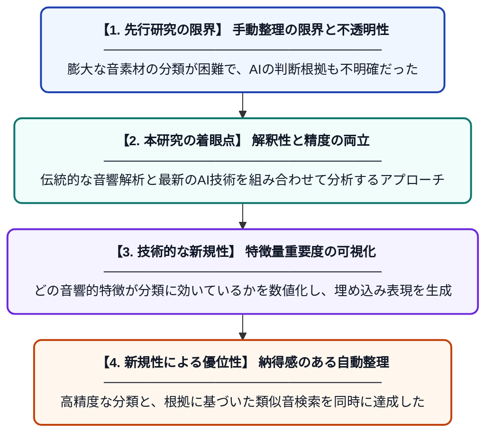

# ワンショット打楽器音の分類と類似性分析のための解釈可能な特徴量重要度とニューラル埋め込み

**Original Title**: *Interpretable Feature Importance and Neural Embeddings for Classification and Similarity Analysis of One-Shot Percussive Sounds*

> **💡 一言要約**: AIと音響分析で打楽器音を賢く自動整理

| 項目 | 内容 |
|---|---|
| **著者** | C Paşa, A Tarikci |
| **掲載誌** | Sakarya University Journal of Computer and … 2026 |
| **アラートキーワード** | one shot |
| **PDF** | [https://dergipark.org.tr/en/download/article-file/6002258](https://dergipark.org.tr/en/download/article-file/6002258) |
| **Git リポジトリ** | [https://github.com/canpasa1940/SAUCIS-Paper--one-shot-percussive-feature-importance](https://github.com/canpasa1940/SAUCIS-Paper--one-shot-percussive-feature-importance) |
| **原文リンク** | [https://dergipark.org.tr/en/download/article-file/6002258](https://dergipark.org.tr/en/download/article-file/6002258) |
| **PDF版要約** | [README.pdf](./README.pdf) |

---

## 📊 新規性の図解（先行研究との違いと本研究のブレークスルー）

## 📝 要約

増大する打楽器サンプルライブラリの自動整理を目的とし、手動設計された音響特徴量とニューラルネットワークによる埋め込み表現を組み合わせて分析した研究です。特に、どの音響特徴が分類に寄与しているかを解釈可能な形で示し、音の類似性検索の精度向上を図っています。

## ❓ どんな問題に取り組んだか

膨大な数のワンショット打楽器サンプルを手作業で分類・整理することは、音楽制作において非効率で困難な作業となっています。また、既存の自動分類手法では「なぜその音と判断されたのか」という根拠が不透明であり、ユーザーが納得感を持って検索や整理を行えないという課題がありました。

## ✨ 何が新しい？何がすごい？（新規性）

従来の手法ではブラックボックスになりがちだったディープラーニングによる分類に、手動設計されたスペクトル・時間的特徴量の重要度分析を統合した点が画期的です。これにより、単に音を分類するだけでなく、どの音響成分が識別に重要かを可視化し、解釈性を高めています。さらに、ニューラル埋め込みを用いることで、高精度な類似音検索も同時に実現しています。

## 🎓 大学1年生向けの解説

ドラムやパーカッションの短い録音素材（サンプル）が何万個もあるとき、それを一つずつ聞かずに「スネアドラム」や「シンバル」と自動で分ける技術の話です。この研究は、AIが音の「高さ」や「音色の明るさ」など、どの要素を重視して分類したかを人間にわかるように説明してくれます。これによって、自分の探している音に近いものを、理由を納得した上で効率よく見つけられるようになります。
