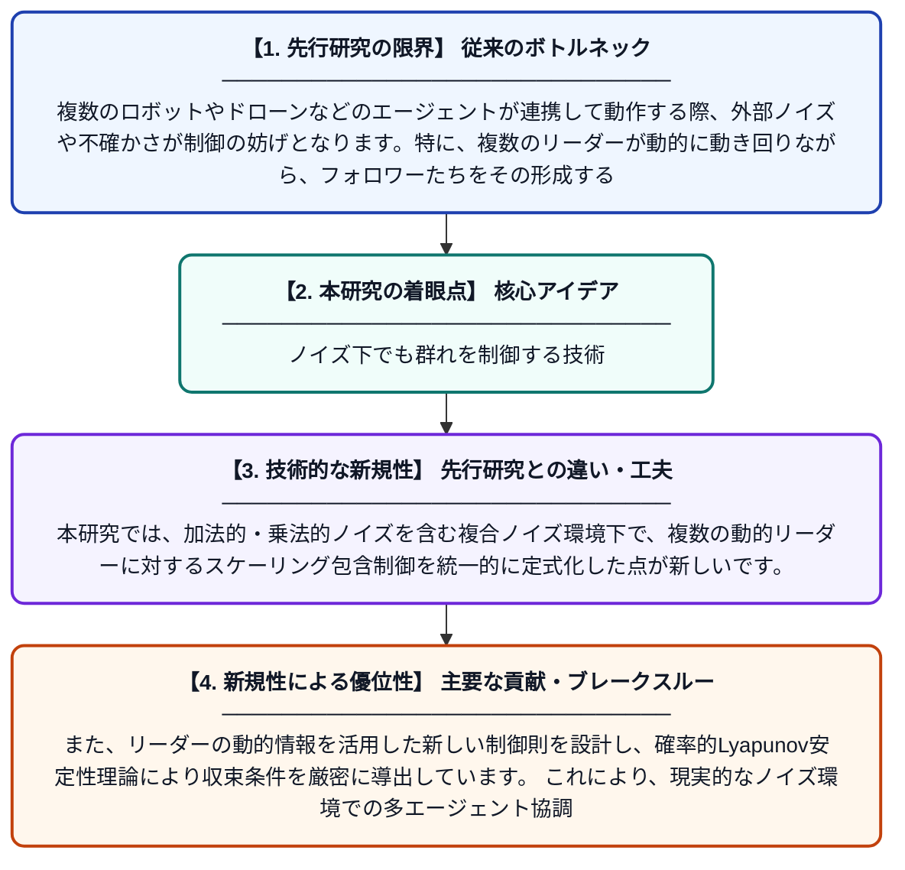

# 複合ノイズと複数の動的リーダーを持つマルチエージェントシステムのスケーリング包含制御

**Original Title**: *Scaled containment for multi-agent systems with compound noises and multiple dynamic leaders*

> **💡 一言要約**: ノイズ下でも群れを制御する技術

| 項目 | 内容 |
|---|---|
| **著者** | C Wang, SS Ge, Y Du |
| **掲載誌** | Neurocomputing 2026 |
| **アラートキーワード** | multi agent |
| **原文リンク** | [https://www.sciencedirect.com/science/article/pii/S0925231226020503](https://www.sciencedirect.com/science/article/pii/S0925231226020503) |
| **PDF版要約** | [README.pdf](./README.pdf) |

---

## 📊 新規性の図解（先行研究との違いと本研究のブレークスルー）

## 📝 要約

本論文は、複合ノイズと複数の動的リーダーが存在する確率的マルチエージェントシステム（SMAS）におけるスケーリング包含制御問題（SCCP）を研究しています。リーダーの動的挙動だけでなく、複合ノイズの影響も考慮した制御手法を提案しており、フォロワーエージェントがリーダーたちの形成する領域内に一定の比率で収束することを目指しています。確率的安定性の理論を用いて、提案手法の有効性が理論的および数値的に検証されています。

## ❓ どんな問題に取り組んだか

複数のロボットやドローンなどのエージェントが連携して動作する際、外部ノイズや不確かさが制御の妨げとなります。特に、複数のリーダーが動的に動き回りながら、フォロワーたちをその形成する空間内に収束させる「包含制御」は難しい問題です。さらに、スケーリング（比率調整）を加えることで、より柔軟な隊形制御が求められますが、これを確率的ノイズ環境下で実現することは未解決の課題でした。

## ✨ 何が新しい？何がすごい？（新規性）

先行研究では、単純なノイズや静的なリーダーを対象とした包含制御が多く、スケーリングと複合ノイズを同時に扱った研究はほとんどありませんでした。本研究では、加法的・乗法的ノイズを含む複合ノイズ環境下で、複数の動的リーダーに対するスケーリング包含制御を統一的に定式化した点が新しいです。また、リーダーの動的情報を活用した新しい制御則を設計し、確率的Lyapunov安定性理論により収束条件を厳密に導出しています。これにより、現実的なノイズ環境での多エージェント協調制御の設計指針を提供する重要な貢献をしています。

## 🎓 大学1年生向けの解説

複数のロボットが協力して動く「マルチエージェントシステム」を想像してください。リーダーロボット数台が動き回り、残りのフォロワーロボットたちがリーダーたちに囲まれた領域の中に収まるよう動く制御を「包含制御」といいます。現実世界では風や通信ノイズなどの「乱れ（ノイズ）」が常に存在するため、ロボットが思い通りに動かないことがあります。この研究では、そうしたノイズがあっても、フォロワーロボットたちがきちんとリーダーたちの内側に収束できるような数学的な制御方法を考案しました。ドローンの群れ制御や自動運転車の隊列走行など、実用的な応用が期待される研究です。
