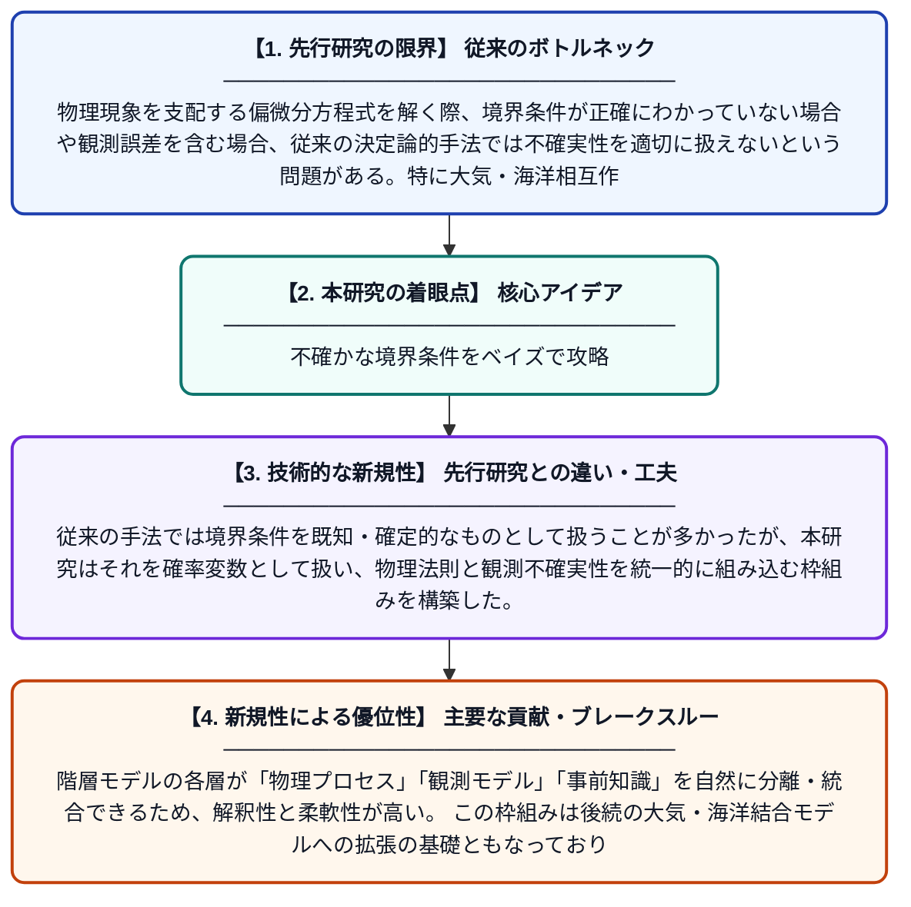

# 確率的境界条件を持つ境界値問題に対する階層ベイズアプローチ

**Original Title**: *Hierarchical Bayesian Approach to Boundary Value Problems with Stochastic Boundary Conditions*

> **💡 一言要約**: 不確かな境界条件をベイズで攻略

| 項目 | 内容 |
|---|---|
| **著者** | LM Berliner, RF Milliff |
| **アラートキーワード** | Bayesian hierarchical ... |
| **原文リンク** | [https://mospace.umsystem.edu/server/api/core/bitstreams/1b0abe7a-9819-4cdd-afe4-f47f99ffd0fd/content](https://mospace.umsystem.edu/server/api/core/bitstreams/1b0abe7a-9819-4cdd-afe4-f47f99ffd0fd/content) |
| **PDF版要約** | [README.pdf](./README.pdf) |

---

## 📊 新規性の図解（先行研究との違いと本研究のブレークスルー）

## 📝 要約

本論文は、物理的な境界値問題において境界条件が不確実・確率的である場合を扱うための階層ベイズモデルの枠組みを提案している。このアプローチは、物理法則をモデルに組み込みつつ、観測データの不確実性を体系的に扱うことを可能にする。さらに、この手法を大気・海洋結合モデルへ拡張する基盤を提供している。

## ❓ どんな問題に取り組んだか

物理現象を支配する偏微分方程式を解く際、境界条件が正確にわかっていない場合や観測誤差を含む場合、従来の決定論的手法では不確実性を適切に扱えないという問題がある。特に大気・海洋相互作用のような複雑な系では、境界における物理量の不確実性が解全体に大きく影響するため、統計的に厳密な取り扱いが求められていた。

## ✨ 何が新しい？何がすごい？（新規性）

本研究は、境界値問題における確率的境界条件を階層ベイズモデルとして定式化するという新しいアプローチを提示した。従来の手法では境界条件を既知・確定的なものとして扱うことが多かったが、本研究はそれを確率変数として扱い、物理法則と観測不確実性を統一的に組み込む枠組みを構築した。階層モデルの各層が「物理プロセス」「観測モデル」「事前知識」を自然に分離・統合できるため、解釈性と柔軟性が高い。この枠組みは後続の大気・海洋結合モデルへの拡張の基礎ともなっており、地球科学への応用可能性が広い。

## 🎓 大学1年生向けの解説

物理の問題を解くとき、「端っこ（境界）の条件」が必要ですが、現実では測定誤差などでその値が正確にわからないことがあります。この論文は、そんな「不確かな境界条件」を確率論を使ってうまく扱う方法を提案しています。ベイズ統計という考え方を使うことで、物理の法則と観測データの両方を組み合わせて、より現実的な予測ができます。たとえば海と空気のやりとりをコンピューターで再現する場合などに役立てられます。難しい数学を使っていますが、要は「わからないことを確率で表して、合理的に推測しよう」という発想です。
