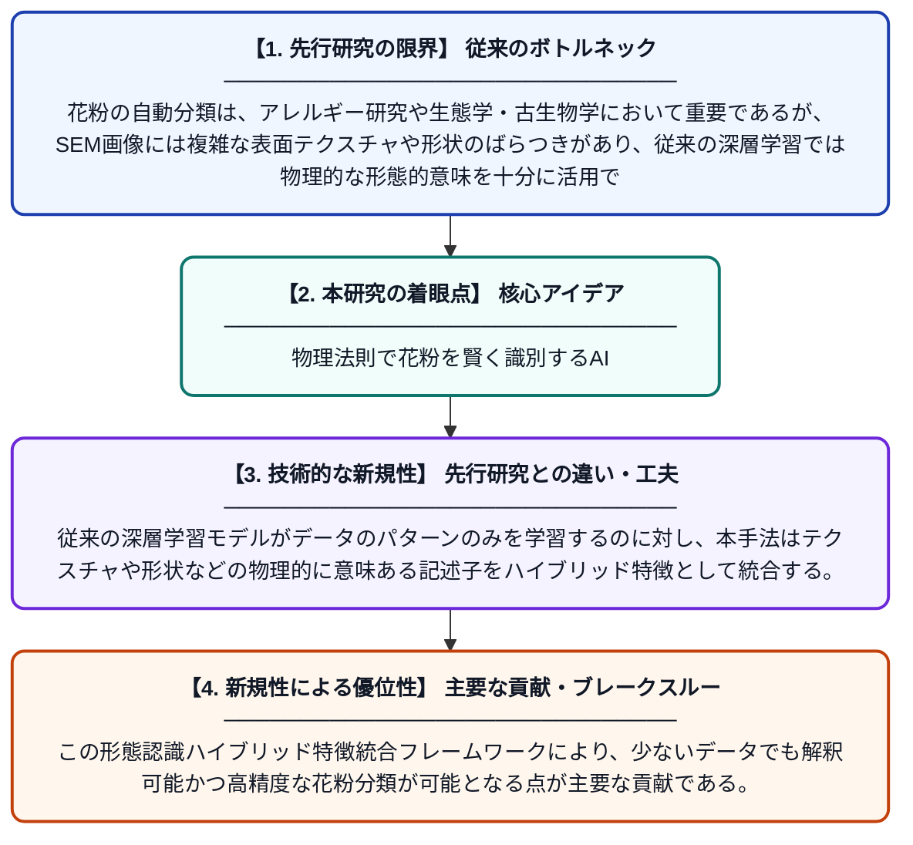

# 形態認識ハイブリッド特徴統合による走査型電子顕微鏡を用いた花粉分類のための物理誘導型深層表現学習

**Original Title**: *Physics-guided deep representation learning for SEM-based pollen classification via morphology-aware hybrid feature integration*

> **💡 一言要約**: 物理法則で花粉を賢く識別するAI

| 項目 | 内容 |
|---|---|
| **著者** | F Ekinci, A Tosunoğlu, Ö Demir, E Kumru, M Sevindik |
| **掲載誌** | Scientific Reports 2026 |
| **アラートキーワード** | representation learning |
| **PDF** | [https://www.nature.com/articles/s41598-026-64659-6_reference.pdf](https://www.nature.com/articles/s41598-026-64659-6_reference.pdf) |
| **原文リンク** | [https://www.nature.com/articles/s41598-026-64659-6_reference.pdf](https://www.nature.com/articles/s41598-026-64659-6_reference.pdf) |
| **PDF版要約** | [README.pdf](./README.pdf) |

---

## 📊 新規性の図解（先行研究との違いと本研究のブレークスルー）

## 📝 要約

本研究では、走査型電子顕微鏡（SEM）画像を用いた花粉の自動分類において、物理的に意味のある記述子を深層学習に組み込む新しいアプローチを提案している。テクスチャや形態学的特徴などの物理的制約を表現学習に反映させることで、従来の深層学習手法を超える精度を実現した。物理知識と深層ニューラルネットワークを融合したハイブリッド特徴統合により、花粉の形態的特徴をより正確に捉えることが可能になった。

## ❓ どんな問題に取り組んだか

花粉の自動分類は、アレルギー研究や生態学・古生物学において重要であるが、SEM画像には複雑な表面テクスチャや形状のばらつきがあり、従来の深層学習では物理的な形態的意味を十分に活用できていなかった。純粋なデータ駆動型のアプローチは大量のラベル付きデータを必要とし、専門知識に基づく物理的特徴を無視しがちであるという課題があった。

## ✨ 何が新しい？何がすごい？（新規性）

本研究の最大の新規性は、深層表現学習に「物理誘導型（physics-guided）」の制約を導入した点であり、花粉の形態に関する物理的・生物学的知識をニューラルネットワークの特徴抽出プロセスに直接組み込んでいる。従来の深層学習モデルがデータのパターンのみを学習するのに対し、本手法はテクスチャや形状などの物理的に意味ある記述子をハイブリッド特徴として統合する。この形態認識ハイブリッド特徴統合フレームワークにより、少ないデータでも解釈可能かつ高精度な花粉分類が可能となる点が主要な貢献である。

## 🎓 大学1年生向けの解説

花粉は植物の種類によって形が異なり、顕微鏡写真を見て種類を判別する作業は専門家でも大変です。この研究では、AIに「花粉の形や表面のでこぼこには物理的・生物学的な意味がある」という知識を教えながら学習させることで、より賢く花粉を自動分類できるシステムを作りました。普通のAIがただ画像のパターンを覚えるだけなのに対し、このAIは「なぜその形をしているか」という物理的な理由も考慮します。これにより、少ない学習データでも高い精度で花粉の種類を見分けられるようになります。
