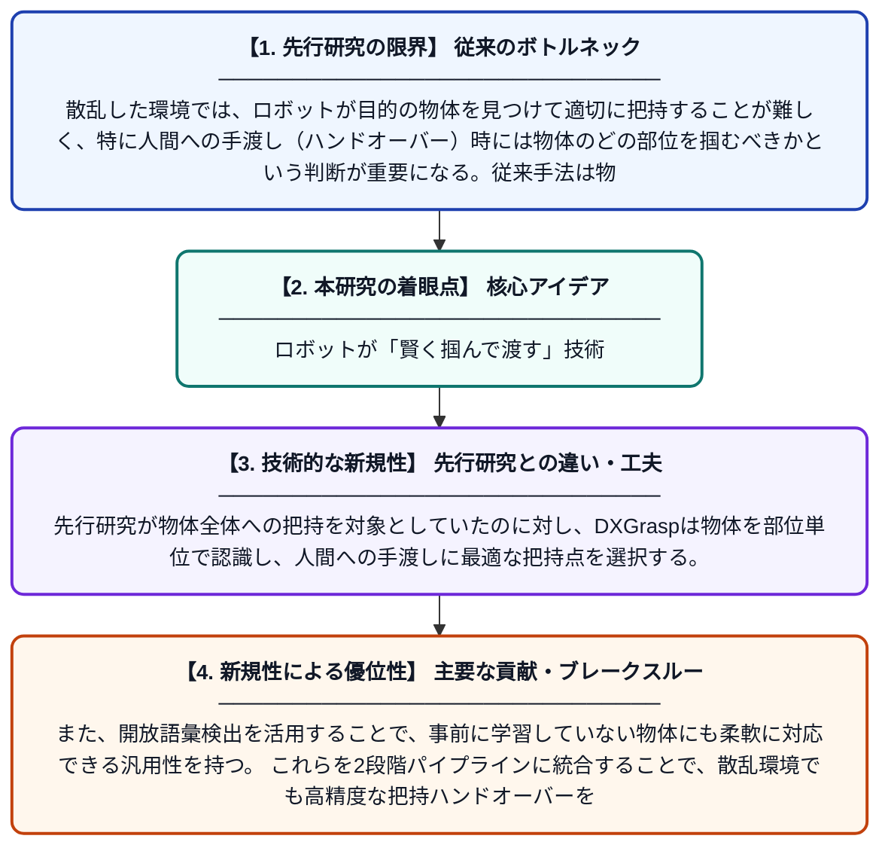

# DXGrasp: 散乱環境における物体の手渡しのためのアフォーダンス推論に基づくパーツレベルのロボット把持

**Original Title**: *DXGrasp: Affordance-Reasoning Based Part-Level Robotic Grasping for Object Handover in Clutter*

> **💡 一言要約**: ロボットが「賢く掴んで渡す」技術

| 項目 | 内容 |
|---|---|
| **著者** | Y Zhang, J Quan, H Yan, CH Zhang, C Hua, G Tian |
| **掲載誌** | IEEE Transactions on Industrial Electronics 2026 |
| **アラートキーワード** | Open-Vocabulary Object ... |
| **原文リンク** | [https://ieeexplore.ieee.org/abstract/document/11627696/](https://ieeexplore.ieee.org/abstract/document/11627696/) |
| **PDF版要約** | [README.pdf](./README.pdf) |

---

## 📊 新規性の図解（先行研究との違いと本研究のブレークスルー）

## 📝 要約

本論文では、散乱した環境下でロボットが物体を人間に安全に手渡すための新しい把持システム「DXGrasp」を提案している。まず開放語彙による物体検出でターゲットを特定し、次にアフォーダンス（物体の使いやすい部位）を考慮したパーツレベルの検出で適切な把持位置を決定する2段階アプローチを採用している。これにより、ロボットは物体の「持ちやすい部分」と「渡すべき部分」を区別して把持・ハンドオーバーを実現する。

## ❓ どんな問題に取り組んだか

散乱した環境では、ロボットが目的の物体を見つけて適切に把持することが難しく、特に人間への手渡し（ハンドオーバー）時には物体のどの部位を掴むべきかという判断が重要になる。従来手法は物体全体の把持に焦点を当てており、人間工学的に適切な部位を考慮したパーツレベルの把持が十分に実現されていなかった。

## ✨ 何が新しい？何がすごい？（新規性）

本研究は、アフォーダンス推論（物体のどの部位がどのような用途に適しているかの理解）をロボット把持に組み込んだ点が新しい。先行研究が物体全体への把持を対象としていたのに対し、DXGraspは物体を部位単位で認識し、人間への手渡しに最適な把持点を選択する。また、開放語彙検出を活用することで、事前に学習していない物体にも柔軟に対応できる汎用性を持つ。これらを2段階パイプラインに統合することで、散乱環境でも高精度な把持ハンドオーバーを実現している。

## 🎓 大学1年生向けの解説

ロボットが机の上に散らばった物を人間に渡す場面を想像してください。例えばハサミを渡す時、刃の部分でなく持ち手の部分を掴んで渡すのが安全ですよね。この論文では、ロボットがまず「目的の物がどこにあるか」を見つけ、次に「その物のどの部分を持てばよいか」をAIで判断する仕組みを作りました。「アフォーダンス」という概念を使い、物体の各部位の役割（掴む部分・使う部分）を理解させることで、より人間らしく安全な受け渡しができるようになります。
