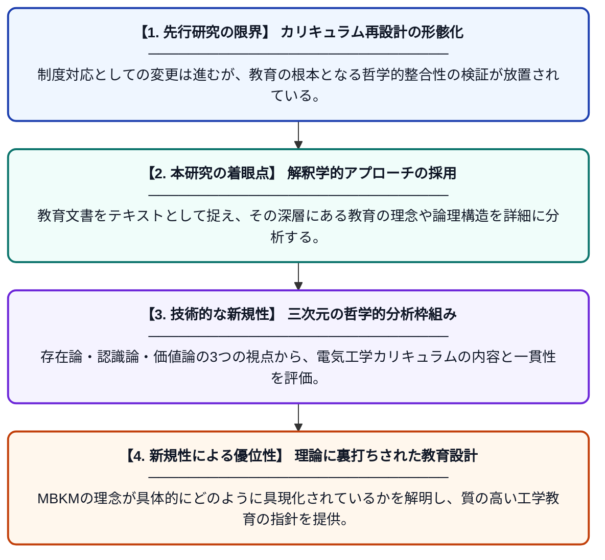

# マナド州立大学電気工学教育課程におけるMBKMカリキュラムの解釈学的分析：存在論・認識論・価値論の観点から

**Original Title**: *… Negeri Manado: Ontologi, Epistemologi, dan Aksiologi (Hermeneutic Analysis of MBKM Curriculum in Electrical Engineering Education at UNIMA: Ontology …*

> **💡 一言要約**: 自由な学びのカリキュラムを哲学的に解剖する

| 項目 | 内容 |
|---|---|
| **著者** | A Paturusi, R Ridwan |
| **掲載誌** | JURNAL EDUNITRO Jurnal Pendidikan Teknik Elektro 2026 |
| **アラートキーワード** | Ontology |
| **原文リンク** | [https://jurnal-edunitro.jedunitro.com/edunitro/article/view/26](https://jurnal-edunitro.jedunitro.com/edunitro/article/view/26) |
| **PDF版要約** | [README.pdf](./README.pdf) |

---

## 📊 新規性の図解（先行研究との違いと本研究のブレークスルー）

## 📝 要約

インドネシアの高等教育政策「MBKM（自由な学び・独立したキャンパス）」に基づく電気工学教育のカリキュラムを、哲学的な観点から分析した研究です。解釈学的手法を用いて、教育課程の文書が「存在論・認識論・価値論」の3つの側面でどのように一貫性を保っているかを検証しています。

## ❓ どんな問題に取り組んだか

MBKM政策により、大学はカリキュラムの大幅な再設計を迫られていますが、新しく作られたカリキュラム文書が哲学的な一貫性を持っているかを検証した研究はほとんどありません。教育の根底にある理論的基盤が不明確なままでは、効果的な人材育成が損なわれるリスクがあります。

## ✨ 何が新しい？何がすごい？（新規性）

実学である電気工学教育に対し、解釈学（Hermeneutics）という人文学的手法を用いて、カリキュラムの背後にある「存在・知識・価値」の構造を浮き彫りにした点が画期的です。存在論（Ontology）、認識論（Epistemology）、価値論（Axiology）という3つの哲学的枠組みを統合して分析することで、単なる制度遵守に留まらない教育の本質的な質を評価しました。これにより、工学教育におけるMBKMの実装が理論的にどの程度妥当であるかを体系的に明らかにしています。

## 🎓 大学1年生向けの解説

インドネシアには、学生が自由に学びたいことを選べる「MBKM」という新しい教育の仕組みがあります。この研究では、電気工学の先生たちが作った「新しい授業の計画書」が、教育として本当に筋が通っているかどうかを哲学の力を使って調べました。「この勉強にどんな意味があるのか？」「どうやって知識を身につけるのか？」という深い部分をチェックすることで、みんなが安心して学べる良いカリキュラムになっているかを確かめています。
