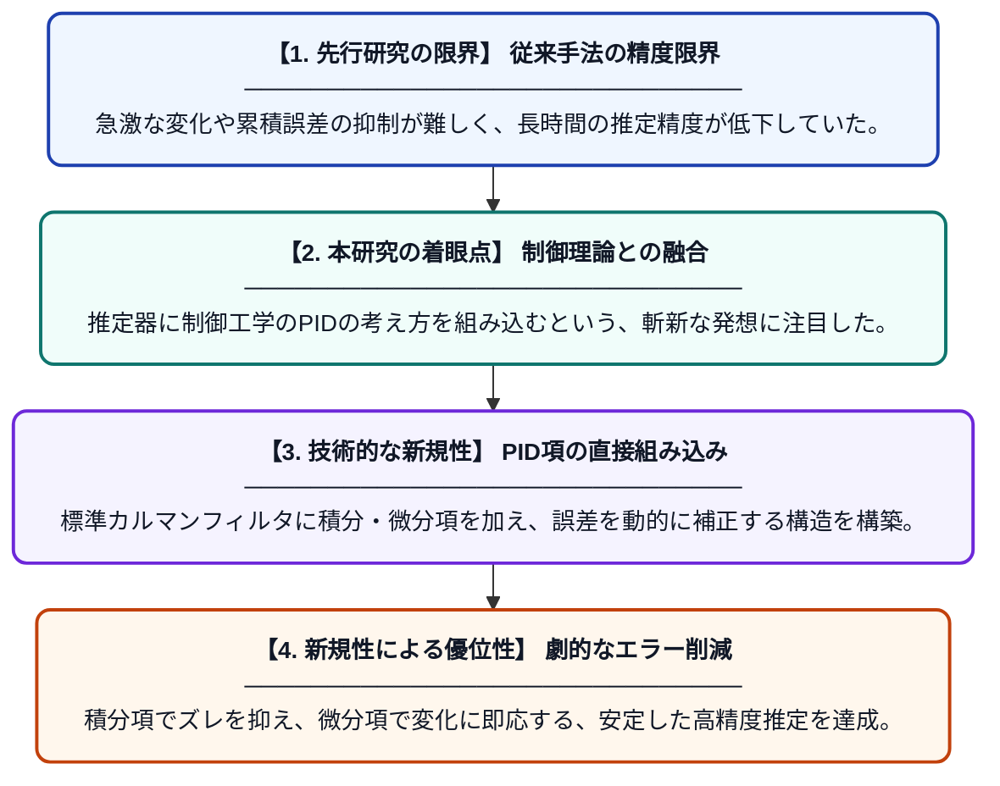

# 拡張カルマンフィルタを用いた慣性航法システムおよびINS/GPS統合における最適パラメータ推定

**Original Title**: *Optimal Parameter Estimation in Inertial Navigation Systems and INS/GPS Integration Using an Enhanced Kalman Filter*

> **💡 一言要約**: PID制御を融合し推定誤差を打破した新世代フィルタ

| 項目 | 内容 |
|---|---|
| **著者** | J Jamali, MHF Dindarloo, MA Rahgoshai, O Mahdiyar… |
| **アラートキーワード** | kalman filter |
| **PDF** | [https://amfad.sndu.ac.ir/article_4102_9ca8c9b0996bbf05ae7753d34667a6fd.pdf](https://amfad.sndu.ac.ir/article_4102_9ca8c9b0996bbf05ae7753d34667a6fd.pdf) |
| **原文リンク** | [https://amfad.sndu.ac.ir/article_4102_9ca8c9b0996bbf05ae7753d34667a6fd.pdf](https://amfad.sndu.ac.ir/article_4102_9ca8c9b0996bbf05ae7753d34667a6fd.pdf) |
| **PDF版要約** | [README.pdf](./README.pdf) |

---

## 📊 新規性の図解（先行研究との違いと本研究のブレークスルー）

## 📝 要約

慣性航法システム（INS）とGPSの統合精度を向上させるため、標準的なカルマンフィルタにPID制御の概念を組み込んだ新しい手法を提案しています。積分項と微分項をフィルタ構造に導入することで、従来の手法よりも推定誤差を大幅に削減することに成功しました。

## ❓ どんな問題に取り組んだか

従来のカルマンフィルタを用いたINS/GPS統合システムでは、センサーのノイズや動的な環境変化によって誤差が蓄積しやすいという課題がありました。特に、長時間の運用におけるドリフト誤差や急激な姿勢変化への追従性の不足が、精度の限界となっていました。

## ✨ 何が新しい？何がすごい？（新規性）

本研究の最大の特徴は、制御工学で定評のあるPID（比例・積分・微分）コントローラのアルゴリズムをカルマンフィルタの枠組みに統合した点にあります。積分項（I）により定常的な偏差を打ち消し、微分項（D）により急激な変動への応答性を高めることで、先行研究にはない強力な誤差補正能力を実現しました。このシンプルな枠組みにより、計算負荷を抑えつつ推定精度を飛躍的に高めています。

## 🎓 大学1年生向けの解説

ドローンや自動運転車が自分の場所を知るには、GPSと加速センサーなどを組み合わせて計算します。しかし、計算にはどうしても少しずつ誤差が混ざり、時間が経つと場所がズレてしまいます。この研究では、エアコンの温度調節などに使われる「PID制御」という賢い仕組みを、位置計算の数式に合体させました。その結果、急に動いても、時間が経ってもズレにくい、非常に正確な位置追計ができるようになりました。
