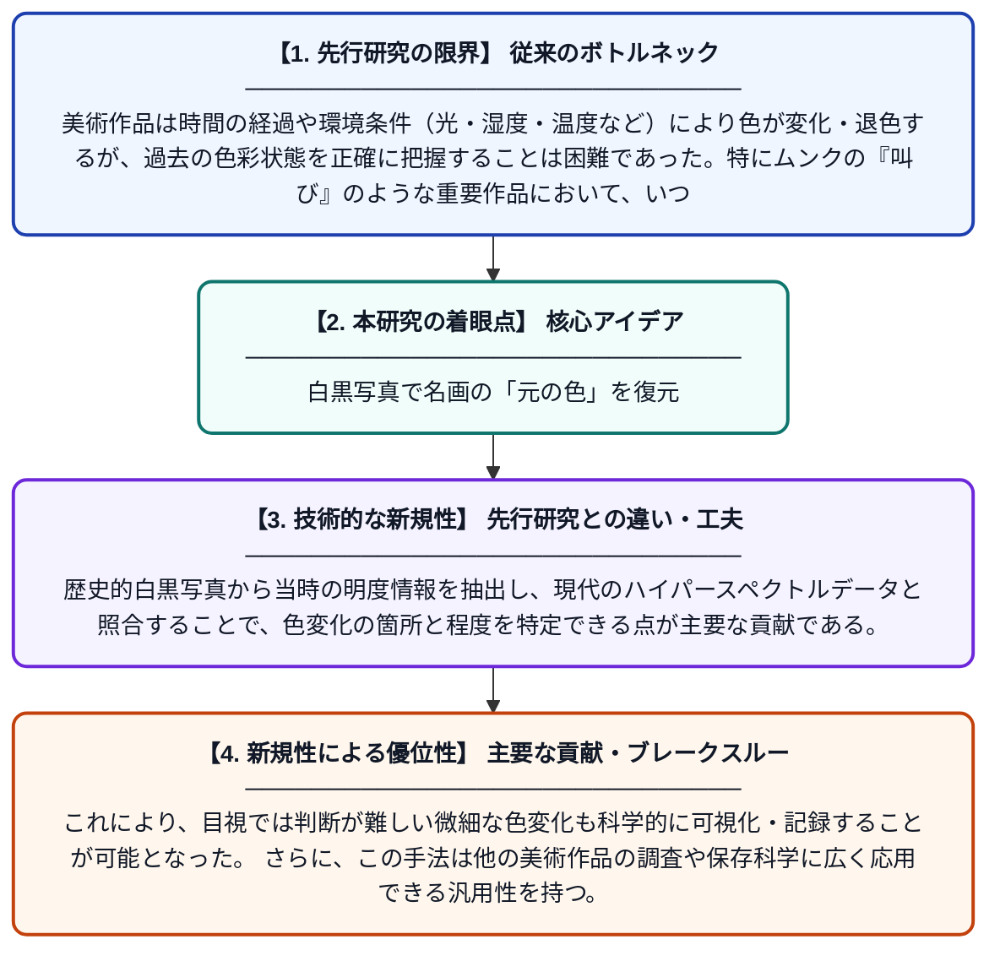

# 白黒写真は絵画の元の色について何を教えてくれるか？：エドヴァルド・ムンクの『叫び』（1910年頃）を事例として

**Original Title**: *… photograph tell us about the original colours of a painting?: A case study on Edvard Munch's The Scream (1910?): authors: P. Siozos, ICA Sandu, PI Stavroulakis,...[et al.]*

> **💡 一言要約**: 白黒写真で名画の「元の色」を復元

| 項目 | 内容 |
|---|---|
| **著者** | ICA Sandu, S Campana, P Siozos, PI Stavroulakis |
| **アラートキーワード** | ICA |
| **原文リンク** | [https://munch.tind.io/record/46807](https://munch.tind.io/record/46807) |
| **PDF版要約** | [README.pdf](./README.pdf) |

---

## 📊 新規性の図解（先行研究との違いと本研究のブレークスルー）

## 📝 要約

本研究は、歴史的な白黒写真と最新のマルチ／ハイパースペクトルイメージングを組み合わせた計算手法を提案し、環境条件などの影響によって生じた美術作品の色変化を検出する。ムンクの代表作『叫び』（1910年頃）を事例として、現在の色彩と過去の色彩の比較を行う。この手法により、絵画の経年変化を定量的に評価し、保存・修復に向けた科学的根拠を提供する。

## ❓ どんな問題に取り組んだか

美術作品は時間の経過や環境条件（光・湿度・温度など）により色が変化・退色するが、過去の色彩状態を正確に把握することは困難であった。特にムンクの『叫び』のような重要作品において、いつ・どの部分がどの程度変色したかを科学的に証明する手段が限られていた。

## ✨ 何が新しい？何がすごい？（新規性）

先行研究では白黒写真とスペクトル分析を個別に用いることはあったが、両者を統合した計算手法によって過去と現在の色彩を定量的に比較するアプローチは新しい。歴史的白黒写真から当時の明度情報を抽出し、現代のハイパースペクトルデータと照合することで、色変化の箇所と程度を特定できる点が主要な貢献である。これにより、目視では判断が難しい微細な色変化も科学的に可視化・記録することが可能となった。さらに、この手法は他の美術作品の調査や保存科学に広く応用できる汎用性を持つ。

## 🎓 大学1年生向けの解説

美術館に飾られている有名な絵画は、時間が経つにつれて色が変わってしまうことがあります。でも「昔どんな色だったか」を知るのはとても難しいことです。この研究では、昔に撮られた白黒写真と、最新の特殊なカメラ（光の波長ごとに色を細かく記録できるカメラ）を組み合わせることで、ムンクの『叫び』がどこでどれだけ色変化したかを調べました。白黒写真から明るさの情報を読み取り、現在の詳細な色データと比べることで、目には見えにくい変色を科学的に発見できるのです。この方法を使えば、大切な絵画をより適切に保存・修復することに役立てられます。
